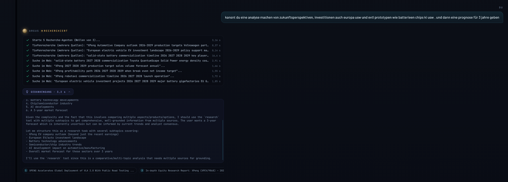
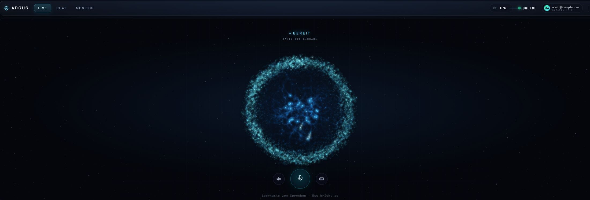
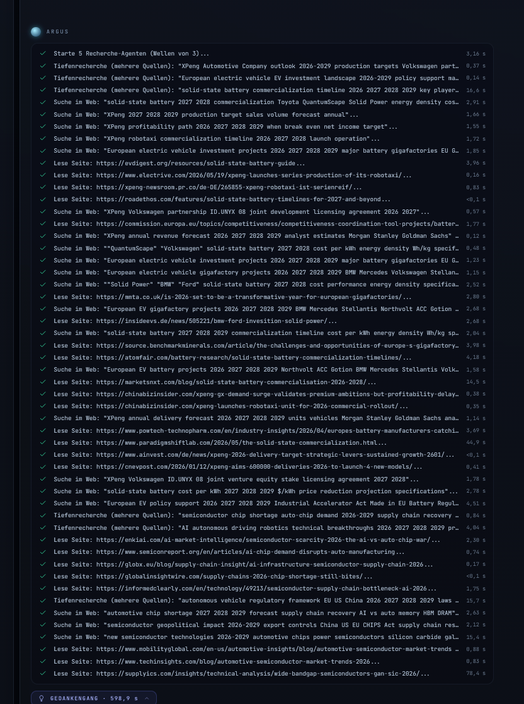
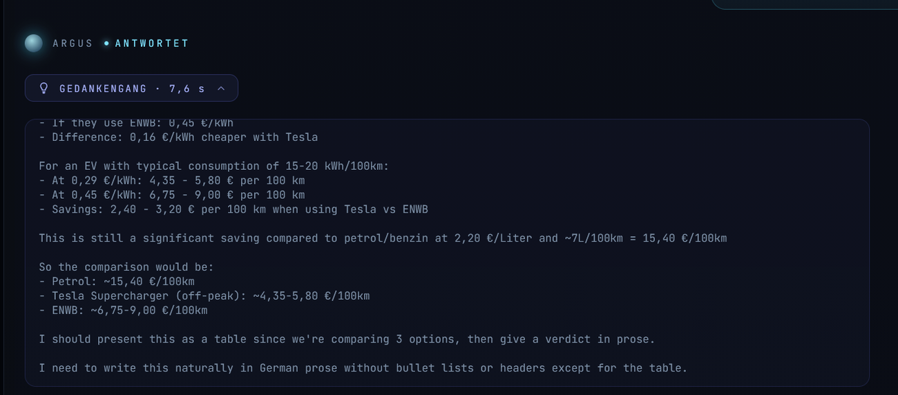
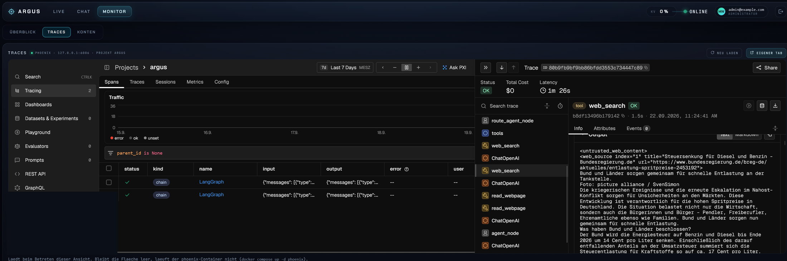

# Argus

*Deutsch · [English](README.md)*

Ein persönlicher KI-Assistent, der vollständig auf dem eigenen Rechner läuft. Das
Sprachmodell liegt auf der eigenen GPU, die Dokumente in der eigenen Datenbank, die
Websuche geht über eine eigene Suchmaschine. Kein Anbieter sieht mit, kein Abo, keine
Weitergabe von Inhalten — es sei denn, man schaltet die Cloud-Stufe bewusst zu, und
dann wird vorher pseudonymisiert.

Argus ist kein Chat-Fenster mit angeflanschter Suche. Er liest Dokumente, recherchiert
im Netz, rechnet in einer Sandbox, spricht und hört zu, und er **steuert den Windows-Rechner**,
auf dem er läuft — über einen eigenen Benutzer, per SSH, mit Bestätigung vor jedem
schreibenden Eingriff.

> **Eine Desktop-App ist unterwegs.** Argus zieht aus dem Browser aus: Chat, Tiefenrecherche,
> Langzeitgedächtnis, die eigenen Dokumente und ein neuer Programmier-Agent in einer
> Windows-App, mit einem größeren lokalen Modell. Sie ist in Arbeit, einen Termin gibt es
> noch nicht. [Was kommt](#wie-es-weitergeht)

**Inhalt:** [Was er kann](#was-er-kann) · [Wofür das gedacht ist](#wofür-das-gedacht-ist) · [Aufbau](#aufbau) · [Messwerte](#messwerte) · [Voraussetzungen](#voraussetzungen) · [Einrichten](#einrichten) · [Konfiguration](#konfiguration) · [Bedienung](#bedienung) · [Betrieb](#betrieb) · [Sicherheit](#sicherheit) · [Grenzen](#grenzen) · [Wie es weitergeht](#wie-es-weitergeht)


*Die Monitor-Ansicht (nur für Administratoren): 71,3 Token pro Sekunde auf einer RTX 5070 Ti,
Sprachausgabe auf der CPU mit Echtzeitfaktor 1,09 und wie oft der Kontext verdichtet werden
musste. Darunter Agenten-Last, Werkzeugaufrufe, Auditprotokoll, Eval-Läufe und Cloud-Missionen.*



*Eine Recherche im Chat: fünf Recherche-Agenten in Wellen, jede Suche und jede gelesene Seite
mit Zeit, dazu der aufklappbare Gedankengang und die nummerierten Quellen.*



*Die Live-Ansicht: Leertaste zum Sprechen, Esc bricht ab. Der Orb zeigt den Zustand —
bereit, hört zu, denkt nach, recherchiert, spricht.*

<details>
<summary>Vollständiger Verlauf derselben Recherche (über 50 Schritte) und der aufgeklappte Gedankengang</summary>




</details>

---

## Was er kann

**Unterhalten und zuhören.** Textchat und Sprachmodus (Leertaste zum Sprechen). Die
Sprachausgabe kann eine geklonte Referenzstimme nutzen, die Erkennung läuft lokal über
faster-whisper. Nichts davon verlässt den Rechner.

**Eigene Unterlagen lesen und einordnen.** Verträge, Rechnungen, Policen, Lohnabrechnungen
— PDF, DOCX, EPUB, HTML, Text. Zwei getrennte Wege: einmalig **lesen** (landet nur in der
laufenden Unterhaltung) oder dauerhaft **indexieren** (Qdrant, später durchsuchbar). Dateien
werden per Ziehen in den Chat übergeben.

**Recherchieren.** Websuche über eine selbst betriebene SearXNG-Instanz, wobei die
Treffer als vollständige Seiten gelesen werden statt nur als Snippets. Für breitere
Fragen liest die Tiefenrecherche mehrere Quellen parallel.

**Den Rechner bedienen.** Dienste neustarten, Speicherplatz prüfen, Ereignisprotokolle
lesen, Windows-Updates einspielen, PowerShell ausführen. Lesende Befehle laufen sofort,
schreibende erst nach Bestätigung, löschende jedes Mal einzeln und mit zweiter Rückfrage.
Das Ganze ist abschaltbar, wenn man nur den Assistenten will.

**Rechnen und Code ausführen.** Symbolische Mathematik und Python in einer abgeschotteten
Sandbox ohne Netzzugang.

**Entfernungen ausrechnen.** Fahrstrecke und Fahrzeit zwischen zwei Adressen über
OpenStreetMap — Hin- und Rückweg, damit eine Pendelrechnung in einem Schritt steht. Ohne
Schlüssel; wer viel routet, trägt in `Setup2.py` seinen eigenen Nominatim/OSRM ein.

**Bilder ansehen.** Optional — das Modell ist multimodal, der Bildpfad kostet aber VRAM und
ist deshalb per Schalter (siehe [Vision einschalten](docs/configuration.de.md#vision-einschalten)).

**Cloud-Missionen.** Für Aufgaben, die das lokale Modell überfordern, gibt es eine
optionale Stufe über Gemini: ein Planer zerlegt das Ziel, Arbeiter recherchieren, ein
Prüfer kontrolliert. Läuft im Hintergrund, das Ergebnis wird zugestellt. Alles, was
hinausgeht, durchläuft vorher eine PII-Erkennung, die im Zweifel blockt.

**Erinnern.** Ein gepflegtes Langzeitgedächtnis pro Nutzer plus Tagesnotizen, aus denen
sich der Assistent selbst bedient.

**Telegram.** Optionaler Zugang von unterwegs, inklusive Sprachnachrichten, Fotos und der
Bestätigungskarten für schreibende Aktionen.

---

## Wofür das gedacht ist

Für alle, die einen fähigen Assistenten wollen, ohne dafür ihre Unterlagen aus der Hand
zu geben. Das ist kein Werkzeug für eine Branche — überall, wo Dokumente vertraulich sind
oder ein Rechner bedient werden muss, gibt es etwas zu tun:

| Wer | Was Argus dort tut |
|---|---|
| Privat | Policen vergleichen, Mietvertrag prüfen, Lohnabrechnung und Steuerbescheid nachrechnen, Arztbriefe verstehen |
| Handwerk (Elektro, SHK, Bau) | Datenblätter, Normen und Herstellerdoku durchsuchbar machen; Angebote und Lieferanten-AGB prüfen; Prüfprotokolle und Aufmaße zusammenfassen |
| Ingenieurbüro, Technik | Normen und technische Dokumentation als Wissensbasis; Berechnungen mit Einheiten in der Sandbox; Logdateien und Messreihen auswerten |
| Personalwesen | Arbeitsverträge, Zeugnisse, Betriebsvereinbarungen, Bewerbungsunterlagen — Daten, die das Haus nicht verlassen dürfen |
| Kanzlei, Praxis, Steuerberatung | Alles unter Verschwiegenheit: Akten lesen, Fristen und Klauseln herausziehen, Schreiben vorbereiten |
| Einkauf, Vertrieb, Verwaltung | Angebote vergleichen, Lieferverträge und AGB prüfen, Ausschreibungen zusammenfassen |
| IT und Rechnerbetrieb | Dienste, Updates, Ereignisprotokolle, PowerShell — ein Assistent, der die Maschine tatsächlich bedienen darf statt nur Befehle vorzuschlagen |
| Selbständige, Vereine | Buchhaltung nachrechnen, Verträge und Förderbescheide verstehen, Recherche für Anträge |
| Lernen, Forschung | Skripte und Fachliteratur durchsuchbar, Tiefenrecherche mit Quellen — und der ganze Aufbau als offenes Lehrstück: RAG, Agenten-Schleife, Werkzeugaufrufe, Absicherung |

Nicht gedacht ist es als Mehrbenutzer-Dienst für ein Unternehmen. Es läuft auf **einem**
Rechner, für dessen Besitzer.

---

## Aufbau

Zehn Container, alle nur auf `127.0.0.1` gebunden:

| Dienst | Aufgabe |
|---|---|
| `sglang` | Sprachmodell auf der GPU (Qwen3.5-9B, AWQ-quantisiert) |
| `rag-backend` | Kern: Agenten-Schleife, Werkzeuge, API, Oberfläche |
| `qdrant` | Vektorspeicher für die Dokumente |
| `postgres` | Verläufe (verschlüsselt), Konten, Metadaten |
| `searxng` | eigene Suchmaschine |
| `tts-service` | Sprachausgabe (Qwen3-TTS über GGML, CPU), wahlweise mit geklonter Stimme |
| `stt-service` | Spracherkennung (faster-whisper, CPU) |
| `calc-sandbox` | abgeschottete Ausführung von Python, ohne Netz |
| `phoenix` | Ablaufverfolgung: was hat der Agent wann getan |
| `open-webui` | alternative Oberfläche |

Die **Setup-Skripte sind die Quelle**, nicht der erzeugte Code. `rag_backend/`,
`docker-compose.yml`, `alembic/` und die `.env` entstehen aus `Setup1-4.py`,
`Setup_Dashboard.py` und `setup_common.py`. Eine Änderung direkt in einer erzeugten
Datei ist beim nächsten Generatorlauf kommentarlos weg. Das ist Absicht: zu sichern und
weiterzugeben sind fünf Python-Dateien und ein PowerShell-Skript, alles andere ist daraus
reproduzierbar.

---

## Messwerte

Zwei Abnahmeläufe, beide gegen `QuantTrio/Qwen3.5-9B-AWQ` auf einer RTX 5070 Ti (16 GB):

| Suite | Umfang | Ergebnis | Datum |
|---|---|---|---|
| HumanEval (Teilmenge) | 20 von 164 Aufgaben | 20/20 bestanden, 26 s gesamt | 31.07.2026 |
| Eigene Agenten-Suite | 50 Aufgaben | 50/50 bestanden, ⌀ 32 s je Aufgabe | 25.07.2026 |

**Einordnung, damit die Zahlen nicht mehr versprechen als sie halten:** Der HumanEval-Lauf
verwendet eine Teilmenge von 20 Aufgaben, nicht den vollständigen Benchmark. Die zweite
Suite ist **selbst gebaut**, im Stil von GAIA, aber nicht GAIA — sie enthält Kategorien,
die es dort nicht gibt (Systembedienung, Sandbox, EU-Recht, Sicherheitsprüfung), und ein
Teil der Antworten wird von einem Modell bewertet statt per exaktem Vergleich. Sie misst,
ob dieser Assistent die Aufgaben löst, für die er gebaut wurde. Sie taugt nicht zum
Vergleich mit veröffentlichten Bestenlisten.

Die Aufgabenverteilung: 20 auf Stufe 1, 20 auf Stufe 2, 10 auf Stufe 3; inhaltlich
Websuche, Mehrschritt-Schlussfolgerungen, Dokumentensuche, Rechnen mit Einheiten,
Systembedienung und Agentenplanung.

---

## Voraussetzungen

**Betriebssystem: Windows 11.** Das ist keine Vorliebe, sondern Bauart. Die Rechnersteuerung
spricht per SSH PowerShell mit dem Windows-Host, `setup_ssh.ps1` legt dort den Benutzer an,
und die Container hängen Windows-Pfade ein (`C:\Argus_Workspace`). Die Container selbst
liefen auch unter Linux — aber Generatoren, Pfade und die Host-Werkzeuge müssten angepasst
werden. Das ist nicht getestet.

**GPU.** Entwickelt und gemessen auf einer RTX 5070 Ti mit 16 GB (Blackwell). Das Modell
belegt rund 13 GB, der Rest ist KV-Cache, also Kontext. Das SGLang-Image ist die
CUDA-13-Variante (`Dockerfile.blackwell`); ältere Generationen (Ada, Ampere) brauchen ein
anderes Basis-Image und sind nicht getestet. Mehr VRAM lässt sich direkt in Kontext und
Bildverarbeitung umsetzen, siehe [Konfiguration](#konfiguration).

**Arbeitsspeicher.** Entwickelt auf 64 GB. Sprachausgabe, Spracherkennung, Embeddings und
Reranker laufen bewusst auf der CPU, damit die GPU dem Sprachmodell gehört. Die
Speicherlimits dieser Container summieren sich auf rund 26 GB (TTS 12, Backend 8, STT 3,
Phoenix 2, Sandbox 0,5), dazu kommt SGLang selbst. Unter 32 GB würde ich es nicht
versuchen.

**Platte.** Rund 60 GB für Images und Modellgewichte.

**Docker Desktop** mit WSL2-Backend und GPU-Zugriff (`nvidia-smi` muss in der
WSL-Distribution funktionieren).

**Python 3.12+ auf dem Host**, nur für die Generatoren. Drei Pakete:

```bash
pip install cryptography PyJWT python-dotenv
```

Alles andere lebt in den Containern.

**Konten und Token.** Ein HuggingFace-Token ist Pflicht (Modelldownloads). Gemini-Key und
Telegram-Bot sind optional — leer heißt aus.

---

## Einrichten

Als Administrator im Projektordner:

```powershell
.\setup_ssh.ps1
```

Legt den lokalen Benutzer `argus` an, installiert OpenSSH, erzeugt das Ed25519-Schlüsselpaar,
setzt die Firewallregel (Port 22 nur aus den Docker-Netzen) und das Arbeitsverzeichnis.

Danach die Token eintragen (Details unter [Schlüssel und Geheimnisse](docs/configuration.de.md#schlüssel-und-geheimnisse--api_tokens)):

- `API_Tokens/HF_TOKEN.txt` — Pflicht
- `API_Tokens/Gemini.txt`, `API_Tokens/telegram.txt` — optional, leer heißt aus

Generatoren in dieser Reihenfolge (`Setup1.py` zieht `Setup_Dashboard.py` automatisch mit):

```bash
python Setup1.py && python Setup2.py && python Setup3.py && python Setup4.py
```

Bauen und starten — der erste Lauf lädt die Modellgewichte, das dauert:

```bash
docker compose up -d --build
```

Dann die ersten Konten anlegen. Der **erste** Account wird jeweils Administrator:

- http://127.0.0.1:7860/dashboard/ — Argus Chat
- http://localhost:3000 — Open WebUI (eigene Kontenverwaltung)

Beim ersten Lauf von `Setup2.py` legt Argus unter `C:\Argus_Workspace\identity\SOUL.md`
seine Persönlichkeit ab — Tonfall, Regeln, und wie er dich anspricht. Deinen Namen trägst du
vorher ein: entweder `"owner_name": "Dein Name"` in `LLM_CONFIG` (`Setup2.py`) oder, wenn du
deine Setup-Dateien weitergibst, als Zeile `OWNER_NAME=Dein Name` in der `.env` — die
Generatoren lassen sie stehen. Leer heißt: Argus spricht dich ohne Namen an. Die
Identity-Dateien sind zum Anpassen gedacht und werden live gelesen; ein Generatorlauf
überschreibt sie nicht.

---

## Konfiguration

Alle Schalter stehen in Python-Dicts in den Setup-Skripten, **nicht in der `.env`**. Die
`.env` wird aus ihnen erzeugt und beim nächsten Lauf überschrieben. Der Weg ist immer
derselbe: Wert im Setup-Skript ändern, das Skript ausführen, betroffene Container neu
starten.

| Bereich | Wo | Danach |
|---|---|---|
| Sprachmodell, Kontext, Vision, RAG, Recherche | `Setup2.py` → `LLM_CONFIG` | `python Setup2.py`, dann `docker compose up -d sglang rag-backend` |
| Rechnersteuerung, SSH, Freigaben | `Setup3.py` → `ACTION_CONFIG` | `python Setup3.py`, dann `docker compose up -d rag-backend` |
| Cloud-Missionen (Gemini) | `Setup4.py` → `write_env_block("SETUP4", …)` | `python Setup4.py`, dann `docker compose up -d rag-backend` |
| Stimme, Rate-Limits, Registrierung, Uploads, Tracing | `Setup1.py` → `env` | `python Setup1.py`, dann `docker compose up -d` |

Der Generator schreibt einen Wert nur, wenn er sich geändert hat; ein Lauf ohne Änderung
ist ein reiner Durchlauf.

Die einzelnen Bereiche stehen in der [Konfigurationsreferenz](docs/configuration.de.md):
Schlüssel und Geheimnisse, Telegram, die Gemini-Cloud-Stufe, Rechnersteuerung abschalten,
Vision, Kontextgröße, Modell tauschen, Stimme und alle weiteren Schalter.

---

## Bedienung

| Oberfläche | Adresse |
|---|---|
| Argus Chat | http://127.0.0.1:7860/dashboard/ |
| Open WebUI | http://localhost:3000 |
| Ablaufverfolgung | http://127.0.0.1:6006 |
| Telegram | falls eingerichtet |

Der Argus Chat hat drei Ansichten: **Live** (Sprachmodus, Leertaste zum Sprechen, Esc
bricht ab), **Chat** (Verlauf; Dateien werden hineingezogen) und **Monitor** (nur für
Administratoren: Überblick, Ablaufverfolgung, Protokolle, Konten, Collection).

Zwei Rollen. `admin` darf alles, `chat` nur sprechen und schreiben. Selbstregistrierte
Nutzer bekommen immer `chat`.

Fähigkeiten werden in normaler Sprache abgerufen, nicht über Befehle:

| Absicht | Beispiel |
|---|---|
| Unterlagen prüfen | Datei in den Chat ziehen, dann »ist der Vertrag in Ordnung?« |
| Recherche | »Recherchier mir den aktuellen Stand zu …« |
| Windows-Aktion | »Wieviel Platz ist auf C:?«, »Starte den Dienst Spooler neu« |
| Dauerhaft indexieren | »Ingestier die Datei C:\Users\…\bericht.pdf« |
| Cloud-Mission | »Erstell eine Mission: vergleiche … und fasse zusammen« |

In den Chat gezogene Dateien landen in `C:\Argus_Workspace\Uploads` und werden nach
24 Stunden automatisch entfernt (`UPLOAD_RETENTION_HOURS`, `0` schaltet es ab). Was
dauerhaft auffindbar bleiben soll, gehört über das Indexieren in die Wissensbasis.

---

## Betrieb

| Zweck | Befehl |
|---|---|
| Nach Code-/Setup-Änderung neu bauen | `docker compose up -d --build` |
| Nur Konfiguration neu einlesen | `docker compose up -d` |
| Protokoll mitlesen | `docker compose logs -f rag-backend` |
| Stoppen | `docker compose down` |
| Kompletter Reset — **löscht Datenbank und Qdrant** | `docker compose down -v` |
| Tests | `docker compose run --rm --no-deps -v ${PWD}/rag_backend/tests:/app/rag_backend/tests rag-backend python -m pytest rag_backend/tests -q` |

Dokumente stapelweise indexieren: Dateien nach `documents_to_ingest/` legen, dann

```bash
docker compose exec rag-backend python -m rag_backend.ingest
```

Nach einer Änderung immer erst die Generatoren in ihrer Reihenfolge, dann `docker compose`.
Nie umgekehrt.

Zu sichern sind: die Setup-Dateien, `API_Tokens/` (enthält den privaten SSH-Schlüssel und
den Fernet-Key), `assets/` (Schriften, binär) und — falls du eine eigene Stimme nutzt —
`voice_ref/`. Die beiden letzten Ordner mit Geheimnissen gehören in kein Repository.

---

## Sicherheit

Der Assistent darf den Rechner bedienen. Das ist der Punkt, an dem ein solches System
gefährlich wird, deshalb steht hier ehrlich, was die Absicherung leistet und was nicht.

### Das Modell darf nichts, was das Gate nicht durchlässt

Jedes PowerShell-Skript, das der Agent ausführen will, wird vor der Ausführung
klassifiziert — auf dem Text nach Entfernen von Kommentaren, String-Literalen, Escapes und
Variablen, damit sich nichts dahinter verstecken lässt:

| Stufe | Beispiele | Was passiert |
|---|---|---|
| **READ** | `Get-Process`, `Get-Service`, `Test-Path`, `docker ps` | läuft sofort |
| **WRITE** | `Set-*`, `New-*`, `Copy-Item`, Umleitungen `>`, Zuweisungen, unbekannte Cmdlets | einmal je Aufgabe bestätigen; die Freigabe gilt 30 Minuten für die weiteren Schritte derselben Aufgabe |
| **DESTRUCTIVE** | `Remove-*`, `del`, `.Delete()`, `Invoke-Expression`, `& $variable`, `Add-Type`, `New-Object` | jedes Mal einzeln bestätigen, nie über eine Aufgabenfreigabe |
| **BLOCKED** | `Format-Volume`, `Stop-Computer`, `Set-ExecutionPolicy`, Zugriff auf `API_Tokens`, `.ssh`, `.pem`, `.kdbx`, `.env` | wird nie ausgeführt, auch nicht mit Bestätigung |

Dazu ein **Veto gegen native Programme**, das für jede Stufe gilt: `cmd`, `powershell`,
`pwsh`, `reg`, `sc`, `schtasks`, `certutil` und jeder Pfad auf `.exe`/`.bat`/`.ps1` werden
abgelehnt, weil sie aus der Cmdlet-Prüfung ausbrechen könnten. Datei-**Inhalte** außerhalb
von `C:\Argus_Workspace` zu lesen (`Get-Content`, `Select-String`, `Import-Csv`) braucht
eine Bestätigung — Auflisten und Systemzustand nicht. Das Gate ist **fail-closed**: was
es nicht eindeutig als lesend erkennt, gilt als schreibend.

Eine Ablehnung beendet die Aufgabe. Der Freigabedialog läuft nach 120 Sekunden ab, und
nach einer Ablehnung gibt es 30 Sekunden Sperre gegen Nachbohren.

### Der Zugang zum Host ist eng

- Ein eigener lokaler Benutzer `argus`. Er **ist Mitglied der Administratoren** — Updates
  einspielen und Dienste neustarten geht nicht ohne — aber er ist ein getrenntes Konto mit
  eigenem Schlüssel, und alles, was er tut, geht durch das Gate und das Protokoll.
- SSH nur mit Ed25519-Schlüssel; die Firewallregel lässt Port 22 nur aus den Docker-Netzen
  zu. Der Host-Schlüssel wird beim ersten Verbinden gepinnt (TOFU).
- Jede Sitzung schaltet PowerShell in den Constrained Language Mode. Ohne WDAC ist das
  Verteidigung in der Tiefe, keine Grenze — die Grenze sind Gate und Bestätigung.
- Die Dateiwerkzeuge des Agenten (`fs_*`) sehen nur `C:\Argus_Workspace`.

### Fremder Text ist Daten, keine Anweisung

Webseiten, gelesene Dokumente, Suchergebnisse, Text in Bildern und Tool-Ausgaben werden als
Daten gerahmt und HTML-escaped in den Kontext gelegt. Bei der Tiefenrecherche prüft ein
zweiter Modellaufruf jede Quelle auf versteckte Anweisungen (`web_injection_guard`).
Identische Werkzeugaufrufe werden dedupliziert, und nach sechs Fehlversuchen in Folge
bricht der Agent ab und berichtet, statt weiterzuprobieren.

Das macht das Modell nicht immun. Es begrenzt, was ein manipuliertes Modell anrichten
kann: Verzeichnisse auflisten und Systemzustand abfragen, ohne zu fragen — für
Dateiinhalte außerhalb des Arbeitsbereichs und für alles Schreibende muss es fragen.



*Nachprüfbar statt behauptet: die Ablaufverfolgung im Monitor zeigt jeden Schritt eines Turns
und die rohe Werkzeugausgabe — hier der gelesene Webinhalt, sichtbar eingerahmt als
`<untrusted_web_content>`. Genau diese Klammer sagt dem Modell, dass der Text Daten sind
und keine Anweisung.*

### Nach draußen geht nur Pseudonymisiertes

Vor jedem Cloud-Aufruf: strukturierte PII per Muster, Namen per lokaler
Named-Entity-Erkennung, Ersatz durch Platzhalter, Rückübersetzung in der Antwort. Scheitert
die Erkennung, wird nicht gesendet. Ein Stolperdraht bricht hart ab, wenn trotzdem etwas
wie eine IBAN oder Zugangsdaten im Paket steht.

### Netz, Geheimnisse, Protokoll

- Alle Container hängen auf `127.0.0.1`. Die Python-Sandbox hat gar kein Netz. Das
  Web-Lesen lehnt private und interne Adressen ab (SSRF-Filter auf DNS-Ebene).
- Anmeldung mit Argon2-Hashes, Token mit kurzer Laufzeit, Rate-Limits je Endpunkt,
  CSRF-Prüfung über Origin und Host-Header-Prüfung. Chatverläufe liegen in Postgres
  verschlüsselt.
- Secrets liegen in `API_Tokens/` verschlüsselt, werden als `/run/secrets` gemountet und im
  Prozess entschlüsselt. Ein Log-Filter schwärzt den Telegram-Token, falls ihn eine
  Bibliothek doch in eine Ausgabe schreibt.
- Container-Images sind per Digest gepinnt, das Modell auf eine Revision.
- Jede Systemaktion, jede Freigabe und jede Ablehnung landet in einem HMAC-verketteten
  Audit-Protokoll, das sich nachträglich nicht unbemerkt ändern lässt.

### Was das nicht schützt

- **Wer den Rechner hat, hat alles.** `fernet_key.txt` liegt auf der Platte; wer ihn und
  `API_Tokens/` lesen kann, kann jedes Secret und jeden Verlauf entschlüsseln.
- **Kein Netzdienst.** Es gibt kein TLS, keine Mandantentrennung, nur zwei Rollen. Die
  Ports auf ein Netz zu öffnen, ist nicht vorgesehen und nicht abgesichert.
- **Das Gate ist ein Textfilter, keine Sandbox.** Es ist fail-closed gebaut und hat eine
  Testsuite mit den bekannten Umgehungen, aber es klassifiziert PowerShell per Muster.
  Deshalb die Bestätigung — sie ist die eigentliche Grenze.
- **Pseudonymisierung ist bestmöglich, nicht perfekt.** Eine Named-Entity-Erkennung
  übersieht Namen. Wer nichts nach draußen lassen darf, lässt `Gemini.txt` leer.
- **Das Modell bleibt ein Modell.** Es kann sich irren, Dokumente falsch lesen und sich
  überreden lassen. Wer etwas Wichtiges bestätigt, sollte den Befehl in der Karte lesen.

Sicherheitslücken bitte nicht als öffentliches Issue, sondern wie in [SECURITY.md](SECURITY.md)
beschrieben melden.

---

## Grenzen

- Ein Rechner, ein Besitzer, Windows 11, NVIDIA. Keine Mehrbenutzer-Installation, kein
  Linux-Host, keine AMD- oder Apple-GPU.
- 16 GB VRAM heißt ein 9B-Modell und rund 20 000 Token Kontext. Lange Dokumente werden
  gechunkt und über den Index gelesen, nicht am Stück.
- Sprachausgabe und Spracherkennung laufen auf der CPU — gut genug für Dialog, nicht für
  lange Vorlesungen.
- Die Messwerte oben stammen aus einer eigenen Suite. Sie belegen, dass das System seine
  eigenen Aufgaben löst, nicht mehr.

---

## Wie es weitergeht

Diese README beschreibt die aktuelle öffentliche Version. Daneben wird Argus gerade zur
Desktop-App, das Browser-Dashboard fällt dabei weg. In der Entwicklungsversion läuft schon:

- **Eine App statt eines Browser-Tabs.** Chat, Tiefenrecherche, Langzeitgedächtnis und die
  Suche in den eigenen Dokumenten ziehen in eine Windows-App mit normalem Installer. Die
  Sprachfunktionen folgen noch.
- **Argus Code.** Ein Programmier-Agent, der in einem vertrauten Projektordner arbeitet. Er
  liest, sucht, ändert Dateien und führt Befehle aus, unter Freigaben, die man selbst
  festlegt, und arbeitet bis zum Ende der Aufgabe, statt nach jedem Schritt anzuhalten.
- **Ein größeres lokales Modell.** Qwen3.6-35B-A3B auf llama.cpp löst das 9B-Modell ab, mit
  deutlich mehr Kontext.
- **MCP-Werkzeuge.** Eingerichtete MCP-Server werden zu Werkzeugen, die der Agent nutzen kann.

Einen Termin gibt es noch nicht: Die App kommt, wenn sie zuverlässig läuft. Bis dahin läuft
Argus so, wie es diese README beschreibt. Wer informiert bleiben will, beobachtet dieses
Repository.

---

## Drittkomponenten und Lizenzen

Argus setzt die folgenden Projekte unverändert als Container-Images oder Pakete ein;
einzig `tts-server.cpp` ist ein Patch auf eine Upstream-Datei und trägt deren Hinweis.

| Komponente | Rolle | Lizenz |
|---|---|---|
| [SGLang](https://github.com/sgl-project/sglang) | Modellserver | Apache-2.0 |
| [Qwen3.5-9B](https://huggingface.co/Qwen/Qwen3.5-9B) via [QuantTrio AWQ](https://huggingface.co/QuantTrio/Qwen3.5-9B-AWQ) | Sprachmodell | Apache-2.0 |
| [Qwen3-TTS](https://huggingface.co/Serveurperso/Qwen3-TTS-GGUF) und [qwentts.cpp](https://github.com/ServeurpersoCom/qwentts.cpp) | Sprachausgabe | Apache-2.0 / MIT |
| [faster-whisper](https://github.com/SYSTRAN/faster-whisper) | Spracherkennung | MIT |
| [BAAI bge-m3](https://huggingface.co/BAAI/bge-m3), bge-reranker-v2-m3 | Embeddings, Reranking | MIT |
| [Qdrant](https://github.com/qdrant/qdrant) | Vektordatenbank | Apache-2.0 |
| [SearXNG](https://github.com/searxng/searxng) | Suchmaschine | AGPL-3.0 (unverändertes Image) |
| [Open WebUI](https://github.com/open-webui/open-webui) | zweite Oberfläche | eigene Lizenz (unverändertes Image) |
| [Arize Phoenix](https://github.com/Arize-ai/phoenix) | Tracing | Elastic License 2.0 (unverändertes Image) |
| LangChain / LangGraph, FastAPI, PostgreSQL, paramiko | Backend | MIT / MIT / PostgreSQL / LGPL |
| Barlow, Chakra Petch, JetBrains Mono | Schriften der Oberfläche | SIL OFL (`assets/fonts/`) |

Die Modellgewichte lädt das Setup mit deinem HuggingFace-Token; die Lizenzbedingungen der
Modelle gelten für dich.

## Änderungen

Was sich je Version geändert hat: [CHANGELOG.md](CHANGELOG.md).

## Lizenz

Siehe [LICENSE](LICENSE).
