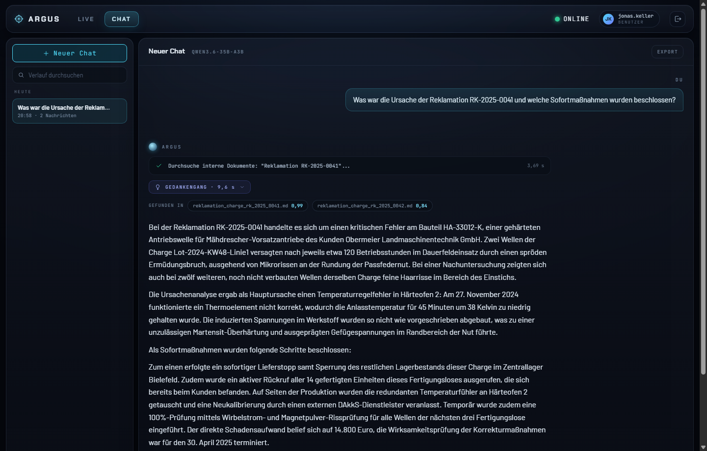
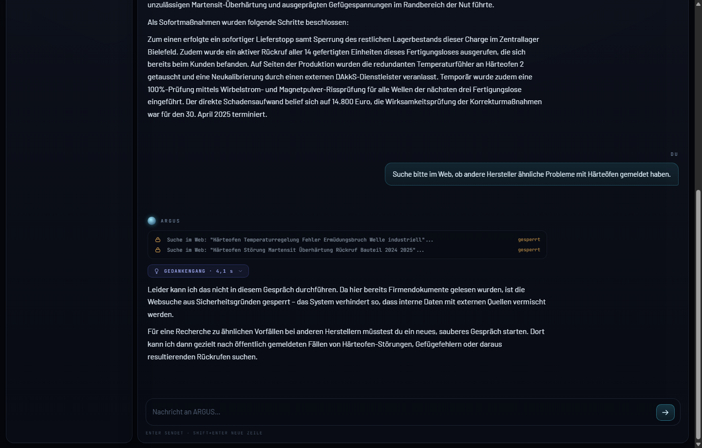
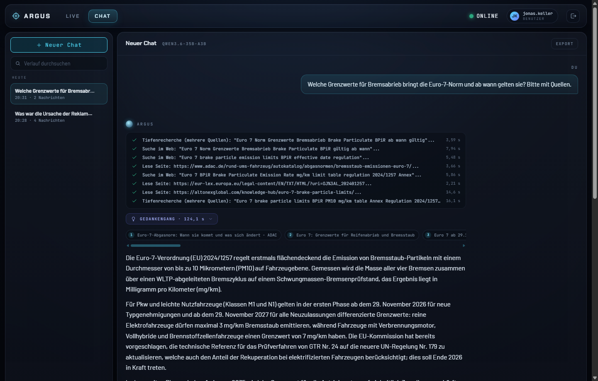
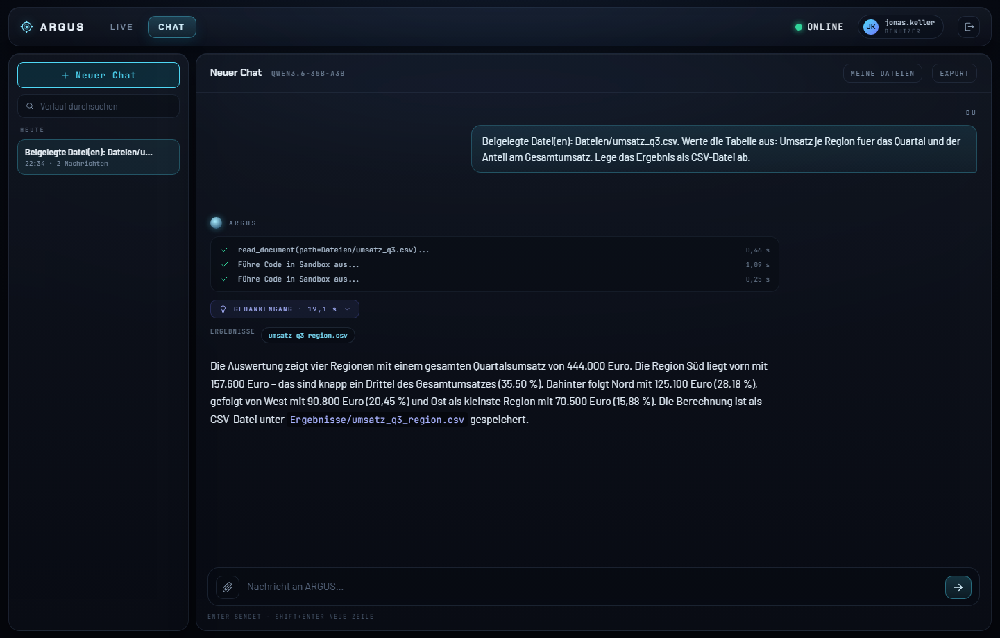
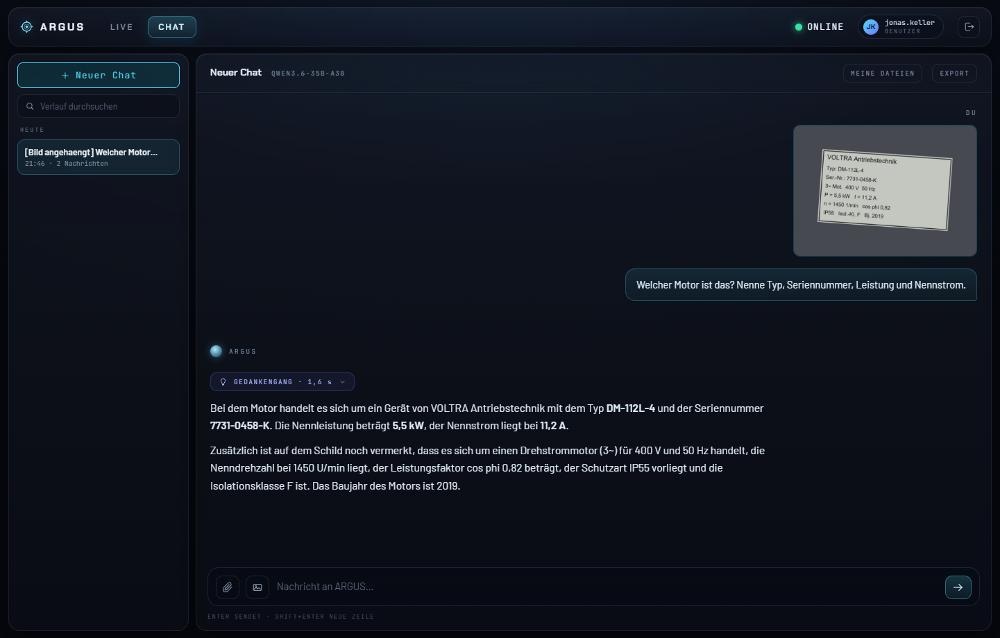
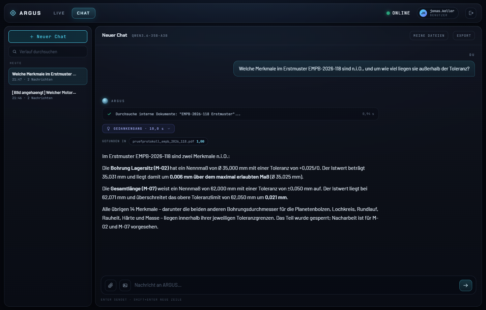
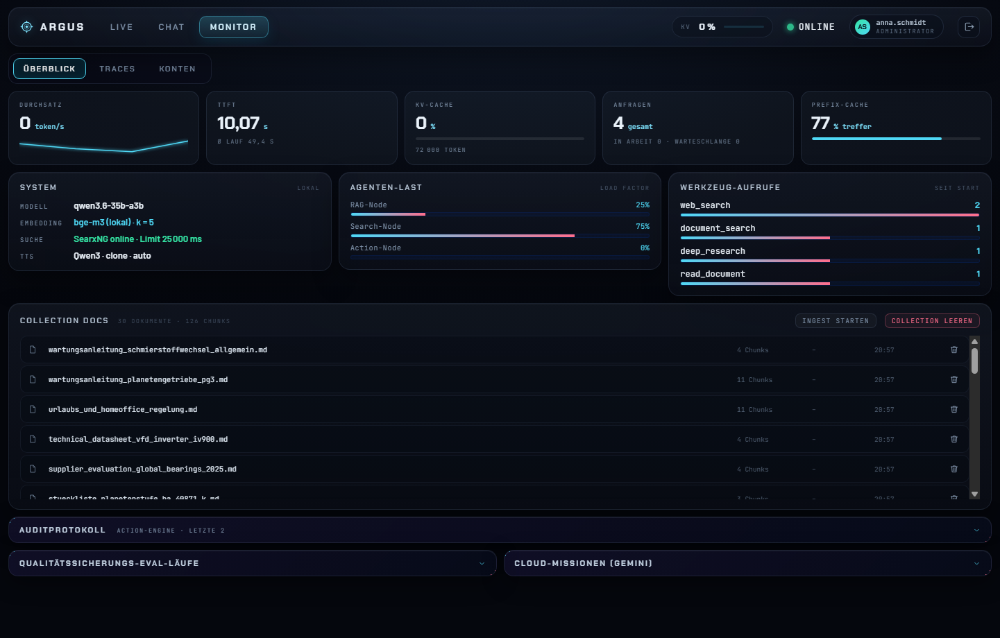
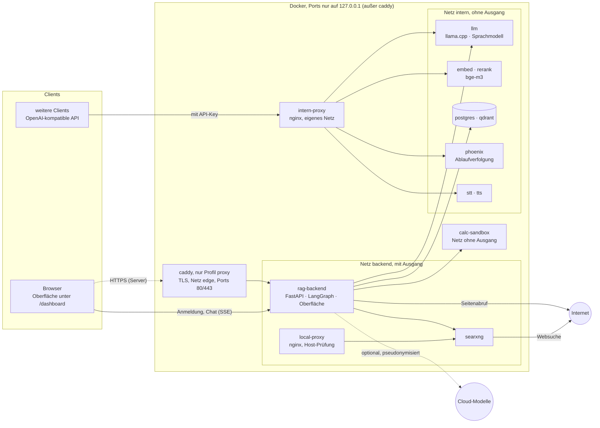

# Argus

*Deutsch · [English](README.md)*

**Ein KI-Assistent für Unterlagen, die das Haus nicht verlassen dürfen.** Argus läuft
vollständig auf eigener Hardware und wird im Browser bedient. Das Sprachmodell hat keinen
Zugang zum Internet. Sobald ein Gespräch Firmendokumente gelesen hat, ist in diesem Gespräch
jeder Weg nach außen gesperrt.



**Inhalt:** [Wofür](#wofür) · [Was heute geht](#was-heute-geht) · [Gemessen](#gemessen) ·
[Warum sicher](#warum-argus-sicher-ist) · [Audit und SIEM](#wer-hat-was-getan-auditprotokoll-und-siem) ·
[Websuche](#warum-websuche-und-wie-sie-abgesichert-ist) ·
[Modell](#das-modell-ist-austauschbar) · [Was fehlt](#was-bis-zum-einsatz-fehlt) ·
[Architektur](#architektur) · [Sicherheitskonzept](#sicherheitskonzept) ·
[Einrichten](#einrichten) · [Betrieb auf einem Server](#betrieb-auf-einem-server) ·
[Dienste](#dienste) · [Stellschrauben](#stellschrauben-env) ·
[Dokumentensuche](#dokumentensuche) · [Sicherheits-Schalter](#sicherheits-schalter) ·
[Tests und Messungen](#tests-und-messungen) · [Lizenz](#lizenz)

## Wofür

Viele Firmen nutzen einen Cloud-Assistenten wie Microsoft 365 Copilot für allgemeines
internes Wissen. Unterlagen mit hohem Schutzbedarf bleiben dabei außen vor, weil sie nicht in
einen Cloud-Dienst sollen oder dürfen. Bei einem Dienstleister der Automobilindustrie ist das
ein großer Teil der täglichen Arbeit:

- Kundenunterlagen unter Geheimhaltungsvereinbarung, Lastenhefte, Zeichnungen
- Daten zu Prototypen und Vorserien
- Reklamationen, 8D-Berichte, Prüf- und Arbeitsanweisungen
- Verträge, Preise, Lieferantenbewertungen

Für diese Unterlagen gibt es heute meist gar keine KI-Unterstützung. Argus schließt die
Lücke: dieselbe Art von Assistent, aber auf einem Rechner im eigenen Netz, mit einem Modell,
das technisch nichts hinausschicken kann.

**Ein Beispiel.** Eine Qualitätsingenieurin fragt: „Was war die Ursache der Reklamation
RK-2025-0041 und welche Sofortmaßnahmen wurden beschlossen?“ Argus sucht in den
aufgenommenen Berichten und antwortet nach rund 20 Sekunden. Über der Antwort steht, in
welchen Dokumenten die Textstellen gefunden wurden (Aufnahme oben). Fragt sie im selben Gespräch nach einer Web-Recherche, lehnt
Argus ab: Dieses Gespräch hat Firmendaten gelesen, also geht aus ihm nichts mehr nach außen.
Für die Recherche beginnt sie ein neues Gespräch, in dem keine Firmendaten liegen.



Weitere Aufgaben, für die Argus gedacht ist:

- Fragen an Richtlinien, Verträge und Anweisungen, mit Quelle statt aus dem Gedächtnis
- Berichte zusammenfassen und vergleichen („Gab es dieses Fehlerbild schon einmal?“)
- Recherche zu Normen, Vorschriften und Herstellerangaben, mit Quellen
- Einarbeitung: Wer neu ist, fragt die Unterlagen statt die Kollegen

### Argus neben einem Cloud-Assistenten

Argus ersetzt einen Cloud-Assistenten nicht, es ergänzt ihn um den Teil, der dort nicht
hingehört.

| | Cloud-Assistent (z. B. Microsoft 365 Copilot) | Argus |
|---|---|---|
| Gerechnet wird | beim Anbieter | auf eigener Hardware im eigenen Netz |
| Gedacht für | allgemeines internes Wissen, Office-Alltag | Unterlagen, die nicht in eine Cloud sollen |
| Schutz vor Datenabfluss | vertraglich und durch den Anbieter | technisch: Modell ohne Internet, Sperre nach Firmendaten, bei jeder Änderung automatisch geprüft |
| Modell | vom Anbieter vorgegeben | frei wählbar und austauschbar |
| Nachvollziehbar | je nach Produkt | jeder Schritt steht im Chat, dazu signiertes Auditprotokoll mit Weitergabe an das eigene SIEM und Ablaufverfolgung im eigenen Haus |
| Kosten | Lizenz je Nutzer | Hardware und Betrieb, keine Lizenz je Nutzer |
| Einbindung in Office | ja | nein |
| Reife | Produkt mit Support | Eigenentwicklung mit [offenen Punkten](#was-bis-zum-einsatz-fehlt) |

Argus ist kein TISAX-Nachweis. Es bringt die technischen Eigenschaften mit, auf die es bei
Unterlagen mit hohem Schutzbedarf ankommt, und macht sie prüfbar: Der Quelltext liegt offen,
die Netz-Abschottung wird bei jeder Änderung automatisch kontrolliert, und Sperren,
Anmeldungen und Kontoänderungen stehen im Auditprotokoll, das an das SIEM der Firma gehen
kann ([Warum Argus sicher ist](#warum-argus-sicher-ist)).

## Was heute geht

- **Fragen an eigene Dokumente:** PDF, Word (`.docx`), OpenDocument-Text (`.odt`), Excel,
  PowerPoint, EPUB, HTML, Text. Dateinamen behalten Umlaute. Das Modell
  antwortet aus den gefundenen Textstellen und nicht aus dem Gedächtnis (oft „RAG“ genannt).
  Die Suche kombiniert Bedeutung (bge-m3) und Stichworte (BM25) und bewertet die Treffer mit
  einem Reranker. Kennungen wie `RK-2025-0041` oder Teilenummern trifft sie wörtlich.
  Über der Antwort steht, in welchen Dokumenten die Textstellen gefunden wurden. Diese Angabe
  kommt aus der Suche, nicht aus dem Text des Modells, kann also nicht erfunden sein.
- **Bilder und gescannte PDFs:** Eine Seite ohne Textebene liest das lokale Modell selbst und
  schreibt sie ab, ebenso Bilddateien (PNG, JPG, WebP). Der Text landet in der Dokumentensuche
  wie jeder andere. Im Chat lässt sich ein Bild anhängen und dazu eine Frage stellen
  ([Text und Bild](#das-modell-ist-austauschbar)).
- **Web-Recherche** mit Quellen über eine eigene Suchinstanz, getrennt von Gesprächen mit
  Firmendaten ([Absicherung](#warum-websuche-und-wie-sie-abgesichert-ist)).
- **Datei in den Chat ziehen oder anhängen:** Eine PDF, eine Tabelle oder ein anderes Dokument
  landet im eigenen Bereich des Kontos, Argus liest es und arbeitet damit. Ein Gespräch mit
  beigelegter Datei gilt sofort als Gespräch mit Firmendaten. Jedes Konto sieht nur seine
  eigenen Dateien, auch Administratoren sehen die Dateien anderer nicht.
- **Rechnen und Auswerten** in einer abgeschotteten Sandbox ohne Internet (Python, Tabellen). Sie
  bekommt nur die Dateien des eigenen Kontos.
- **Ergebnisse herunterladen:** Berichte, Tabellen und andere Dateien, die Argus erzeugt,
  stehen über der Antwort zum Herunterladen bereit und unter *Meine Dateien*. Dateien und
  Ergebnisse werden nach sieben Tagen gelöscht (`USER_FILES_RETENTION_HOURS`), je Konto stehen
  500 MB zur Verfügung (`USER_FILES_MAX_MB`).
- **Sprache:** Spracherkennung (Whisper) und Sprachausgabe, beides lokal.
- **Konten und Rollen:** Administratoren verwalten Dokumente und Konten und sehen den Monitor.
  Benutzer fragen, suchen in den Dokumenten und recherchieren. Argus spricht jede Person mit
  ihrem Namen an.
- **Nachvollziehbarkeit:** Jeder Werkzeugschritt steht im Chat, jede Anfrage als Ablauf in
  Phoenix (im eigenen Haus, Inhalte geschwärzt). Sicherheitsrelevante Ereignisse wie
  Anmeldungen, Kontoänderungen und Sperren stehen im signierten Auditprotokoll und gehen auf
  Wunsch an das SIEM der Firma.











*Die Aufnahmen zeigen den Stand dieses Repos mit dem Modell Qwen3.6-35B-A3B. Dokumente,
Firmen und Namen darin sind erfunden (`eval/retrieval/corpus`, `eval/scans`).*

## Gemessen

Alle Werte stammen vom selben Rechner: ein PC mit einer Grafikkarte (RTX 5070 Ti, 16 GB),
Modell Qwen3.6-35B-A3B. Die Messungen liegen im Repo und lassen sich wiederholen.

| Was | Wert | Wie gemessen |
|---|---|---|
| Dokumentensuche: richtiges Dokument an erster Stelle | 96 % (vor dem Umbau 67 %) | 60 Fragen an 30 Dokumente, `eval/retrieval` |
| Dauer einer Dokumentensuche | 3,5 s (vorher 19,9 s) | ebenda, Suche und Bewertung auf der CPU |
| Aufgaben, die der ganze Agent richtig löst | 91 von 96 (mit Gemma 4: 94 von 96, [Vergleich](#das-modell-ist-austauschbar)) | 32 Aufgaben mit je 3 Durchläufen gegen den echten Agenten, `eval/agent` |
| Dauer je Aufgabe | 24 s im Median | ebenda |
| Schreibtempo des Modells | 79 Token je Sekunde, bei zwei Anfragen gleichzeitig je 47 | `bench.sh` im Container |
| Text, den eine Anfrage fassen kann | 72.000 Token, rund 100 Seiten | Einstellung `LLM_CTX_PER_SLOT` |
| Scans, Fotos und Handschrift abschreiben | 111 von 111 Prüfungen auf 11 Testseiten; falsche Zahlen erst unter 150 dpi oder bei 4 pt Schrift | Fax, Handyfoto, Formular, Zeichnung, Stempel und Belastungsreihen, `eval/scans` |
| Automatische Tests | 544 für das Backend, 80 für die Rechen- und Code-Sandbox | bei jeder Änderung im CI, zusammen mit der Prüfung der Netz-Abschottung |

Die Aufgaben der Agenten-Messung prüfen unter anderem, ob Argus interne Fragen aus den
Dokumenten beantwortet statt aus dem Gedächtnis, ob es Internes nicht im Web sucht und ob es
sich von eingeschleusten Anweisungen in Dokumenten nicht lenken lässt.

## Warum Argus sicher ist

Nicht, weil sich das Modell gut benimmt, sondern weil es nichts Gefährliches tun kann. Ein
Sprachmodell lässt sich mit geschickt formuliertem Text (Prompt Injection) zu fast allem
überreden, auch über eine präparierte Webseite oder ein präpariertes Dokument. Argus geht
deshalb davon aus, dass das Modell irgendwann falsch handelt, und sorgt dafür, dass daraus
kein Schaden entsteht. Die Schutzmaßnahmen sitzen außerhalb des Modells:

| Argus ist sicher, weil … | So ist es umgesetzt | Prüfbar über |
|---|---|---|
| das Modell nichts hinausschicken kann | Es läuft in einem Netz ohne Ausgang. Ins Internet kommen nur das Backend und die eigene Suchinstanz. | `setup/check_networks.py`, bei jeder Änderung im CI |
| Firmendaten und Internet nie im selben Gespräch zusammenkommen | Hat ein Gespräch Firmendaten gelesen oder eine Datei bekommen, ist darin jeder Weg nach außen gesperrt. | Tests, Agenten-Messung (Gruppe Sicherheit) |
| jede Person nur ihr Eigenes sieht | Rollen werden an jeder Route im Backend geprüft. Dateien liegen je Konto getrennt, die Code-Sandbox bekommt nur die Dateien des eigenen Kontos. | Tests (`test_user_files.py`) |
| das Modell auf keinem Rechner etwas ausführen kann | Kein Zugang zu Rechnern, keine Zugangsdaten in den Containern. Code läuft nur in einer Sandbox ohne Internet, unter einem eigenen Benutzer ohne Rechte, jeder Lauf in einem frisch gestarteten Container. | Compose-Datei, Tests der Sandbox |
| fremde Inhalte als Daten gelten, nicht als Anweisung | Webseiten und Dokumente laufen durch eine Prüfung auf eingeschleuste Anweisungen. Köder-Schlüssel schlagen Alarm, wenn etwas Geschütztes hinaus will. | Agenten-Messung (Injection in Dokument und Webseite) |
| sich alles nachvollziehen lässt | Signiertes Auditprotokoll, auf Wunsch weitergegeben an das SIEM der Firma ([unten](#wer-hat-was-getan-auditprotokoll-und-siem)). | `GET /v1/dashboard/audit/verify`, das SIEM |
| man es nicht glauben muss | Quelltext offen, Tests und Messungen liegen im Repo und lassen sich wiederholen. | dieses Repo |

Die Einzelheiten stehen im [Sicherheitskonzept](#sicherheitskonzept). Was noch fehlt, steht
unter [Offen für einen Einsatz im Unternehmen](#offen-für-einen-einsatz-im-unternehmen), vor
allem: Wer den Server bedient, kann die Dateien lesen, und eine Anmeldung über das
Firmenverzeichnis (SSO) gibt es noch nicht.

### Wer hat was getan: Auditprotokoll und SIEM

**Was ist ein SIEM?** Ein SIEM (Security Information and Event Management) ist die zentrale
Stelle, an der die IT-Sicherheit die Protokolle aller Systeme sammelt: Firewall,
Verzeichnisdienst, Virenschutz auf den Rechnern, Server. Dort werden sie unveränderlich
aufbewahrt, miteinander verknüpft und automatisch ausgewertet. Typische Regeln sind viele
Fehlanmeldungen in kurzer Zeit, eine Anmeldung zu ungewöhnlicher Uhrzeit oder ein neues
Administratorkonto. Schlägt eine Regel an, bekommt das Sicherheitsteam einen Alarm. Verbreitet
sind etwa Microsoft Sentinel, Splunk, IBM QRadar, CrowdStrike Falcon Next-Gen SIEM oder das
freie Wazuh.

**Warum das zählt.** Ein neues System, das vertrauliche Unterlagen verarbeitet, muss sich in
diese Überwachung einfügen. Der VDA-ISA-Katalog, auf dem TISAX beruht, verlangt, dass
sicherheitsrelevante Ereignisse protokolliert, vor Veränderung geschützt und ausgewertet
werden. Ein Protokoll, das nur auf dem Server selbst liegt, erfüllt das schlecht: Wer den
Server übernimmt, kann es löschen.

**Was Argus protokolliert:**

| Ereignis | Beispiele | Wofür im SIEM |
|---|---|---|
| Anmeldung | erfolgreich, falsches Passwort, unbekanntes Konto, gesperrt nach Fehlversuchen, Abmeldung | Passwort-Raten erkennen, Anmeldungen mit anderen Systemen abgleichen |
| Kontoänderung durch einen Administrator | Konto angelegt oder gelöscht, Rolle geändert, Passwort zurückgesetzt | Rechteausweitung erkennen: Wer hat wen wann zum Administrator gemacht? |
| Sperre nach Firmendaten | Websuche in einem Gespräch mit Firmendaten abgewiesen | Eine Häufung zeigt Fehlbedienung oder einen Angriffsversuch über präparierte Inhalte |
| Köder-Alarm | ein Köder-Schlüssel sollte hinaus | höchste Stufe: deutet auf einen gezielten Abflussversuch |
| Schreiben im Arbeitsordner | Datei über ein Werkzeug der Administratoren angelegt oder geändert, mit Pfad | Änderungen an Dateien nachvollziehen |
| Freigaben und Cloud-Aufrufe (nur mit Cloud-Modul) | wer was freigegeben hat, was an ein Cloud-Modell ging | nachvollziehen, was das Haus verlassen hat |
| Leeren des Protokolls | ein Administrator löscht die Einträge in der Datenbank | wird selbst gemeldet; im SIEM bleiben die alten Einträge erhalten |

Jeder Eintrag trägt Zeit, Ereignis und Ergebnis, dazu Konto und Adresse, wo sie bekannt sind.
**Nicht im Protokoll** stehen Passwörter, Chat-Verläufe und Dokumenttexte. Ein unbekannter
Kontoname wird nur als Prüfsumme gespeichert, weil in diesem Feld oft versehentlich ein
Passwort landet. Die einzige Ausnahme bei Inhalten: Was mit dem Cloud-Modul an ein
Cloud-Modell geht, steht als Anfrage im Protokoll, denn genau das soll nachvollziehbar sein.

**Schutz vor Manipulation.** Jeder Eintrag ist mit einem geheimen Schlüssel signiert und mit
dem vorigen verkettet (HMAC-Kette). Wer einen Eintrag ändert, löscht oder umsortiert, bricht
die Kette, und die Prüfung meldet die Stelle. Endgültig sicher ist das Protokoll erst im
SIEM, denn darauf hat ein Administrator von Argus keinen Zugriff.

**Einschalten** in der `.env`, zum Beispiel für einen Syslog-Empfänger des SIEM:

```ini
AUDIT_SIEM=syslog
AUDIT_SIEM_FORMAT=cef
AUDIT_SYSLOG_HOST=siem-collector.firma.local
AUDIT_SYSLOG_PROTOCOL=tcp
```

Argus sendet nach RFC 5424 über UDP oder TCP, als JSON oder als CEF (Common Event Format),
das gängige SIEM-Produkte direkt einlesen. Alternativ schreibt `AUDIT_SIEM=stdout` jeden
Eintrag ins Container-Log, wo ein vorhandener Log-Sammler ihn abholt. Die Weitergabe hält
keine Anfrage auf. Ist das SIEM nicht erreichbar, warten die Einträge in einer Datei im
Volume `rag_data` und gehen, älteste zuerst, nach, sobald es wieder antwortet. Erst über der
Obergrenze (`AUDIT_SIEM_SPOOL_MAX_MB`, 50 MB) zählt Argus sie als verloren und warnt. Über UDP
bemerkt Argus Verluste unterwegs nicht; wo nichts fehlen darf, TCP nehmen. Alle Schalter
stehen unter [Sicherheits-Schalter](#sicherheits-schalter).

**Für den Betrieb:** Das Protokoll enthält Anmeldungen einzelner Personen. Wie andere
Protokolle gehört es deshalb ins Löschkonzept und, wo es einen Betriebsrat gibt, in die
passende Betriebsvereinbarung. Argus löscht Audit-Einträge nicht von selbst; wie lange sie
aufbewahrt werden, regelt das SIEM.

## Warum Websuche, und wie sie abgesichert ist

Das Wissen eines Sprachmodells endet mit seinem Training. Normen, Vorschriften,
Herstellerangaben und alles Aktuelle kennt es nicht oder nur veraltet, und ohne Zugriff auf
Quellen neigt es dazu, Lücken zu füllen. Mit der Websuche belegt Argus solche Antworten mit
Quellen. Dabei gilt:

- **Das Modell selbst hat kein Internet.** Es läuft in einem Netz ohne Ausgang. Suchen und
  Seiten abrufen kann nur das Backend.
- **Eigene Suchinstanz.** Gesucht wird über SearXNG im eigenen Stapel, ohne Konto und ohne
  Profil bei einer Suchmaschine. Bei einer Recherche gehen die Suchbegriffe und die Adressen
  der abgerufenen Seiten nach außen.
- **Gespräche mit Firmendaten können nicht suchen.** Hat ein Gespräch ein Dokument oder eine
  Datei gelesen oder wurde ihm eine Datei beigelegt, sind Websuche, Seitenabruf und alle
  anderen Wege nach außen darin gesperrt. Ein abgewiesener Versuch steht mit einem Schloss
  im Chat.
  Das verhindert, dass eine präparierte Webseite oder ein präpariertes Dokument das Modell
  dazu bringt, Inhalte über eine Suchanfrage hinauszutragen.
- **Internes wird nicht im Web gesucht.** Eine feste Regel schickt Fragen nach Richtlinien,
  Verträgen, Preisen und Datenblättern zuerst in die Dokumente.
- **Fremde Inhalte werden geprüft.** Jede geladene Seite läuft durch eine Prüfung auf
  eingeschleuste Anweisungen. Der Seitenabruf erreicht keine internen Adressen, auch nicht
  über Weiterleitungen.
- **Köder-Schlüssel.** Taucht einer der hinterlegten Köder in einer Suchanfrage oder Adresse
  auf, wird die Anfrage blockiert und im Audit vermerkt.

Was bleibt: Was jemand selbst in ein Recherche-Gespräch tippt, kann als Suchbegriff
hinausgehen, wie bei einer Suche von Hand. Einen Schalter, der die Websuche ganz abstellt,
gibt es noch nicht.

## Das Modell ist austauschbar

Argus hängt an keinem bestimmten Modell. Der Modell-Dienst lädt eine Modelldatei (GGUF), das
Backend spricht ihn über eine genormte Schnittstelle an. Ein Wechsel heißt: andere Datei in
den Modellordner, zwei Zeilen in der `.env` (`LLM_MODEL_FILE`, `OAI_MODEL`). Welches Modell
eine Firma zulässt, ist damit ihre Entscheidung, etwa nach Herkunft oder Lizenz.

| Modell | Lizenz | Bilder als Eingabe | Anmerkung |
|---|---|---|---|
| Qwen3.6-35B-A3B (Alibaba) | Apache 2.0 | ja | Damit sind alle Werte oben gemessen. |
| Gemma 4, 26B-A4B oder 31B (Google) | Apache 2.0 | ja | 26B-A4B gemessen, siehe unten |
| Mistral Small 3.2, 24B (Mistral AI, Frankreich) | Apache 2.0 | ja | europäischer Anbieter |
| Llama 4 (Meta) | Llama 4 Community License | ja | Die Nutzungsbedingungen nehmen Firmen mit Hauptsitz in der EU von den Rechten an den multimodalen Modellen aus. Vor einem Einsatz rechtlich prüfen. |

Lizenzangaben nach den Modellkarten der Anbieter, Stand November 2026; vor einem Einsatz
prüfen. Gemessen sind Qwen3.6-35B-A3B und Gemma 4 26B-A4B.

**Wie gut ist ein Modell?** Das sagt bei Argus eine Messung und keine Behauptung: Die
Agenten-Messung (`eval/agent`) läuft in etwa einer Stunde gegen ein beliebiges Modell und
liefert dieselbe Tabelle wie oben. So lässt sich ein Ersatzmodell vor dem Wechsel mit dem
bisherigen vergleichen. Ein Modell dieser Größe ist schwächer als die großen Cloud-Modelle,
vor allem bei langen Aufgaben mit vielen Schritten. Für Fragen an Dokumente,
Zusammenfassungen und Recherche mit Quellen reicht es, wie die Werte oben zeigen.

**Gemessen: Qwen gegen Gemma.** Beide auf derselben Karte (16 GB), beide in Q4 (Unsloth
UD-Q4_K_XL), beide mit MTP, mit denselben Prompts und derselben Agenten-Messung (32 Aufgaben,
je 3 Durchläufe). Die Prompts sind an Qwen entwickelt und für Gemma nicht angepasst.

| | Qwen3.6-35B-A3B | Gemma 4 26B-A4B |
|---|---|---|
| Aufgaben richtig gelöst | 91 von 96 | 94 von 96 |
| davon zurückgehaltene Kontrollaufgaben | 18 von 18 | 18 von 18 |
| Dauer je Aufgabe (Median) | 24 s | 36 s |
| Schreibtempo mit MTP | 79 Token/s | 89 Token/s |
| Einlesen | ~2.800 Token/s | ~3.600 Token/s |
| Modelldatei | 22,9 GB | 17,0 GB, dazu 0,5 GB für MTP |
| VRAM, Experten im RAM | 14,9 GB, 25 von 40 Schichten | 14,8 GB, 14 von 30 Schichten |

Beide reichen für den Einsatzzweck. Ein Unterschied von drei Durchläufen liegt nahe am
Rauschen dieser Messung; belastbar ist, dass der Wechsel ohne eine Zeile Code und ohne
angepasste Prompts ein gleich gutes Ergebnis liefert. Gemma löst die Aufgaben, an denen Qwen
scheitert (Kilometerpauschale aus der Richtlinie statt der gesetzlichen, Wochentag,
Vergleichstabelle). Schwächer ist es bei der Recherche: Es sucht auch öffentliche Fragen
zuerst in den Firmendokumenten, damit gilt das Gespräch als Gespräch mit Firmendaten und die
Websuche ist gesperrt. Je Aufgabe braucht es länger, obwohl es pro Token schneller schreibt;
vermutlich denkt es länger nach, einzeln gemessen ist das nicht.

**Sampling gehört zum Wechsel.** Mit den von Google empfohlenen Werten (Temperatur 1,0, top_k
64) kam Gemma auf 92 von 96, im Median 47 s, und einmal brach eine Aufgabe nach 600 s ab,
weil sich das Modell im Denken im Kreis drehte. Mit den ruhigeren Werten, die Argus für Qwen
nutzt, und einer Strafe für Wiederholungen ergab sich die Tabelle oben. Bei einem neuen
Modell also beides messen.

Gemma 4 wählt die Installation auf Wunsch selbst: die Frage nach dem Sprachmodell
beantworten oder `install.sh --llm gemma` (unter Windows `install.cmd --llm gemma`). Sie lädt
Modell, MTP-Kopf und Bild-Encoder, trägt sie in die `.env` ein und stellt die Aufteilung auf
den Grafikspeicher ein; ein zweiter Lauf mit `--llm qwen` stellt zurück. Von Hand in der
`.env`, Sampling-Werte leer lassen:

```ini
LLM_MODEL_FILE=gemma-4-26B-A4B-it-UD-Q4_K_XL.gguf
LLM_MTP_MODEL_FILE=mtp-gemma-4-26B-A4B-it.gguf
LLM_MMPROJ_FILE=mmproj-gemma-4-26B-A4B-it-F16.gguf
LLM_N_CPU_MOE=15
OAI_MODEL=gemma-4-26b-a4b
```

Alle drei Dateien liegen bei Hugging Face unter `unsloth/gemma-4-26B-A4B-it-GGUF`; Qwens
Bild-Encoder passt nicht zu Gemma. **Bilder mit Gemma** (gemessen mit `eval/scans`): Saubere
Scans, Fax, Handyfoto, Handschrift und Zeichnung las es so gut wie Qwen und rund dreimal so
schnell (3 statt 10 bis 15 s je Seite). Bei schwierigen Scans ist es unsicherer: Bei 10° schief
eingelegten Seiten rutschten die Spalten einer Tabelle um eine Zeile, so dass i.O. und n.i.O.
bei zwei Merkmalen vertauscht standen; ab 75 dpi abwärts las es deutlich mehr Ziffern falsch.
Für Scans, deren Werte zählen, ist Qwen die sicherere Wahl. Gemma braucht dazu
`LLM_UBATCH=2048` für kleine Schrift und gedrehte Seiten; das kostet rund 1,4 GB Grafikspeicher,
die Installation setzt es nur auf Karten, auf die dann noch alles passt.

**Ein Modell für Text und Bild.** Alle Modelle in der Tabelle sind multimodal
(Vision-Language): Sie lesen Text und Bilder mit denselben Gewichten. Eine gescannte Seite, ein
Foto vom Prüfteil oder eine Zeichnung liest also dasselbe Modell, das danach die Frage
beantwortet oder den Bericht bewertet. Ein eigener OCR-Schritt und ein zweites Modell nur für
Bilder sind dafür nicht nötig, und die Karte muss nur ein Modell im Speicher halten statt
zwei. Für den Bildteil lädt der Modell-Dienst eine kleine Zusatzdatei (mmproj), die bei
Hugging Face neben dem Modell liegt: 0,9 GB bei Qwen3.6, 1,2 GB bei Gemma 4.

So arbeitet Argus damit: Die Installation lädt die Zusatzdatei mit (`LLM_MMPROJ_FILE`), der
Modell-Dienst lädt sie beim Start, und das Backend fragt ihn, ob er Bilder annimmt. Dann
erscheint im Chat der Knopf für Bilder. Eine PDF-Seite mit weniger als 20 Zeichen Text, aber mit
einem Bild, gilt als Scan: Das Modell schreibt sie ab, Tabellen als Tabellen, und der Text steht
an der Stelle der Seite, gekennzeichnet als „aus dem Bild gelesen“. Bilddateien liest es
genauso. Das gilt für die Aufnahme in die Dokumentensuche, für `read_document` und für den
Monitor. Was dabei herauskommt, zählt wie jeder Dokumenttext als Firmendaten. Alles läuft
über das lokale Modell, nie über ein Cloud-Modell. Fehlt die Zusatzdatei, läuft Argus wie
vorher ohne Bildeingabe, und Scans bleiben leer.

Gemessen mit Qwen3.6 (`eval/scans`): Elf erfundene Testseiten las das Modell ohne Fehler,
darunter ein Fax, ein schräges Handyfoto, Handschrift, ein Formular mit Kreuzen, eine
technische Zeichnung und einen Betrag unter einem Stempel. Eine Anweisung an „KI-Systeme“ im
Bild schrieb es nur ab. In Belastungsreihen mit einer Prüftabelle blieben die Werte bei
Unschärfe, starker Kompression, blasser Schrift und Drehung richtig. Bei 100 dpi und weniger
oder 4 pt Schrift verfälschte es dagegen einzelne Ziffern, ohne es kenntlich zu machen
(0,82 statt 0,62). Mehr als 150 dpi kommt beim Modell nicht an, es sieht A4 mit rund 137 dpi.
Eine Seite dauert 10 bis 15 s; der Encoder liegt im RAM und braucht keinen Grafikspeicher
(Stellschrauben unten). Echte Handschrift und echte Firmenseiten sind noch nicht gemessen.

## Was bis zum Einsatz fehlt

Argus läuft und ist gemessen, aber bisher auf einem einzelnen Rechner. Für einen Betrieb mit
vielen Personen fehlen vor allem:

- **Anmeldung über das Firmenverzeichnis (SSO)** statt eigener Konten.
- **Rechte der Quellen:** Die Wissensbasis ist für alle Konten dieselbe.
- **Betrieb:** ein Modell-Dienst für viele gleichzeitige Nutzer. Eine geführte Installation
  und einen TLS-Proxy gibt es (siehe [Einrichten](#einrichten) und
  [Betrieb auf einem Server](#betrieb-auf-einem-server)).

Die vollständige Liste steht unter
[Offen für einen Einsatz im Unternehmen](#offen-für-einen-einsatz-im-unternehmen).

## Aufbau des Repos

| Ordner | Inhalt |
|---|---|
| `rag_backend/` | Backend: FastAPI, LangGraph-Agent, Dokumentensuche, Freigaben, Audit |
| `rag_backend/static/` | Browser-Oberfläche (reines HTML, CSS, JavaScript, ohne Build-Schritt) |
| `alembic/` | Datenbank-Migrationen |
| `docker-compose.yml` | der Stapel |
| `setup/` | Einrichtung (`install.py`, `init_stack.py`, `bootstrap.sh` für Linux-Server, `models.json`), Prüfung der Netze (`check_networks.py`) |
| `stt_service/`, `tts_service/`, `calc_sandbox/` | Sprache und abgeschottete Code-Ausführung |
| `local_proxy/`, `searxng_config/` | die beiden Proxys auf 127.0.0.1, Websuche |
| `proxy/` | TLS-Proxy für den Server (Caddy, Profil `proxy`): `Caddyfile`, `certs/` für ein eigenes Zertifikat |
| `eval/` | Messungen: Dokumentensuche (`retrieval/`) und ganzer Agent (`agent/`) |

## Architektur



## Sicherheitskonzept

**Grundsatz:** Das Modell ist ein nicht vertrauenswürdiger Baustein. Prompt Injection lässt
sich im Modell nicht zuverlässig verhindern. Deshalb hängt die Sicherheit an Rechten,
Freigaben und Abschottung, nicht daran, dass sich das Modell richtig verhält.

**Kein Weg auf einen Rechner.** Argus kann nichts auf einem Computer ausführen: Es gibt
kein Admin-Konto, keine Zugangsdaten für einen Host in einem Container und keinen Schalter,
der das ändert. Code läuft nur in der Sandbox ohne Internet.

**Zwei Rollen:**

| | Benutzer | Administrator |
|---|---|---|
| Fragen, Dokumente durchsuchen, im Web recherchieren, rechnen, Sprache | ja | ja |
| Eigene Chats | nur die eigenen | nur die eigenen |
| Dokumente hochladen, in die Wissensbasis aufnehmen, löschen | nein | ja |
| Eigene Dateien in den Chat geben, auswerten, Ergebnisse herunterladen | ja | ja |
| Dateien anderer Konten | nein | nein |
| Konten anlegen, Monitor, Audit, Ablaufverfolgung | nein | ja |
| Cloud-Modelle (nur mit Cloud-Modul) | nein | ja |

**Schichten:**
- **Netze:** Ins Internet kommen nur `rag-backend` (Websuche, Seitenabruf, optional Cloud) und
  SearXNG. Ohne Profil `web` bietet Argus kein Werkzeug an, das ins Internet geht; dann bleibt
  nur das Cloud-Modul, wenn es eingeschaltet ist. Modell, Einbettung, Reranker, Datenbanken, Sprache und Phoenix hängen im Netz
  `intern` ohne Ausgang. Sie erreichen weder das Internet noch SearXNG, laden also nichts nach
  und können nichts hinausschicken, auch wenn einer von ihnen kompromittiert wäre.
  `intern-proxy` leitet nur an Ziele in `intern` weiter und teilt sein Netz zum
  Veröffentlichen der Ports mit keinem anderen Dienst, damit er keine Brücke wird. Die
  Code-Ausführung hat ein eigenes Netz ohne Ausgang. Mit dem Profil `proxy` kommt `caddy`
  dazu: nur im Netz `edge`, das er allein mit `rag-backend` teilt, und als einziger Dienst mit
  Ports außerhalb von 127.0.0.1, nur 80 und 443. `setup/check_networks.py` prüft diese Regeln
  bei jedem Push im CI, mit und ohne Profil `proxy`.
- **Sperre nach Firmendaten:** Gefährlich wird ein Agent, der zugleich Firmendaten liest,
  fremde Inhalte verarbeitet und nach außen senden kann. Dann kann eine präparierte Seite ihn
  dazu bringen, Daten über eine Suchanfrage abfließen zu lassen. Liest ein Gespräch
  Firmendaten, ist darin jeder Weg nach außen gesperrt (`EGRESS_AFTER_SENSITIVE=block`):
  Websuche, Seitenabruf, Wetter, Routen, Cloud-Modelle, Missionen und fremde MCP-Werkzeuge.
  Als Firmendaten zählen Dokumentensuche und -abruf, Dateien und die Code-Sandbox (sie bekommt
  die Dateien des Kontos). Eine beigelegte Datei zählt schon, bevor sie gelesen ist: Nennt
  eine Nachricht eine Datei aus dem eigenen Bereich, gilt das Gespräch von da an als
  Gespräch mit Firmendaten. Abgewiesene Schritte stehen mit einem Schloss im Chat. Die
  Sperre gilt auch für Unteragenten und bleibt nach einem
  Neustart bestehen. Jede Sperre landet im Audit, ohne Inhalte. Für eine
  Recherche beginnt man ein neues Gespräch.
- **Fremde Inhalte:** Websuche und Seitenabruf laufen durch eine Injection-Prüfung
  (`WEB_INJECTION_GUARD`). Lässt sich ein Inhalt nicht prüfen, etwa weil der Prüfaufruf
  scheitert, wird er nicht übernommen. Der Seitenabruf sperrt interne Adressen, auch nach
  Weiterleitungen, und liest höchstens 3 MB je Seite (`WEBPAGE_MAX_BYTES`).
- **Rollen:** Geprüft wird an jeder Route im Backend, nicht in der Oberfläche. Benutzer
  bekommen die Werkzeuge für Cloud, Unteragenten und die Wissensbasis gar nicht erst
  angeboten, und der Prompt beschreibt sie ihnen nicht.
- **Bereich je Konto:** Hochgeladene Dateien und Ergebnisse liegen unter
  `users/<Konto>/Dateien` und `users/<Konto>/Ergebnisse` im Arbeitsordner. Jeder Zugriff
  (Oberfläche, Download, Werkzeuge) läuft über eine Stelle (`rag_backend/user_files.py`), die
  Namen bereinigt, den Pfad auf genau diesen Ordner festlegt und Verknüpfungen ablehnt. Auch
  Administratoren erreichen über ihre Werkzeuge keine fremden Bereiche: Der ganze Ordner
  `users/` ist für die Datei-Werkzeuge gesperrt, auch das Gedächtnis je Konto.
- **Code-Sandbox:** Sie bindet den Arbeitsordner nicht ein. Das Backend schickt ihr nur die
  Dateien des Kontos. Der Code läuft unter einem eigenen Benutzer ohne Rechte, getrennt vom
  Dienst der Sandbox; Rechnungen laufen unter einem zweiten. **Jeder Code-Lauf bekommt einen
  frisch gestarteten Container:** Ein Sandbox-Container nimmt genau einen Lauf an und beendet
  sich danach, Docker startet ihn neu (leeres `/tmp`, neue Namensräume). Zwei Repliken stehen
  bereit (`ARGUS_SANDBOX_REPLICAS`), das Backend nimmt die nächste freie. Einen Docker-Socket
  braucht dafür kein Container. Zusätzlich beendet die Sandbox vor und nach jedem Lauf alle
  Prozesse des Lauf-Benutzers, prüft, dass keiner übrig ist, und leert `/tmp` und `/dev/shm`;
  SysV-IPC ist abgeschaltet. Lässt sich das Aufräumen nicht bestätigen, führt sie nichts mehr
  aus. Anfragen aus der Sandbox weist das Backend ab, auch von frisch gestarteten Repliken.
- **Freigaben:** Mit dem Cloud-Modul fragt eine Mission vor dem Versand per Karte im Chat
  nach. Freigeben kann nur das Konto, das sie ausgelöst hat.
- **Anmeldung:** Sitzung als HttpOnly-Cookie, Passwörter mit Argon2, keine
  Selbstregistrierung, Sperre nach fünf Fehlversuchen. Abmelden und Passwortwechsel beenden
  alle Sitzungen des Kontos. Das erste Administrator-Konto legt nur an, wer den
  Einrichtungs-Schlüssel der Installation kennt (`DASHBOARD_SETUP_TOKEN`).
- **Audit:** Ein Protokoll mit HMAC-Kette hält fest, was sicherheitsrelevant ist:
  Werkzeugaufrufe mit Schreibzugriff, Sperren nach Firmendaten, Köder-Alarme, Freigaben,
  Anmeldungen (erfolgreich, fehlgeschlagen, gesperrt), Abmeldungen und jede Kontoänderung
  durch einen Administrator (angelegt, Rolle, Passwort, gelöscht). Gespeichert werden Konto,
  Adresse und Grund, nie Passwörter oder Inhalte. Bei einem unbekannten Kontonamen steht nur
  ein Hash im Protokoll, weil dort oft ein Passwort im falschen Feld landet. Jede Änderung oder
  Lücke in der Kette meldet `GET /v1/dashboard/audit/verify` (nur für Administratoren). Mit
  `AUDIT_SIEM` geht jeder Eintrag zusätzlich an ein SIEM (siehe
  [Sicherheits-Schalter](#sicherheits-schalter)).
- **Oberfläche:** Die Seite lädt nichts von fremden Hosts (Schriften und Skripte liegen im
  Repo). Content-Security-Policy, Prüfung von Host- und Origin-Header gegen DNS-Rebinding und
  CSRF. Text des Modells wird vor der Anzeige maskiert.
- **Köder-Schlüssel** (`CANARY_TOKENS`) in einer nie gebrauchten Datei. Taucht einer in einer
  Cloud-Anfrage, Websuche, URL oder in Werkzeug-Parametern auf, wird blockiert und gewarnt.
- **Ablaufverfolgung:** Phoenix bekommt Prompts und Antworten nur geschwärzt (Schlüssel,
  Tokens, E-Mail, IBAN, Telefon, interne Adressen, Begriffe der PII-Liste). Mit
  `TRACE_CONTENT=metadata` gehen nur Ablauf, Dauer, Token-Zahlen und Werkzeugnamen hin.
  Scheitert die Schwärzung, wird nichts gesendet.
- **Cloud-Modelle** sind aus (`CLOUD_AGENTS_ENABLED=false`). Eingeschaltet bekommen sie nur
  geschwärzte Texte, ein PII-Stopp blockiert, wenn die Schwärzung nicht greift, und ohne
  `CLOUD_MISSION_AUTO_APPROVE=true` fragt jeder Versand nach, auch eine Mission, die der
  Router erkannt hat. Die Hilfswege ohne Karte im
  Chat (Recherche-Plan, Plan-Prüfung, Fehlersuche beim Programmieren) laufen nur mit diesem
  Schalter; ohne ihn rechnet Argus dort lokal. Ein hinterlegter Schlüssel allein schaltet
  nichts ein.
- **Container:** Ports nur auf `127.0.0.1`, `cap_drop: ALL`, `no-new-privileges`, Speicher- und
  Prozessgrenzen (das Modell bewusst ohne Speichergrenze, siehe Compose). Die Code-Ausführung
  hat keine Einbindung des Arbeitsordners und keine Geheimnisse; ihr Dienst behält nur die
  Rechte für den Benutzerwechsel und das Beenden von Prozessen (`SETUID`, `SETGID`, `KILL`). Basis-Images sind per Digest festgelegt, Migrationen
  schreibgeschützt eingebunden.
- **Geheimnisse** liegen nie im Repo, sondern in `API_Tokens/`. Unter Windows darf nur der
  Besitzer den Ordner öffnen. Unter Linux hat der Ordner `0700` und die Dateien darin `0644`:
  Andere Nutzer des Rechners kommen nicht hinein, die Container lesen die einzeln
  eingebundenen Dateien trotzdem, auch ohne Root-Rechte.

### Offen für einen Einsatz im Unternehmen

Diese Punkte sind bekannt und noch nicht gelöst. Wer Argus mit mehreren Personen betreibt,
sollte sie kennen.

- **Dateien bleiben lesbar für den Server:** Die Bereiche je Konto trennen die Konten in
  Argus. Wer den Server oder Docker bedienen darf, liest sie trotzdem. Eine Verschlüsselung je
  Konto gibt es nicht.
- **Rechte der Quellen:** Die Dokumentensuche kennt eine gemeinsame Wissensbasis. Für Firmen
  müsste sie die Rechte der Quelle mitprüfen (etwa SharePoint). Die Anmeldung läuft über
  eigene Konten, nicht über SSO (OIDC). Entschiedener Weg: zuerst SSO über Entra ID, dann
  sucht Argus in SharePoint und Teams über Microsoft Graph mit dem Zugriffsrecht der
  angemeldeten Person (delegiert). Microsoft liefert dann nur, was diese Person sehen darf;
  nichts wird kopiert, gelesen und beantwortet wird lokal. Die Copilot-Schnittstellen
  (Retrieval und Chat) setzen dagegen je Person eine Microsoft-365-Copilot-Lizenz voraus
  (Retrieval für SharePoint auch nutzungsabhängig bezahlt); das kostenlose Copilot Chat hat
  keine Schnittstelle. Als Cloud-Modell für eine Firma passt eher Azure OpenAI im eigenen
  Tenant als Gemini.
- **Sandbox:** Jeder Code-Lauf hat seinen eigenen, frisch gestarteten Container, aber alle
  teilen sich den Kernel des Hosts. Wer stärker trennen will, braucht eine Laufzeit wie gVisor
  oder Kata; das richtet Argus nicht ein. Ein Container steht nach einem Lauf rund 10 Sekunden
  nicht bereit; folgen mehr Läufe dicht aufeinander, als es Repliken gibt, warten sie
  (höchstens `SANDBOX_WAIT_SECONDS`, 30 s).
- **Name in der Anrede:** Er leitet sich aus dem Kontonamen ab; mit SSO käme er aus dem
  Verzeichnis.
- **Audit:** Ein Administrator kann das Protokoll in der Datenbank leeren. Das Leeren wird
  vermerkt und mit `AUDIT_SIEM` auch ans SIEM gemeldet. Unveränderlich ist das Protokoll erst
  dort. Über UDP bemerkt Argus nicht, wenn ein Eintrag unterwegs verloren geht.
- **Betrieb:** Wer Docker auf dem Server bedienen darf, hat dort praktisch Admin-Rechte. Der
  mitgelieferte TLS-Proxy ist lokal mit eigener CA und mit eigenem Zertifikat getestet, mit
  Let's Encrypt noch nicht.
- **Lizenzen als Module:** Websuche (SearXNG, AGPL) und Ablaufverfolgung (Phoenix, Elastic
  License) lassen sich abschalten (Profile `web`, `tracing`), aber nicht gegen andere Dienste
  austauschen. Die AGPL ist kein Hindernis: Argus nutzt SearXNG unverändert und nur intern.
  Heikler sind die Suchmaschinen dahinter: SearXNG fragt Google, Bing und andere ohne Vertrag
  ab, deren Nutzungsbedingungen automatisierte Abfragen meist ausschließen. Für den Einsatz in
  einer Firma gehört deshalb eine Such-API mit Vertrag (etwa Brave Search API) als
  austauschbarer Anbieter dazu.
- **Lieferkette:** Python-Pakete haben keine Lock-Datei, drei Images installieren Pakete ohne
  feste Version. Die Modelle prüft die Installation per SHA-256, wer sie von Hand ablegt,
  prüft selbst.
- **Installation unter Linux:** Rechte für Geheimnisse und Arbeitsordner sind unter Linux
  nachgestellt und getestet, der Stapel ist aber noch nicht auf einem echten Linux-Server
  gestartet worden. Mit SELinux im Modus `enforcing` (RHEL, Rocky, Alma, Fedora) setzt die
  Installation `ARGUS_MOUNT_LABEL=,z`; auf einem echten SELinux-System ist das noch nicht
  ausprobiert.
- **Bilder und Scans:** Das Modell liest Scans und Bilder selbst, gemessen an erfundenen
  Testseiten (`eval/scans`). Bei weniger als 150 dpi oder sehr kleiner Schrift verfälscht es
  einzelne Ziffern still; Werte aus solchen Scans, die über eine Freigabe entscheiden, gehören
  gegen das Original geprüft. Eine Messung mit echten Firmenseiten und echter Handschrift
  fehlt. Gescannte Seiten liest es nacheinander, je Datei höchstens 30 Seiten und
  15 Minuten. Große Scan-Archive brauchen dafür Zeit oder einen eigenen Durchlauf.
- **Grenzen der Sperre:** Vom Nutzer selbst eingefügte Bilder und Texte zählen nicht als
  Firmendaten. Der Modus `allow` vergleicht Fingerabdrücke (Kennungen, E-Mail, IBAN,
  Wortfolgen) und entschlüsselt dafür auch gängige Umkodierungen (Base64, Base32, Hex, gzip,
  ROT13, rückwärts, Vollbreite, zeichenweise getrennt, verschachtelt); lange, zufällig
  aussehende Folgen (verschlüsselt oder gepackt) sperrt er ganz. Was das Modell in eigene
  Worte fasst, übersetzt oder in kleinen Stücken über viele Anfragen verteilt, erkennt er
  nicht. Gegen einen gezielten Angriff schützt nur der Standard `block`.

## Einrichten

Getestet unter Windows 11 mit Docker Desktop (WSL2). Linux mit Docker Engine und dem NVIDIA
Container Toolkit ist vorgesehen, aber noch nicht auf echter Hardware durchgetestet. Unter
Linux trägt die Installation die Nutzerkennung dessen, der installiert, als `ARGUS_UID` und
`ARGUS_GID` in die `.env` ein; das Backend läuft damit und kann in den Arbeitsordner schreiben.
Installiert wird ohne `sudo`, als Mitglied der Gruppe `docker` (`sudo usermod -aG docker
$USER`, danach neu anmelden). Fehlt die Gruppe, sagt die Installation das, statt einen
stehenden Docker-Dienst zu melden. Läuft sie doch über `sudo`, warnt sie und nimmt den Nutzer
hinter `sudo` als `ARGUS_UID`. Mit SELinux im Modus `enforcing` fragt sie, ob die
Einbindungen das Label `:z` bekommen (`ARGUS_MOUNT_LABEL=,z`). Für System- oder ganze
Home-Ordner (etwa `/home/anna` als Arbeitsordner) lehnt sie das ab, weil Docker sonst auch
`~/.ssh` umbeschriften würde.

**Voraussetzungen:** eine NVIDIA-Karte (gemessen mit 16 GB), 32 GB Arbeitsspeicher, rund
30 GB Platz für die Modelle.

### Linux-Server mit einem Befehl

Auf einem Linux-Server mit Docker reicht ein Befehl, als normaler Nutzer in der Gruppe
`docker`:

```bash
curl -fsSL https://raw.githubusercontent.com/Donofluziver-dev/Argus/main/setup/bootstrap.sh | bash
```

`setup/bootstrap.sh` prüft zuerst alles und sagt, was fehlt:
- CPU-Art, Grafikkarte und Treiber (ab 570, das Modell-Image braucht CUDA 12.8);
- Docker mit Compose und das NVIDIA Container Toolkit (ein Test-Container muss die Karte sehen);
- Arbeitsspeicher und Platz für Images (rund 35 GB) und Modelle (rund 27 GB);
- einen Proxy und ob GitHub, Hugging Face, Docker Hub, ghcr.io, PyPI und die Debian-Quellen erreichbar sind.

Danach holt das Skript den Code nach `~/argus/app` (mit `git`, sonst als Archiv) und startet
die [geführte Installation](#geführte-installation). Die fragt nach dem Sprachmodell, lädt es,
stellt die Aufteilung auf den Grafikspeicher ein und baut und startet den Stapel. Modelle und
Arbeitsordner liegen unter `~/argus`. Ein zweiter Lauf aktualisiert den Code und lässt `.env`,
Geheimnisse und Daten, wie sie sind.

- **Ohne `curl | bash`:** das Skript erst laden und ansehen, dann starten:
  `curl -fsSLO https://raw.githubusercontent.com/Donofluziver-dev/Argus/main/setup/bootstrap.sh`
  und `bash bootstrap.sh`. Oder das Repo selbst holen (`git clone`, oder das ZIP von GitHub per
  `scp` auf den Server) und dort `./install.sh` starten. Modelle und Images lädt die
  Installation in jedem Fall selbst.
- **Optionen** gehen an die Installation: `bash bootstrap.sh --llm gemma`, mit `curl | bash` als
  `… | bash -s -- --llm gemma`. `ARGUS_NUR_PRUEFEN=1` macht nur die Vorprüfung, `ARGUS_DIR`
  wählt einen anderen Ordner für den Code.
- **Zugriff:** Im Betriebsmodus „nur dieser Rechner“ hört Argus nur auf dem Server selbst
  (127.0.0.1:7860). Vom eigenen PC geht es dann über einen SSH-Tunnel,
  `ssh -L 7860:127.0.0.1:7860 <nutzer>@<server>`, und im Browser `http://127.0.0.1:7860`. Für
  mehrere Personen den Servermodus mit TLS-Proxy wählen
  ([Betrieb auf einem Server](#betrieb-auf-einem-server)).
- **Ohne Internet** hilft das nicht: Dann das [Offline-Paket](#geführte-installation)
  auf einem Rechner mit Internet bauen. Seine Images passen nur zur CPU-Art, auf der es gebaut
  wurde (von einem Windows-PC aus x86_64).

Grafikspeicher: Die Installation liest ihn aus und verteilt das Modell selbst. Auf 16 GB liegen
bei Qwen 25 Schichten mit ihren Experten im RAM und der Bild-Encoder ebenfalls; ab rund 31 GB
(Gemma: 24 GB) liegt alles auf der Karte, Gemma bekommt ab rund 26 GB dazu das volle Budget an
Bild-Token. Ein Server mit großer Karte (etwa 94 GB) braucht also nichts einzustellen. Eigene Werte in der `.env` bleiben bei einem zweiten Lauf, solange das Modell
gleich bleibt.

### Geführte Installation

Unter Windows `install.cmd` per Doppelklick starten, unter Linux `./install.sh`. Die
Installation führt durch diese Schritte:

1. **Python** ab 3.10 suchen. Fehlt es, fragt sie und installiert Python 3.13 über `winget`
   (Windows) oder `apt-get` (Debian, Ubuntu).
2. **Docker** prüfen. Unter Windows bietet sie an, Docker Desktop und WSL über `winget` zu
   installieren, und startet Docker Desktop, wenn es nicht läuft. Unter Linux nennt sie die
   Anleitung und prüft das NVIDIA Container Toolkit, installiert aber nichts selbst.
3. **Grafikkarte und Arbeitsspeicher** prüfen und vor zu wenig davon warnen.
4. **Fragen:** Arbeitsordner, Modellordner, Sprachmodell (Qwen3.6 oder Gemma 4), Betrieb nur
   auf diesem Rechner oder als Server.
   Als Server fragt sie nach der Adresse, ob der mitgelieferte TLS-Proxy laufen soll und mit
   welchem Zertifikat (siehe [Betrieb auf einem Server](#betrieb-auf-einem-server)).
5. **Geheimnisse und `.env`** anlegen (`setup/init_stack.py`, in einer eigenen Umgebung
   `.venv-setup`). Ausgegeben werden nur Dateinamen, keine Werte. Dazu das gewählte
   Sprachmodell und seine Aufteilung zwischen Grafikkarte und RAM, passend zum Grafikspeicher.
6. **Modelle laden** (mit Qwen rund 27 GB, darin 0,9 GB Bild-Encoder; mit Gemma rund 22 GB):
   jede Datei aus `setup/models.json`, vom Sprachmodell nur das gewählte, festgelegt auf eine
   Revision bei Hugging Face und nach dem Laden per SHA-256 geprüft. Abgebrochene Downloads
   setzen beim nächsten Lauf fort. Vorhandene Dateien werden nur geprüft.
7. **Stapel bauen und starten** und warten, bis Argus antwortet. Am Ende kopiert sie unter
   Windows auf Wunsch den Einrichtungs-Schlüssel in die Zwischenablage und öffnet den Browser.

Jeder Schritt fragt vorher. Ein zweiter Lauf ist harmlos: Vorhandenes bleibt, wie es ist.
Optionen: `--yes` (alle Vorgaben annehmen), `--llm qwen|gemma`, `--workspace`, `--models`, `--server-url`,
`--proxy` / `--no-proxy`, `--tls-mode internal|files|acme`, `--voice` / `--no-voice`,
`--tracing` / `--no-tracing`, `--web` / `--no-web`, `--bundle <ordner>`,
`--image-prefix` / `--image-version`,
`--no-models`, `--no-start`, `--models-only` (nur Modelle prüfen und laden).

**Profile:** `COMPOSE_PROFILES` in der `.env` schaltet die optionalen Teile ein. Vorgabe ist
`voice,tracing,web`; die Installation fragt nach allen dreien.

| Profil | Dienste | ohne das Profil |
|---|---|---|
| `voice` | `stt-service`, `tts-service` (Spracheingabe, Vorlesen; der erste Bau lädt 4,4 GB) | Mikrofon und Vorlesen sind ausgeblendet |
| `tracing` | `phoenix` (Ablaufverfolgung) | der Reiter *Traces* zeigt einen Hinweis |
| `web` | `searxng`, `local-proxy` (Websuche und Seitenabruf) | Argus geht nicht ins Internet: Websuche, Seitenabruf, Recherche, Wetter und Route werden dem Modell nicht angeboten. Das Cloud-Modul ist ein eigener Schalter. |
| `proxy` | `caddy` (TLS-Proxy, siehe [Betrieb auf einem Server](#betrieb-auf-einem-server)) | Port 7860 nur auf 127.0.0.1 |

Das Backend erkennt selbst, welche Dienste laufen. Eine ältere `.env` stellen `install.cmd`
und `setup/init_stack.py` beim nächsten Lauf um (`ARGUS_ENV_VERSION=2`):
- Fehlt `COMPOSE_PROFILES`, wird es `voice,tracing,web`.
- Sonst kommt `web` dazu, weil SearXNG vorher immer lief.

Bis dahin fehlen die betroffenen Teile, und `doctor` warnt.

**Ohne Internet installieren (Offline-Paket).** Auf einem Rechner mit Internet baut
`./install.sh bundle --with-models` (unter Windows `install.cmd bundle --with-models`) das
Paket `argus-bundle-<version>/`. Darin liegen:

- `images.tar`: alle Images aller Profile; die fremden werden per Digest geholt
- `argus-src.tar`: der Quellstand des letzten Commits
- `wheels/`: das Python-Paket, das die Installation selbst braucht
- `models/`: die Modelle

Mit Modellen sind das rund 45 GB. Auf dem Zielrechner `argus-src.tar` entpacken und dort
`./install.sh --bundle <ordner>` starten. Die Installation prüft die Prüfsumme der Images,
lädt sie (`docker load`), kopiert und prüft die Modelle und startet den Stapel, ohne etwas zu
bauen oder aus dem Internet zu holen. Vorher installiert sein müssen Python ab 3.10 mit
`venv`, Docker mit Compose und das NVIDIA Container Toolkit.

**Fertige Images aus einer Registry.** Der Workflow *Images*
(`.github/workflows/images.yml`) legt die eigenen Images unter
`ghcr.io/<inhaber>/argus/<dienst>:<version>` ab. Er läuft nur von Hand oder bei einem Tag
`v*`. Auf dem Server dann `./install.sh --image-prefix ghcr.io/<inhaber>/argus
--image-version <version>`.

Selbst gebaute Dienste haben feste Namen (`argus/<dienst>:local`) und `pull_policy: never`.
Fehlt ein Image, wird es gebaut, nie aus einer Registry geholt. Sonst zöge Compose ein fremdes
Image gleichen Namens vom Docker Hub.

**Prüfen und Pflege** mit demselben Skript (`install.cmd …` unter Windows, `./install.sh …`
unter Linux):

- `doctor` prüft nur, ändert nichts: Docker und GPU, Arbeitsspeicher und Platz, `.env` gegen
  `.env.example`, Geheimnisse und Ordnerrechte, Modelle (mit `--verify-models` auch per
  SHA-256), Netz-Abschottung, den TLS-Proxy (Name in `TRUSTED_HOSTS` und
  `DASHBOARD_ORIGINS`, Datenordner, Zertifikat für `ARGUS_UID` lesbar), Zustand des Stapels,
  unter Linux SELinux samt Label und riskante Schalter wie `CLOUD_MISSION_AUTO_APPROVE=true`. Werte von Geheimnissen gibt es
  nie aus.
- `reset-password <konto>` setzt das Passwort eines Kontos zurück, auch des letzten
  Administrators. Es fragt das neue Passwort verdeckt ab, beendet alle Sitzungen des Kontos und
  schreibt einen Eintrag ins Auditprotokoll. Der Stapel muss dafür laufen.

`install.cmd` ist ein reines Batch-Skript ohne PowerShell und startet `setup/install.py`. Eine
EXE gibt es bewusst nicht: Ein lesbares Skript lässt sich prüfen, und unsignierte EXE-Dateien
fallen bei Endpoint-Schutz wie CrowdStrike eher auf.

**Erstes Konto:** `http://127.0.0.1:7860` öffnen. Die Seite fragt nach Benutzername,
Passwort und dem Einrichtungs-Schlüssel (in der `.env` unter `DASHBOARD_SETUP_TOKEN`). Dieses
Konto wird Administrator und legt weitere Konten unter *Monitor › Konten* an.

**Dokumente:** Als Administrator Dateien im Monitor hochladen, dann unter *Monitor ›
Überblick* „Ingest starten“. Zum Ausprobieren eignen sich die 30 erfundenen Dokumente in
`eval/retrieval/corpus`. Gescannte PDFs und Bilder gehen denselben Weg: Eine Seite mit weniger
als 20 Zeichen Text und einem Bild schreibt das Modell ab, je Datei höchstens 30 Seiten
(`SCAN_MAX_PAGES`).

**Bilder und Scans in einer bestehenden Installation einschalten.** Eine neue Installation
bringt die Bildeingabe von selbst mit. Bei einer älteren:

1. Den neuen Stand holen (`git pull` oder ein neues Paket).
2. `install.cmd` beziehungsweise `./install.sh` erneut starten. Schritt 5 trägt
   `LLM_MMPROJ_FILE` und `LLM_MMPROJ_OFFLOAD` in die `.env` ein, Schritt 6 lädt den
   Bild-Encoder (`mmproj-Qwen3.6-35B-A3B-F16.gguf`, 0,9 GB) und prüft ihn per SHA-256,
   Schritt 7 baut und startet neu. Wer nur die Datei laden will: `--models-only`, danach
   `docker compose up -d --build llm rag-backend`.
3. Prüfen: Im Chat steht neben der Büroklammer ein Knopf für Bilder, und das Log des
   Modell-Dienstes meldet `loaded multimodal model`. Fehlt die Datei, steht dort eine Warnung,
   und Argus läuft ohne Bildeingabe weiter.

Mit einem anderen Modell als Qwen3.6 trägt das Update nichts ein; dessen eigene Zusatzdatei
gehört dann von Hand in `LLM_MMPROJ_FILE` (siehe [Modell](#das-modell-ist-austauschbar)).

Was das kostet, gemessen auf der 16-GB-Karte: Der Encoder liegt im RAM (rund 1 GB), der
Grafikspeicher bleibt bei rund 14,4 GB. Ein Bild oder eine Scan-Seite dauert 10 bis 15 s und
lastet dabei alle Kerne der CPU aus. Auf der Karte geht es in rund 5 s
(`LLM_MMPROJ_OFFLOAD=true` und `LLM_N_CPU_MOE=26`, dann rund 15,1 GB). Scanner auf 150 bis
200 dpi stellen: Mehr kommt beim Modell nicht an, weniger kostet Ziffern
([Messung](eval/scans/README.md)).

### Von Hand

1. `python -m pip install cryptography`, dann `python setup/init_stack.py` (mit
   `--workspace` und `--models` für andere Ordner als `C:\Argus_Workspace` und
   `C:\Argus_Models`). Legt `API_Tokens/` und die `.env` an.
2. `.env` prüfen: Modell und `LLM_N_CPU_MOE` passend zur Grafikkarte.
3. Die Modelle aus `setup/models.json` nach `ARGUS_MODELS_DIR` legen (Repo, Revision, Datei
   und Prüfsumme stehen dort), auch den Bild-Encoder (`mmproj-…`). Die Dienste hängen in
   einem Netz ohne Ausgang und laden selbst nichts nach.
4. `docker compose up -d --build`. Der erste Bau dauert, weil der Sprachdienst seine Modelle
   (4,4 GB) lädt und übersetzt. Ohne Sprache: `COMPOSE_PROFILES=tracing` in der `.env`.

## Betrieb auf einem Server

Für mehrere Personen läuft Argus auf einem Server, die Nutzer brauchen nur einen Browser.
Vor Port 7860 gehört ein Proxy mit TLS. Der Stapel bringt dafür Caddy als Compose-Profil
`proxy` mit, das ohne Weiteres aus ist. Die Installation richtet ihn ein, wenn sie mit einer
Server-Adresse läuft, etwa `./install.sh --server-url https://argus.example.org --tls-mode files`.

| TLS-Art (`ARGUS_TLS_MODE`) | Zertifikat |
|---|---|
| `internal` (Standard) | Caddy stellt es mit einer eigenen CA aus. Deren Stammzertifikat liegt nach dem ersten Start unter `proxy/data/caddy/pki/authorities/local/root.crt` und muss auf den Rechnern der Nutzer als vertrauenswürdig eingetragen werden, etwa per Gruppenrichtlinie. |
| `files` | Zertifikat der Firma: `cert.pem` (samt Zwischenzertifikaten) und `key.pem` in `proxy/certs` (`ARGUS_TLS_DIR`). Unter Linux reicht es, wenn beide dem installierenden Nutzer gehören, auch mit Rechten `0600`. |
| `acme` | Let's Encrypt. Braucht einen öffentlichen DNS-Namen und die Ports 80 und 443 aus dem Internet. |

Caddy läuft als `ARGUS_UID` ohne Capabilities und mit schreibgeschütztem Dateisystem. Er
leitet HTTP auf HTTPS um, setzt HSTS und puffert den Chat-Stream nicht. Ein `X-Forwarded-For`,
das ein Client selbst mitschickt, verwirft er. Das Backend übernimmt `X-Forwarded-For` und
`X-Forwarded-Proto` nur von Adressen aus `ARGUS_TRUSTED_PROXIES`; die Installation trägt dort
das Netz `edge` ein. So sehen Ratenlimit und Auditprotokoll die echte Adresse des Clients.
Das Ratenlimit zählt ohnehin je Konto (Sitzung oder API-Token), nur Anmeldung, Einrichtung
und Registrierung zählen je Adresse.

Diese Werte setzt die Installation in der `.env`:

| Schalter | Wert |
|---|---|
| `DASHBOARD_ORIGINS` | Adresse der Oberfläche, z. B. `https://argus.example.org` |
| `TRUSTED_HOSTS` | derselbe Name zusätzlich zu `127.0.0.1,localhost,rag-backend` |
| `DASHBOARD_TRACES_URL` | Adresse, unter der der Browser Phoenix erreicht; leer zeigt der Reiter nur einen Hinweis |
| `COMPOSE_PROFILES` | `proxy` schaltet Caddy ein |
| `ARGUS_DOMAIN`, `ARGUS_TLS_MODE` | Name des Servers und TLS-Art |
| `ARGUS_TRUSTED_PROXIES` | Adressen oder Netze (CIDR), deren Weiterleitungs-Header gelten; leer = keine |
| `ARGUS_EDGE_SUBNET` | Netz `edge` (Standard `172.31.250.0/29`), falls es mit einem Firmennetz kollidiert |
| `ARGUS_PROXY_BIND`, `ARGUS_PROXY_HTTPS_PORT`, `ARGUS_PROXY_HTTP_PORT` | Adresse und Ports auf dem Server (Standard `0.0.0.0`, 443, 80) |

Mit einem anderen HTTPS-Port als 443 (etwa `https://argus.example.org:8443`) leitet Caddy
Aufrufe über HTTP trotzdem auf Port 443 um; die Nutzer rufen dann direkt die HTTPS-Adresse
auf. Ein eigener Proxy statt Caddy geht auch: `COMPOSE_PROFILES` ohne `proxy`, und in
`ARGUS_TRUSTED_PROXIES` die Adresse, mit der er beim Backend ankommt (sie steht im
Zugriffsprotokoll von `rag-backend`). Er muss `X-Forwarded-Proto` setzen, sonst fehlt dem
Sitzungs-Cookie das `Secure`. `install.cmd doctor` prüft die Einstellungen.

Für einen Server mit vielen gleichzeitigen Nutzern ist llama.cpp nicht die erste Wahl.
Das Backend spricht das Modell über eine OpenAI-kompatible Schnittstelle an (`OAI_BASE_URL`);
ein Betrieb mit vLLM oder SGLang ist damit vorgesehen, mit diesem Stand aber nicht getestet.
Die offenen Punkte oben gelten.

**Grafikkarte für einen Server** (gerechnet, nicht gemessen). Experten in den RAM auslagern
(`LLM_N_CPU_MOE`) kann llama.cpp; damit reichen auf dem PC 16 GB. Mit vLLM liegt das ganze
Modell im VRAM: Qwen3.6-35B-A3B braucht in FP8 rund 35 GB, in 4 Bit gut 20 GB, dazu den
Speicher für den Kontext (KV-Cache) und gut 1 GB für den Bildteil. Eine Karte mit 48 GB reicht
damit für FP8, eine mit 24 bis 32 GB für 4 Bit. Gemma 4 26B-A4B braucht etwa ein Viertel
weniger. Weil Text und Bild in einem Modell stecken, gilt das für beides.

## Dienste

| Dienst | Aufgabe |
|---|---|
| `rag-backend` | Oberfläche und API (Anmeldung, Chats, Uploads, Websuche, Sprache), Port 127.0.0.1:7860 |
| `llm` | llama.cpp mit dem Sprachmodell (GGUF); für Clients 127.0.0.1:30000 |
| `embed`, `rerank` | bge-m3 und bge-reranker-v2-m3 (GGUF) auf der CPU für die Dokumentensuche; für Clients 127.0.0.1:30001 und :30002 |
| `postgres`, `qdrant` | Chats und Konten; Abschnitte mit dichtem Vektor und BM25-Sparse-Vektor |
| `searxng` | Profil `web`: Websuche; Clients erreichen sie über `local-proxy` auf `127.0.0.1:8888` |
| `phoenix` | Profil `tracing`: lokale Ablaufverfolgung; UI und Empfang über `intern-proxy` auf `127.0.0.1:6006` |
| `stt-service`, `tts-service` | Profil `voice`: Spracherkennung (Whisper), Sprachausgabe; für Clients 127.0.0.1:8003 und :8002, mit API-Key |
| `local-proxy` | Profil `web`: nginx vor SearXNG, lässt nur Anfragen an `localhost`/`127.0.0.1` durch, sonst 421 (Schutz gegen DNS-Rebinding) |
| `intern-proxy` | nginx vor den Diensten im Netz `intern`: Phoenix mit derselben Host-Prüfung, Modell, Einbettung, Reranker und Sprache als TCP-Durchreichung |
| `calc-sandbox` | abgeschottete Code-Ausführung |
| `caddy` | nur mit Profil `proxy`: TLS-Proxy vor `rag-backend` für den Server-Betrieb, Ports 80 und 443 |

Clients außerhalb des Browsers brauchen den Modell-Schlüssel aus `API_Tokens/llm_api_key.txt`.

## Stellschrauben (`.env`)

Das Modell ist eine GGUF-Datei und austauschbar (`LLM_MODEL_FILE`, `OAI_MODEL`). Gemessen ist
bisher nur Qwen3.6-35B-A3B; die Werte unten gelten für dieses Modell auf einer 16-GB-Karte.

- `LLM_N_CPU_MOE=25` – Schichten, deren Experten im RAM liegen (nur Modelle mit Experten,
  MoE). Mit MTP ~14,9 GB VRAM. Bei 16 lief der VRAM über (Windows lagert dann aus:
  ~3 Token/s, Absturz); unter ~15,3 GB bleiben.
- `LLM_CTX_SIZE=102400`, `LLM_PARALLEL=2` – gemeinsamer Kontext-Pool für zwei gleichzeitige
  Anfragen (`--kv-unified`).
- `LLM_CTX_PER_SLOT=72000` – Obergrenze je Platz, damit der andere mindestens ~30k behält.
  `/props` meldet dann `n_ctx = 72000`; das Backend liest sein Budget daraus.
- `LLM_MTP=true`, `LLM_MTP_DRAFT=3` – spekulatives Dekodieren über den MTP-Kopf des Modells.
  Qwen3.6 trägt ihn in der Modelldatei. Bringt ein Modell ihn als eigene Datei mit (Gemma 4:
  `mtp-gemma-4-26B-A4B-it.gguf`), steht ihr Name in `LLM_MTP_MODEL_FILE`.
- `LLM_MMPROJ_FILE` – Bild-Encoder des Modells (Zusatzdatei im Modellordner). Leer heißt:
  keine Bildeingabe. Fehlt die Datei, startet der Modell-Dienst ohne Bildeingabe und meldet
  das im Log. Ob Bilder gehen, fragt das Backend selbst beim Modell-Dienst ab (`/props`);
  `LLM_ENABLE_MULTIMODAL=true` oder `false` erzwingt es.
- `LLM_MMPROJ_OFFLOAD=false` – der Encoder liegt im RAM. So bleibt es bei ~14,4 GB VRAM, und
  ein Bild dauert ~11 s. Mit `true` liegt er auf der Karte, ein Bild dauert ~5 s. Dann
  zusätzlich `LLM_N_CPU_MOE=26`, sonst steigt der VRAM auf ~15,6 GB. Mit 26 sind es ~15,1 GB,
  das Einlesen ist ~2,5 % langsamer, das Schreibtempo gleich.
- `SCAN_MAX_PAGES=30`, `SCAN_MAX_SECONDS=900` – Obergrenzen je Datei für gescannte Seiten.
  Darüber steht im Text, dass Seiten fehlen. `VISION_MAX_SIDE=1600` (Pixel, längste Seite),
  `VISION_MAX_TOKENS=4096` und `VISION_TIMEOUT_SECONDS=180` gelten je Bild.
- `LLM_TEMPERATURE`, `LLM_TOP_P`, `LLM_TOP_K`, `PRESENCE_PENALTY` – Sampling der Antworten.
  Leer gelten die Werte für Qwen (0,6 mit Denken, 0,7 ohne; top_k 20; presence_penalty 1,5).
  Für ein anderes Modell die Werte aus seiner Modellkarte eintragen, für Gemma 4 etwa
  `1.0`, `0.95`, `64` und `0`. Kurze interne Prüfungen behalten ihre niedrige Temperatur.

Messung (RTX 5070 Ti 16 GB, DDR5-6200, n-cpu-moe 25, MTP 3):

| | ohne MTP | mit MTP |
|---|---|---|
| Ausgabe, kurzer Prompt | 56 Token/s | 79 Token/s |
| Ausgabe nach 60k Kontext | – | 70 Token/s (57 % Entwürfe angenommen) |
| Einlesen | ~2900 Token/s | ~2800 Token/s |
| zwei Anfragen gleichzeitig | – | je ~47 Token/s |

`bench.sh`, `bench2.sh` und `bench3.sh` messen das im Container (`docker cp` + `docker exec`).

## Dokumentensuche

`document_search` sucht hybrid (`rag_backend/retrieval.py`):
1. Der Container `embed` bettet die Frage mit bge-m3 ein. Unabhängig davon wird sie in
   Stichworte zerlegt, Kennungen wie `HA-40817-K` auch am Stück.
2. Qdrant liefert je 40 Kandidaten aus Vektor- und Stichwortsuche (BM25 als Sparse-Vektor, die
   IDF rechnet Qdrant) und führt beide per Reciprocal Rank Fusion zusammen.
3. Die besten 12 bewertet bge-reranker-v2-m3 im Container `rerank`. Treffer unter der
   Schwelle fallen weg, höchstens 5 gehen an das Modell.

Jeder Abschnitt trägt den Dateinamen als Kopfzeile, damit Fragen nach einem Dokument beim
Namen treffen. Fällt `embed` oder `rerank` aus, sucht der Rest weiter und das Ergebnis sagt
es dem Modell. Das Backend lädt selbst keine Modelle (kein PyTorch, kein Hugging-Face-Token).

| Schalter | Standard | Wirkung |
|---|---|---|
| `HARD_MIN_SCORE` | `0.05` | Mindestwert des Rerankers (0..1). Gemessen in `eval/retrieval`: richtige Treffer ab ~0,02, themenfremde Fragen meist darunter. |
| `RERANK_CANDIDATES` | `12` | Kandidaten für den Reranker. Bestimmt die Dauer (12: ~3,5 s auf der CPU). |
| `K_PER_METHOD` | `40` | Vorauswahl je Verfahren (Vektor, Stichworte). |
| `K_RERANKED` | `5` | Treffer, die an das Modell gehen. |

Messung vorher/nachher (60 Fragen, 30 erfundene Dokumente, `eval/retrieval/README.md`):
richtiges Dokument an erster Stelle 67 % → 96 %, Suche ohne Treffer trotz Antwort im Bestand
25 % → 2 %, Dauer je Suche 19,9 s → 3,5 s.

## Agent und Prompts

Der Systemprompt setzt sich aus drei Dateien zusammen: `SOUL.md` (Haltung, Ton),
`SKILL.md` (Werkzeuge) und `AGENTS.md` (Arbeitsweise). Die Vorgaben liegen versioniert in
`rag_backend/prompts/identity/`. Eine gleichnamige Datei in `<Arbeitsordner>/identity/` ersetzt
die Vorgabe. Abschnitte zu einem Werkzeug erscheinen nur, wenn das angemeldete Konto es hat;
`{{OWNER}}` ist die angemeldete Person. Eigene Dateien können dieselben Platzhalter benutzen
(`{{OWNER}}`, `{{ANREDE}}`, `{{#tool:NAME}}…{{/tool:NAME}}`, Beschreibung in
`rag_backend/prompts/__init__.py`).

Die Vorgaben sprechen wie ein sachlicher Kollege: freundlich, knapp, ohne Floskeln und ohne
Hinweise wie „ich darf nicht beraten“. Unterlagen (Verträge, Angebote, Richtlinien,
Datenblätter, Prüfberichte) beurteilt Argus konkret gegen das Übliche. Wo eine Fachstelle
entscheiden muss (Recht, Datenschutz, Exportkontrolle), nennt es sie einmal am Ende. Ein
eigener Abschnitt zur Vertraulichkeit verbietet interne Namen, Zahlen und Dateinamen in
Websuchen; findet Argus eine genannte Datei nicht, bittet es um den Anhang, statt im Web zu
suchen. `ARGUS_ANREDE=Sie` stellt die Anrede von „du“ (Vorgabe) auf „Sie“ um.

Unabhängig von den Dateien hängt das Backend eine Regel für interne Fragen an: Richtlinien,
Verträge, Preise und Datenblätter erst in den Dokumenten suchen, keine Zahlen selbst
einsetzen, Internes nicht im Web suchen. Die Dokumentsuche wird dem Modell immer angeboten,
auch wenn der Router auf Web-Recherche tippt. Je Frage laufen höchstens zwei Recherchen
(`RESEARCH_CALLS_PER_TURN`), je Recherche-Unteragent höchstens acht Websuchen
(`SUBAGENT_MAX_SEARCHES`).

Gemessen mit `eval/agent` (32 Aufgaben gegen den echten Agenten und das echte Modell, je 3
Runden, Details in `eval/agent/README.md`):

| Stand | Hauptaufgaben | Median je Aufgabe | Zurückgehaltene Kontrollaufgaben |
|---|---|---|---|
| Ausgang | 7 von 17 | 155 s, 4 × Zeitlimit | – |
| Router, Deckel | 61 von 78 | 16 s | 10 von 18 |
| plus Regel, Vorgaben aus dem Repo | 73 von 78 | 23 s | 15 von 18 |
| plus Firmenton und Vertraulichkeit | 73 von 78 | 24 s | 18 von 18 |

## Sicherheits-Schalter

Alle per `.env` änderbar:

| Schalter | Standard | Wirkung |
|---|---|---|
| `DASHBOARD_SETUP_TOKEN` | von `init_stack.py` erzeugt | Einrichtungs-Schlüssel für das erste Administrator-Konto. Leer = wer die Seite zuerst erreicht, wird Administrator. |
| `DASHBOARD_ALLOW_REGISTER` | `false` | Selbstregistrierung neuer Konten (immer als Benutzer). |
| `DASHBOARD_ORIGINS`, `TRUSTED_HOSTS` | `127.0.0.1`, `localhost` | Adressen, unter denen die Oberfläche aufgerufen werden darf (CSRF, DNS-Rebinding). |
| `DASHBOARD_TRACES_URL` | `http://127.0.0.1:6006` | Adresse von Phoenix für den Reiter *Traces*; nur diese Adresse darf die Seite einbetten. Leer = der Reiter zeigt nur einen Hinweis. |
| `EGRESS_AFTER_SENSITIVE` | `block` | Weg nach außen, nachdem ein Gespräch Firmendaten gelesen hat. `block` sperrt ihn. `allow` lässt ihn offen und sperrt nur Anfragen mit Bestandteilen der gelesenen Daten, auch umkodiert (Base64, Hex, gzip und andere), sowie lange zufällig aussehende Folgen; fehlen die Fingerabdrücke (nach einem Neustart), wirkt auch `allow` wie `block`. |
| `WEB_INJECTION_GUARD` | `true` | Prüft Websuche und Seitenabruf auf eingeschleuste Anweisungen: der ganze Text in Abschnitten von 16.000 Zeichen; mehr als sechs Abschnitte gelten als verdächtig. Ist die Prüfung nicht möglich, wird der Inhalt nicht übernommen. |
| `TRACE_CONTENT` | `redacted` | Was Phoenix sieht: `redacted` (Inhalte mit geschwärzten Schlüsseln und PII) oder `metadata` (nur Ablauf, Dauer, Token-Zahlen, Werkzeugnamen). Einen Klartext-Modus gibt es nicht. |
| `CANARY_TOKENS` | von `init_stack.py` erzeugt | Köder-Schlüssel (Komma-getrennt, je ab 12 Zeichen). Taucht einer in einer Cloud-Anfrage, Websuche, URL oder in Werkzeug-Parametern auf, wird blockiert, als Fehler protokolliert und im Audit vermerkt. |
| `SEARXNG_SECRET` | von `init_stack.py` erzeugt | HMAC-Schlüssel für SearXNG. |
| `WEBPAGE_MAX_BYTES` | `3000000` | Höchstens so viele Bytes liest der Seitenabruf; meldet eine Seite vorab mehr, wird sie gar nicht geladen. |
| `AUDIT_SIEM` | `off` | Weitergabe jedes Audit-Eintrags: `syslog` an einen Syslog-Empfänger (RFC 5424), `stdout` als JSON-Zeile ins Container-Log (für einen Log-Sammler). |
| `AUDIT_SIEM_FORMAT` | `json` | `json` oder `cef` (Common Event Format, etwa für Microsoft Sentinel, Falcon LogScale, QRadar). |
| `AUDIT_SYSLOG_HOST`, `AUDIT_SYSLOG_PORT`, `AUDIT_SYSLOG_PROTOCOL` | –, `514`, `udp` | Ziel für `syslog`. Bei `tcp` mit Längenangabe je Nachricht (RFC 6587), die Verbindung wird gehalten und nach Fehlern neu aufgebaut. |
| `AUDIT_SIEM_HOSTNAME` | Name des Containers | Rechnername im Syslog-Kopf und im Feld `host`. |
| `AUDIT_SIEM_SPOOL_DIR` | `/app/data/siem_spool` | Ordner für Einträge, die das SIEM nicht erreicht haben (im Volume `rag_data`, Ordner `0700`, Dateien `0600`). |
| `AUDIT_SIEM_SPOOL_MAX_MB` | `50` | Obergrenze dieses Ordners; darüber zählen neue Einträge als verloren. |
| `ARGUS_TRUSTED_PROXIES` | leer | Adressen oder Netze (CIDR) von Proxys, deren `X-Forwarded-For` und `X-Forwarded-Proto` gelten; von allen anderen werden sie ignoriert. `*` wird nicht angenommen. Siehe [Betrieb auf einem Server](#betrieb-auf-einem-server). |
| `AUDIT_TRUST_FORWARDED` | `false` | Schreibt zusätzlich die erste Adresse aus `X-Forwarded-For` ungeprüft ins Protokoll. Meist unnötig: Mit `ARGUS_TRUSTED_PROXIES` steht die echte Adresse schon im Feld `ip`. |

Die Weitergabe ans SIEM blockiert keine Anfrage: Einträge gehen über eine Warteschlange
(10.000 Plätze). Ist das SIEM nicht erreichbar oder die Warteschlange voll, kommt der Eintrag
in den Spool und geht nach, sobald das SIEM wieder antwortet: älteste zuerst und vor neuen
Einträgen. Nach einem Sendefehler pausiert Argus mit wachsendem Abstand (bis 30 s). Zugestellt
wird mindestens einmal; Doppelte erkennt das SIEM an der HMAC-Signatur (`hmac`), die für
jeden Eintrag eine andere ist. Backend und MCP-Dateiserver schreiben je eine eigene Datei; die Dateien eines
abgestürzten Prozesses übernimmt ein anderer per atomarem Umbenennen, so geht keine Datei
gleichzeitig zweimal raus. Erst über `AUDIT_SIEM_SPOOL_MAX_MB` zählt ein Eintrag als verloren,
mit höchstens einer Warnung je Minute. Maßgeblich bleibt das Protokoll in der Datenbank. Jeder
weitergegebene Eintrag trägt seine HMAC-Signatur, so lässt er sich dort wiederfinden.
| `CLOUD_AGENTS_ENABLED` | `false` | Cloud-Modelle (Gemini) als Helfer. Ohne `true` geht nichts an ein Cloud-Modell, auch wenn ein Schlüssel hinterlegt ist. |
| `CLOUD_MISSION_AUTO_APPROVE` | `false` | Mit `true` gehen Cloud-Anfragen ohne Rückfrage raus; Schwärzung, PII-Stopp und Köder-Prüfung laufen trotzdem. In einem Gespräch mit Firmendaten nie ohne Rückfrage. Die Hilfswege ohne Karte (Recherche-Plan, Plan-Prüfung, Fehlersuche) laufen nur mit `true`. |
| `API_DOCS` | `false` | Mit `true` ist die API-Beschreibung unter `/docs` erreichbar, ohne Anmeldung. |
| `AUDIT_ANCHOR_PATH` | `/app/data/audit_anchor.json` | Anker der Audit-Kette: Löschen am Ende fällt bei der Prüfung auf. |

Nach fünf Fehlversuchen ist ein Konto 15 Minuten gesperrt. `alembic/` ist schreibgeschützt
eingebunden: Die Migrationen laufen beim Start als Code.

Änderungen am Backend oder an der Oberfläche brauchen einen Neubau:
`docker compose up -d --build rag-backend`.

## Geheimnisse

`API_Tokens/`, `.env` und Stimmaufnahmen in `voice_ref/` sind per `.gitignore` ausgeschlossen.
Im Repo liegt nur `.env.example` (gut 50 Einstellungen; alles andere nimmt den Standard aus dem
Code). Werte mit `ENC:` in `API_Tokens/` sind mit `fernet_key.txt` verschlüsselt; an diesem
Schlüssel hängen auch die gespeicherten Chats. Ältere Installationen haben den Modell-Schlüssel
noch als `sglang_api_key.txt`; `init_stack.py` benennt die Datei beim nächsten Lauf um.

## Tests und Messungen

```powershell
uv pip install -r rag_backend/pyproject.toml
python -m pytest rag_backend/tests -q
```

Die Tests brauchen keine laufenden Container (SQLite, Test-Schlüssel). Sie laufen in einem
Ordner ohne `.env`, etwa in einem frischen Klon: Eine vorhandene `.env` überschreibt die
Testwerte. Lokal überspringen sie vier Tests, die nur im CI laufen.

Die Tests der Sandbox laufen in ihrem eigenen Abbild (Stufe `test`) und mit denselben
Einschränkungen wie der Dienst in der Compose-Datei, denn nur so prüfen sie die Trennung
zwischen Dienst und ausgeführtem Code:

```powershell
docker build --target test -t argus-sandbox-test -f calc_sandbox/Dockerfile.sandbox calc_sandbox
docker run --rm --network none --read-only --tmpfs /tmp:size=256m,noexec --security-opt no-new-privileges:true --cap-drop ALL --cap-add SETUID --cap-add SETGID --cap-add KILL --ipc private --sysctl kernel.shmmni=0 --sysctl kernel.shmall=0 --sysctl kernel.msgmni=0 --sysctl "kernel.sem=0 0 0 0" --memory 512m --cpus 1.0 --pids-limit 256 argus-sandbox-test
```

Im CI laufen beide bei jedem Push auf `main`, dazu die Prüfung der Compose-Dateien, der
Netz-Abschottung und des Installers (ShellCheck). Die Messungen in `eval/` laufen gegen den echten Stapel und das
echte Modell.

## Lizenz

Argus steht unter der [Apache-Lizenz 2.0](LICENSE); der Urheberhinweis steht in
[NOTICE](NOTICE).

Argus baut auf Software, Schriften und Modellen anderer auf.
[THIRD_PARTY_NOTICES.md](THIRD_PARTY_NOTICES.md) führt sie mit ihren Lizenzen auf, getrennt
danach, ob sie im Repo liegen, beim Bauen in die Abbilder kommen oder als eigener Container
laufen. Das Wichtigste für einen Einsatz im Unternehmen:

| Baustein | Lizenz | Was das heißt |
|---|---|---|
| Eigener Code von Argus | Apache 2.0 | Nutzen, ändern und weitergeben erlaubt, auch kommerziell; Lizenz und NOTICE müssen dabeibleiben. |
| Python-Pakete des Backends | MIT, BSD, Apache 2.0, LGPL (psycopg2) | Kein Paket unter GPL oder AGPL. |
| SearXNG (Websuche) | AGPL-3.0 | Läuft unverändert als eigener Container. Wer es ändert und anderen übers Netz anbietet, muss den geänderten Quelltext anbieten. |
| Arize Phoenix (Ablaufverfolgung) | Elastic License 2.0 | Im eigenen Haus nutzbar. Nicht erlaubt: Dritten als gehosteten Dienst anbieten. Wer Argus Kunden als Dienst bereitstellt, lässt Phoenix weg oder ersetzt es. |
| FFmpeg in den Sprachdiensten | GPL (Debian-Paket) | Läuft als eigenes Programm. Wer die Abbilder weitergibt, gibt FFmpeg unter der GPL weiter. |
| Modelle | je nach Modellkarte | Vor dem Einsatz die Lizenz des gewählten Sprachmodells prüfen. |

Das ist die Einschätzung des Autors, keine Rechtsberatung.
