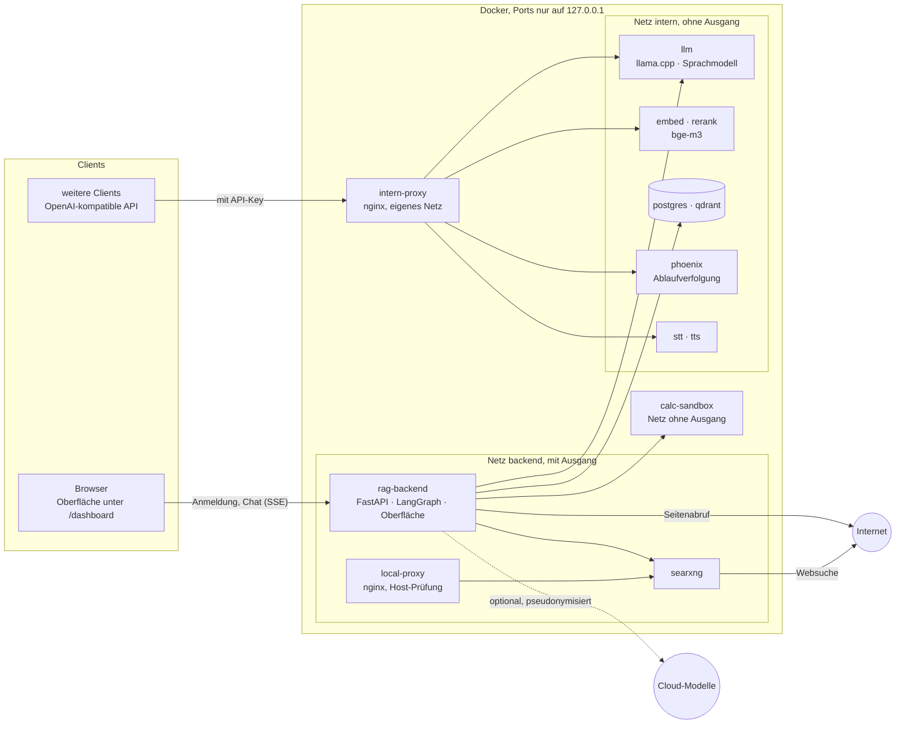

# Argus

*Deutsch · [English](README.md)*

**Ein KI-Assistent für Unterlagen, die das Haus nicht verlassen dürfen.** Argus läuft
vollständig auf eigener Hardware und wird im Browser bedient. Das Sprachmodell hat keinen
Zugang zum Internet. Sobald ein Gespräch Firmendokumente gelesen hat, ist in diesem Gespräch
jeder Weg nach außen gesperrt.


**Inhalt:** [Wofür](#wofür) · [Was heute geht](#was-heute-geht) · [Gemessen](#gemessen) ·
[Websuche](#warum-websuche-und-wie-sie-abgesichert-ist) ·
[Modell](#das-modell-ist-austauschbar) · [Was fehlt](#was-bis-zum-einsatz-fehlt) ·
[Architektur](#architektur) · [Sicherheitskonzept](#sicherheitskonzept) ·
[Einrichten](#einrichten) · [Betrieb auf einem Server](#betrieb-auf-einem-server) ·
[Dienste](#dienste) · [Stellschrauben](#stellschrauben-env) ·
[Dokumentensuche](#dokumentensuche) · [Sicherheits-Schalter](#sicherheits-schalter) ·
[Tests und Messungen](#tests-und-messungen) · [Lizenz](#lizenz)

## Wofür

Viele Firmen nutzen einen Cloud-Assistenten wie Microsoft 365 Copilot für allgemeines
internes Wissen. Unterlagen mit hohem Schutzbedarf bleiben dabei außen vor, weil sie nicht in
einen Cloud-Dienst sollen oder dürfen. Bei einem Dienstleister der Automobilindustrie ist das
ein großer Teil der täglichen Arbeit:

- Kundenunterlagen unter Geheimhaltungsvereinbarung, Lastenhefte, Zeichnungen
- Daten zu Prototypen und Vorserien
- Reklamationen, 8D-Berichte, Prüf- und Arbeitsanweisungen
- Verträge, Preise, Lieferantenbewertungen

Für diese Unterlagen gibt es heute meist gar keine KI-Unterstützung. Argus schließt die
Lücke: dieselbe Art von Assistent, aber auf einem Rechner im eigenen Netz, mit einem Modell,
das technisch nichts hinausschicken kann.

**Ein Beispiel.** Eine Qualitätsingenieurin fragt: „Was war die Ursache der Reklamation
RK-2025-0041 und welche Sofortmaßnahmen wurden beschlossen?“ Argus sucht in den
aufgenommenen Berichten und antwortet nach rund 20 Sekunden. Über der Antwort steht, in
welchen Dokumenten die Textstellen gefunden wurden (Aufnahme oben). Fragt sie im selben Gespräch nach einer Web-Recherche, lehnt
Argus ab: Dieses Gespräch hat Firmendaten gelesen, also geht aus ihm nichts mehr nach außen.
Für die Recherche beginnt sie ein neues Gespräch, in dem keine Firmendaten liegen.


Weitere Aufgaben, für die Argus gedacht ist:

- Fragen an Richtlinien, Verträge und Anweisungen, mit Quelle statt aus dem Gedächtnis
- Berichte zusammenfassen und vergleichen („Gab es dieses Fehlerbild schon einmal?“)
- Recherche zu Normen, Vorschriften und Herstellerangaben, mit Quellen
- Einarbeitung: Wer neu ist, fragt die Unterlagen statt die Kollegen

### Argus neben einem Cloud-Assistenten

Argus ersetzt einen Cloud-Assistenten nicht, es ergänzt ihn um den Teil, der dort nicht
hingehört.

| | Cloud-Assistent (z. B. Microsoft 365 Copilot) | Argus |
|---|---|---|
| Gerechnet wird | beim Anbieter | auf eigener Hardware im eigenen Netz |
| Gedacht für | allgemeines internes Wissen, Office-Alltag | Unterlagen, die nicht in eine Cloud sollen |
| Schutz vor Datenabfluss | vertraglich und durch den Anbieter | technisch: Modell ohne Internet, Sperre nach Firmendaten, bei jeder Änderung automatisch geprüft |
| Modell | vom Anbieter vorgegeben | frei wählbar und austauschbar |
| Nachvollziehbar | je nach Produkt | jeder Schritt steht im Chat, dazu Auditprotokoll und Ablaufverfolgung im eigenen Haus |
| Kosten | Lizenz je Nutzer | Hardware und Betrieb, keine Lizenz je Nutzer |
| Einbindung in Office | ja | nein |
| Reife | Produkt mit Support | Eigenentwicklung mit [offenen Punkten](#was-bis-zum-einsatz-fehlt) |

Argus ist kein TISAX-Nachweis. Es bringt die technischen Eigenschaften mit, auf die es bei
Unterlagen mit hohem Schutzbedarf ankommt, und macht sie prüfbar: Der Quelltext liegt offen,
die Netz-Abschottung wird bei jeder Änderung automatisch kontrolliert, und jede Sperre steht
im Auditprotokoll.

## Was heute geht

- **Fragen an eigene Dokumente:** PDF, Word, Excel, PowerPoint, EPUB, HTML, Text. Das Modell
  antwortet aus den gefundenen Textstellen und nicht aus dem Gedächtnis (oft „RAG“ genannt).
  Die Suche kombiniert Bedeutung (bge-m3) und Stichworte (BM25) und bewertet die Treffer mit
  einem Reranker. Kennungen wie `RK-2025-0041` oder Teilenummern trifft sie wörtlich.
  Über der Antwort steht, in welchen Dokumenten die Textstellen gefunden wurden. Diese Angabe
  kommt aus der Suche, nicht aus dem Text des Modells, kann also nicht erfunden sein.
- **Web-Recherche** mit Quellen über eine eigene Suchinstanz, getrennt von Gesprächen mit
  Firmendaten ([Absicherung](#warum-websuche-und-wie-sie-abgesichert-ist)).
- **Datei in den Chat ziehen oder anhängen:** Eine PDF, eine Tabelle oder ein anderes Dokument
  landet im eigenen Bereich des Kontos, Argus liest es und arbeitet damit. Ein Gespräch mit
  beigelegter Datei gilt sofort als Gespräch mit Firmendaten. Jedes Konto sieht nur seine
  eigenen Dateien, auch Administratoren sehen die Dateien anderer nicht.
- **Rechnen und Auswerten** in einer abgeschotteten Sandbox ohne Netz (Python, Tabellen). Sie
  bekommt nur die Dateien des eigenen Kontos.
- **Ergebnisse herunterladen:** Berichte, Tabellen und andere Dateien, die Argus erzeugt,
  stehen über der Antwort zum Herunterladen bereit und unter *Meine Dateien*. Dateien und
  Ergebnisse werden nach sieben Tagen gelöscht (`USER_FILES_RETENTION_HOURS`), je Konto stehen
  500 MB zur Verfügung (`USER_FILES_MAX_MB`).
- **Sprache:** Spracherkennung (Whisper) und Sprachausgabe, beides lokal.
- **Konten und Rollen:** Administratoren verwalten Dokumente und Konten und sehen den Monitor.
  Benutzer fragen, suchen in den Dokumenten und recherchieren. Argus spricht jede Person mit
  ihrem Namen an.
- **Nachvollziehbarkeit:** Jeder Werkzeugschritt steht im Chat, jede Anfrage als Ablauf in
  Phoenix (im eigenen Haus, Inhalte geschwärzt), sicherheitsrelevante Ereignisse im
  Auditprotokoll.


*Die Aufnahmen zeigen den Stand dieses Repos mit dem Modell Qwen3.6-35B-A3B. Dokumente,
Firmen und Namen darin sind erfunden (`eval/retrieval/corpus`).*

## Gemessen

Alle Werte stammen vom selben Rechner: ein PC mit einer Grafikkarte (RTX 5070 Ti, 16 GB),
Modell Qwen3.6-35B-A3B. Die Messungen liegen im Repo und lassen sich wiederholen.

| Was | Wert | Wie gemessen |
|---|---|---|
| Dokumentensuche: richtiges Dokument an erster Stelle | 96 % (vor dem Umbau 67 %) | 60 Fragen an 30 Dokumente, `eval/retrieval` |
| Dauer einer Dokumentensuche | 3,5 s (vorher 19,9 s) | ebenda, Suche und Bewertung auf der CPU |
| Aufgaben, die der ganze Agent richtig löst | 88 von 96 | 32 Aufgaben mit je 3 Durchläufen gegen den echten Agenten, `eval/agent` |
| Dauer je Aufgabe | 23 s im Median | ebenda |
| Schreibtempo des Modells | 79 Token je Sekunde, bei zwei Anfragen gleichzeitig je 47 | `bench.sh` im Container |
| Text, den eine Anfrage fassen kann | 72.000 Token, rund 100 Seiten | Einstellung `LLM_CTX_PER_SLOT` |
| Automatische Tests | 300 für das Backend, 36 für die Rechen- und Code-Sandbox | bei jeder Änderung im CI, zusammen mit der Prüfung der Netz-Abschottung |

Die Aufgaben der Agenten-Messung prüfen unter anderem, ob Argus interne Fragen aus den
Dokumenten beantwortet statt aus dem Gedächtnis, ob es Internes nicht im Web sucht und ob es
sich von eingeschleusten Anweisungen in Dokumenten nicht lenken lässt.

## Warum Websuche, und wie sie abgesichert ist

Das Wissen eines Sprachmodells endet mit seinem Training. Normen, Vorschriften,
Herstellerangaben und alles Aktuelle kennt es nicht oder nur veraltet, und ohne Zugriff auf
Quellen neigt es dazu, Lücken zu füllen. Mit der Websuche belegt Argus solche Antworten mit
Quellen. Dabei gilt:

- **Das Modell selbst hat kein Internet.** Es läuft in einem Netz ohne Ausgang. Suchen und
  Seiten abrufen kann nur das Backend.
- **Eigene Suchinstanz.** Gesucht wird über SearXNG im eigenen Stapel, ohne Konto und ohne
  Profil bei einer Suchmaschine. Bei einer Recherche gehen die Suchbegriffe und die Adressen
  der abgerufenen Seiten nach außen.
- **Gespräche mit Firmendaten können nicht suchen.** Hat ein Gespräch ein Dokument oder eine
  Datei gelesen oder wurde ihm eine Datei beigelegt, sind Websuche, Seitenabruf und alle
  anderen Wege nach außen darin gesperrt. Ein abgewiesener Versuch steht mit einem Schloss
  im Chat.
  Das verhindert, dass eine präparierte Webseite oder ein präpariertes Dokument das Modell
  dazu bringt, Inhalte über eine Suchanfrage hinauszutragen.
- **Internes wird nicht im Web gesucht.** Eine feste Regel schickt Fragen nach Richtlinien,
  Verträgen, Preisen und Datenblättern zuerst in die Dokumente.
- **Fremde Inhalte werden geprüft.** Jede geladene Seite läuft durch eine Prüfung auf
  eingeschleuste Anweisungen. Der Seitenabruf erreicht keine internen Adressen, auch nicht
  über Weiterleitungen.
- **Köder-Schlüssel.** Taucht einer der hinterlegten Köder in einer Suchanfrage oder Adresse
  auf, wird die Anfrage blockiert und im Audit vermerkt.

Was bleibt: Was jemand selbst in ein Recherche-Gespräch tippt, kann als Suchbegriff
hinausgehen, wie bei einer Suche von Hand. Einen Schalter, der die Websuche ganz abstellt,
gibt es noch nicht.

## Das Modell ist austauschbar

Argus hängt an keinem bestimmten Modell. Der Modell-Dienst lädt eine Modelldatei (GGUF), das
Backend spricht ihn über eine genormte Schnittstelle an. Ein Wechsel heißt: andere Datei in
den Modellordner, zwei Zeilen in der `.env` (`LLM_MODEL_FILE`, `OAI_MODEL`). Welches Modell
eine Firma zulässt, ist damit ihre Entscheidung, etwa nach Herkunft oder Lizenz.

| Modell | Lizenz | Bilder als Eingabe | Anmerkung |
|---|---|---|---|
| Qwen3.6-35B-A3B (Alibaba) | Apache 2.0 | ja | Damit sind alle Werte oben gemessen. |
| Gemma 4, 26B oder 31B (Google) | Apache 2.0 | ja | |
| Mistral Small 3.2, 24B (Mistral AI, Frankreich) | Apache 2.0 | ja | europäischer Anbieter |
| Llama 4 (Meta) | Llama 4 Community License | ja | Die Nutzungsbedingungen nehmen Firmen mit Hauptsitz in der EU von den Rechten an den multimodalen Modellen aus. Vor einem Einsatz rechtlich prüfen. |

Lizenzangaben nach den Modellkarten der Anbieter, Stand November 2026; vor einem Einsatz
prüfen. Gemessen ist bisher nur Qwen3.6-35B-A3B.

**Wie gut ist ein Modell?** Das sagt bei Argus eine Messung und keine Behauptung: Die
Agenten-Messung (`eval/agent`) läuft in etwa einer Stunde gegen ein beliebiges Modell und
liefert dieselbe Tabelle wie oben. So lässt sich ein Ersatzmodell vor dem Wechsel mit dem
bisherigen vergleichen. Ein Modell dieser Größe ist schwächer als die großen Cloud-Modelle,
vor allem bei langen Aufgaben mit vielen Schritten. Für Fragen an Dokumente,
Zusammenfassungen und Recherche mit Quellen reicht es, wie die Werte oben zeigen.

**Bilder im Chat:** Oberfläche und Backend können Bilder an das Modell weitergeben
(`LLM_ENABLE_MULTIMODAL`). Der Modell-Dienst lädt die dafür nötige Zusatzdatei (mmproj) noch
nicht; Bildeingabe ist deshalb aus und nicht getestet.

## Was bis zum Einsatz fehlt

Argus läuft und ist gemessen, aber bisher auf einem einzelnen Rechner. Für einen Betrieb mit
vielen Personen fehlen vor allem:

- **Anmeldung über das Firmenverzeichnis (SSO)** statt eigener Konten.
- **Rechte der Quellen:** Die Wissensbasis ist für alle Konten dieselbe.
- **Betrieb:** ein TLS-Proxy und ein Modell-Dienst für viele gleichzeitige Nutzer. Eine
  geführte Installation gibt es (siehe [Einrichten](#einrichten)).

Die vollständige Liste steht unter
[Offen für einen Einsatz im Unternehmen](#offen-für-einen-einsatz-im-unternehmen).

## Aufbau des Repos

| Ordner | Inhalt |
|---|---|
| `rag_backend/` | Backend: FastAPI, LangGraph-Agent, Dokumentensuche, Freigaben, Audit |
| `rag_backend/static/` | Browser-Oberfläche (reines HTML, CSS, JavaScript, ohne Build-Schritt) |
| `alembic/` | Datenbank-Migrationen |
| `docker-compose.yml` | der Stapel |
| `setup/` | Einrichtung (`init_stack.py`), Prüfung der Netze (`check_networks.py`) |
| `stt_service/`, `tts_service/`, `calc_sandbox/` | Sprache und abgeschottete Code-Ausführung |
| `local_proxy/`, `searxng_config/` | die beiden Proxys auf 127.0.0.1, Websuche |
| `eval/` | Messungen: Dokumentensuche (`retrieval/`) und ganzer Agent (`agent/`) |

## Architektur



## Sicherheitskonzept

**Grundsatz:** Das Modell ist ein nicht vertrauenswürdiger Baustein. Prompt Injection lässt
sich im Modell nicht zuverlässig verhindern. Deshalb hängt die Sicherheit an Rechten,
Freigaben und Abschottung, nicht daran, dass sich das Modell richtig verhält.

**Kein Weg auf einen Rechner.** Argus kann nichts auf einem Computer ausführen: Es gibt
kein Admin-Konto, keine Zugangsdaten für einen Host in einem Container und keinen Schalter,
der das ändert. Code läuft nur in der Sandbox ohne Netz.

**Zwei Rollen:**

| | Benutzer | Administrator |
|---|---|---|
| Fragen, Dokumente durchsuchen, im Web recherchieren, rechnen, Sprache | ja | ja |
| Eigene Chats | nur die eigenen | nur die eigenen |
| Dokumente hochladen, in die Wissensbasis aufnehmen, löschen | nein | ja |
| Eigene Dateien in den Chat geben, auswerten, Ergebnisse herunterladen | ja | ja |
| Dateien anderer Konten | nein | nein |
| Konten anlegen, Monitor, Audit, Ablaufverfolgung | nein | ja |
| Cloud-Modelle (nur mit Cloud-Modul) | nein | ja |

**Schichten:**
- **Netze:** Ins Internet kommen nur `rag-backend` (Websuche, Seitenabruf, optional Cloud) und
  SearXNG. Modell, Einbettung, Reranker, Datenbanken, Sprache und Phoenix hängen im Netz
  `intern` ohne Ausgang. Sie erreichen weder das Internet noch SearXNG, laden also nichts nach
  und können nichts hinausschicken, auch wenn einer von ihnen kompromittiert wäre.
  `intern-proxy` leitet nur an Ziele in `intern` weiter und teilt sein Netz zum
  Veröffentlichen der Ports mit keinem anderen Dienst, damit er keine Brücke wird. Die
  Code-Ausführung hat ein eigenes Netz ohne Ausgang. `setup/check_networks.py` prüft diese
  Regeln bei jedem Push im CI.
- **Sperre nach Firmendaten:** Gefährlich wird ein Agent, der zugleich Firmendaten liest,
  fremde Inhalte verarbeitet und nach außen senden kann. Dann kann eine präparierte Seite ihn
  dazu bringen, Daten über eine Suchanfrage abfließen zu lassen. Liest ein Gespräch
  Firmendaten, ist darin jeder Weg nach außen gesperrt (`EGRESS_AFTER_SENSITIVE=block`):
  Websuche, Seitenabruf, Wetter, Routen, Cloud-Modelle, Missionen und fremde MCP-Werkzeuge.
  Als Firmendaten zählen Dokumentensuche und -abruf, Dateien und die Code-Sandbox (sie bekommt
  die Dateien des Kontos). Eine beigelegte Datei zählt schon, bevor sie gelesen ist: Nennt
  eine Nachricht eine Datei aus dem eigenen Bereich, gilt das Gespräch von da an als
  Gespräch mit Firmendaten. Abgewiesene Schritte stehen mit einem Schloss im Chat. Die
  Sperre gilt auch für Unteragenten und bleibt nach einem
  Neustart bestehen. Jede Sperre landet im Audit, ohne Inhalte. Für eine
  Recherche beginnt man ein neues Gespräch.
- **Fremde Inhalte:** Websuche und Seitenabruf laufen durch eine Injection-Prüfung
  (`WEB_INJECTION_GUARD`). Der Seitenabruf sperrt interne Adressen, auch nach Weiterleitungen.
- **Rollen:** Geprüft wird an jeder Route im Backend, nicht in der Oberfläche. Benutzer
  bekommen die Werkzeuge für Cloud, Unteragenten und die Wissensbasis gar nicht erst
  angeboten, und der Prompt beschreibt sie ihnen nicht.
- **Bereich je Konto:** Hochgeladene Dateien und Ergebnisse liegen unter
  `users/<Konto>/Dateien` und `users/<Konto>/Ergebnisse` im Arbeitsordner. Jeder Zugriff
  (Oberfläche, Download, Werkzeuge) läuft über eine Stelle (`rag_backend/user_files.py`), die
  Namen bereinigt, den Pfad auf genau diesen Ordner festlegt und Verknüpfungen ablehnt. Auch
  Administratoren erreichen über ihre Werkzeuge keine fremden Bereiche. Die Code-Sandbox
  bindet den Arbeitsordner nicht mehr ein: Das Backend schickt ihr nur die Dateien des Kontos,
  sie führt die Läufe nacheinander aus und löscht danach alles, auch zurückgebliebene
  Prozesse.
- **Freigaben:** Mit dem Cloud-Modul fragt eine Mission vor dem Versand per Karte im Chat
  nach. Freigeben kann nur das Konto, das sie ausgelöst hat.
- **Anmeldung:** Sitzung als HttpOnly-Cookie, Passwörter mit Argon2, keine
  Selbstregistrierung, Sperre nach fünf Fehlversuchen. Abmelden und Passwortwechsel beenden
  alle Sitzungen des Kontos. Das erste Administrator-Konto legt nur an, wer den
  Einrichtungs-Schlüssel der Installation kennt (`DASHBOARD_SETUP_TOKEN`).
- **Oberfläche:** Die Seite lädt nichts von fremden Hosts (Schriften und Skripte liegen im
  Repo). Content-Security-Policy, Prüfung von Host- und Origin-Header gegen DNS-Rebinding und
  CSRF. Text des Modells wird vor der Anzeige maskiert.
- **Köder-Schlüssel** (`CANARY_TOKENS`) in einer nie gebrauchten Datei. Taucht einer in einer
  Cloud-Anfrage, Websuche, URL oder in Werkzeug-Parametern auf, wird blockiert und gewarnt.
- **Ablaufverfolgung:** Phoenix bekommt Prompts und Antworten nur geschwärzt (Schlüssel,
  Tokens, E-Mail, IBAN, Telefon, interne Adressen, Begriffe der PII-Liste). Mit
  `TRACE_CONTENT=metadata` gehen nur Ablauf, Dauer, Token-Zahlen und Werkzeugnamen hin.
  Scheitert die Schwärzung, wird nichts gesendet.
- **Cloud-Modelle** sind aus (`CLOUD_AGENTS_ENABLED=false`). Eingeschaltet bekommen sie nur
  geschwärzte Texte, ein PII-Stopp blockiert, wenn die Schwärzung nicht greift, und ohne
  `CLOUD_MISSION_AUTO_APPROVE=true` fragt jeder Versand nach.
- **Container:** Ports nur auf `127.0.0.1`, `cap_drop: ALL`, `no-new-privileges`, Speicher- und
  Prozessgrenzen (das Modell bewusst ohne Speichergrenze, siehe Compose). Die Code-Ausführung
  hat keine Einbindung des Arbeitsordners und keine Geheimnisse. Basis-Images sind per Digest festgelegt, Migrationen
  schreibgeschützt eingebunden.
- **Geheimnisse** liegen nie im Repo, sondern in `API_Tokens/` mit Rechten nur für den Besitzer.

### Offen für einen Einsatz im Unternehmen

Diese Punkte sind bekannt und noch nicht gelöst. Wer Argus mit mehreren Personen betreibt,
sollte sie kennen.

- **Dateien bleiben lesbar für den Server:** Die Bereiche je Konto trennen die Konten in
  Argus. Wer den Server oder Docker bedienen darf, liest sie trotzdem. Eine Verschlüsselung je
  Konto gibt es nicht.
- **Rechte der Quellen:** Die Dokumentensuche kennt eine gemeinsame Wissensbasis. Für Firmen
  müsste sie die Rechte der Quelle mitprüfen (etwa SharePoint). Die Anmeldung läuft über
  eigene Konten, nicht über SSO (OIDC).
- **Cloud-Missionen:** Erkennt der Router eine Nachricht eines Administrators als
  Hintergrund-Auftrag, startet er die Mission ohne Karte im Chat (Schwärzung und PII-Stopp
  laufen trotzdem). Betrifft nur Installationen mit Cloud-Modul.
- **Seitenabruf ohne Größengrenze:** Eine sehr große Antwort wird ganz in den Speicher
  geladen, bevor sie gekürzt wird.
- **Langzeitgedächtnis:** Die Zusammenfassung je Konto wird im normalen Chat derzeit nicht
  fortgeschrieben.
- **Prompts:** Ton und Beispiele der Vorgaben stammen aus einem persönlichen Assistenten und
  sind noch nicht auf den Firmeneinsatz umgeschrieben. Die Anrede leitet sich aus dem
  Kontonamen ab; mit SSO käme der Name aus dem Verzeichnis.
- **Audit:** Ein Administrator kann das Protokoll in der Datenbank leeren (das Leeren wird
  vermerkt). Anmeldungen und Kontoänderungen stehen nicht im Audit, eine Ausgabe für ein SIEM
  fehlt.
- **Betrieb:** Der Stapel bringt keinen TLS-Proxy mit. Hinter einem Proxy teilen sich alle
  Nutzer ein Ratenlimit, weil nach Adresse gezählt wird. Wer Docker auf dem Server bedienen
  darf, hat dort praktisch Admin-Rechte.
- **Lizenzen als Module:** Websuche (SearXNG, AGPL) und Ablaufverfolgung (Phoenix, Elastic
  License) gehören fest zum Stapel. Für ein Angebot an Dritte sollten beide abschaltbar oder
  austauschbar sein.
- **Lieferkette:** Python-Pakete haben keine Lock-Datei, drei Images installieren Pakete ohne
  feste Version. Die Modelle prüft die Installation per SHA-256, wer sie von Hand ablegt,
  prüft selbst.
- **Installation unter Linux:** `install.sh` ist nur in Teilen getestet (Syntax,
  ShellCheck, die Schritte in Python unter Windows), noch nicht auf einem Linux-Server.
- **Bilder im Chat:** Oberfläche und Backend können Bilder an das Modell weitergeben
  (`LLM_ENABLE_MULTIMODAL`). Der Modell-Dienst lädt die dafür nötige Zusatzdatei (mmproj)
  noch nicht; Bildeingabe ist aus und nicht getestet.
- **Websuche abschalten:** Einen Schalter, der die Websuche ganz abstellt, gibt es nicht.
- **Grenzen der Sperre:** Vom Nutzer selbst eingefügte Bilder und Texte zählen nicht als
  Firmendaten. Der Modus `allow` vergleicht nur Fingerabdrücke (Kennungen, E-Mail, IBAN,
  Wortfolgen). Umkodierte Daten (etwa Base64) erkennt er nicht, er ist also kein Schutz gegen
  einen gezielten Angriff.

## Einrichten

Getestet unter Windows 11 mit Docker Desktop (WSL2). Linux mit Docker Engine und dem NVIDIA
Container Toolkit ist vorgesehen, aber noch nicht auf echter Hardware durchgetestet.

**Voraussetzungen:** eine NVIDIA-Karte (gemessen mit 16 GB), 32 GB Arbeitsspeicher, rund
30 GB Platz für die Modelle.

### Geführte Installation

Unter Windows `install.cmd` per Doppelklick starten, unter Linux `./install.sh`. Die
Installation führt durch diese Schritte:

1. **Python** ab 3.10 suchen. Fehlt es, fragt sie und installiert Python 3.13 über `winget`
   (Windows) oder `apt-get` (Debian, Ubuntu).
2. **Docker** prüfen. Unter Windows bietet sie an, Docker Desktop und WSL über `winget` zu
   installieren, und startet Docker Desktop, wenn es nicht läuft. Unter Linux nennt sie die
   Anleitung und prüft das NVIDIA Container Toolkit, installiert aber nichts selbst.
3. **Grafikkarte und Arbeitsspeicher** prüfen und vor zu wenig davon warnen.
4. **Fragen:** Arbeitsordner, Modellordner, Betrieb nur auf diesem Rechner oder als Server
   (dann mit Adresse, siehe [Betrieb auf einem Server](#betrieb-auf-einem-server)).
5. **Geheimnisse und `.env`** anlegen (`setup/init_stack.py`, in einer eigenen Umgebung
   `.venv-setup`). Ausgegeben werden nur Dateinamen, keine Werte.
6. **Modelle laden** (rund 25 GB): jede Datei aus `setup/models.json`, festgelegt auf eine
   Revision bei Hugging Face und nach dem Laden per SHA-256 geprüft. Abgebrochene Downloads
   setzen beim nächsten Lauf fort. Vorhandene Dateien werden nur geprüft.
7. **Stapel bauen und starten** und warten, bis Argus antwortet. Am Ende kopiert sie unter
   Windows auf Wunsch den Einrichtungs-Schlüssel in die Zwischenablage und öffnet den Browser.

Jeder Schritt fragt vorher. Ein zweiter Lauf ist harmlos: Vorhandenes bleibt, wie es ist.
Optionen: `--yes` (alle Vorgaben annehmen), `--workspace`, `--models`, `--server-url`,
`--no-models`, `--no-start`, `--models-only` (nur Modelle prüfen und laden).

`install.cmd` ist ein reines Batch-Skript ohne PowerShell und startet `setup/install.py`. Eine
EXE gibt es bewusst nicht: Ein lesbares Skript lässt sich prüfen, und unsignierte EXE-Dateien
fallen bei Endpoint-Schutz wie CrowdStrike eher auf.

**Erstes Konto:** `http://127.0.0.1:7860` öffnen. Die Seite fragt nach Benutzername,
Passwort und dem Einrichtungs-Schlüssel (in der `.env` unter `DASHBOARD_SETUP_TOKEN`). Dieses
Konto wird Administrator und legt weitere Konten unter *Monitor › Konten* an.

**Dokumente:** Als Administrator Dateien im Monitor hochladen, dann unter *Monitor ›
Überblick* „Ingest starten“. Zum Ausprobieren eignen sich die 30 erfundenen Dokumente in
`eval/retrieval/corpus`.

### Von Hand

1. `python -m pip install cryptography`, dann `python setup/init_stack.py` (mit
   `--workspace` und `--models` für andere Ordner als `C:\Argus_Workspace` und
   `C:\Argus_Models`). Legt `API_Tokens/` und die `.env` an.
2. `.env` prüfen: Modell und `LLM_N_CPU_MOE` passend zur Grafikkarte.
3. Die Modelle aus `setup/models.json` nach `ARGUS_MODELS_DIR` legen (Repo, Revision, Datei
   und Prüfsumme stehen dort). Die Dienste hängen in einem Netz ohne Ausgang und laden selbst
   nichts nach.
4. `docker compose up -d --build`. Der erste Bau dauert, weil der Sprachdienst seine Modelle
   (4,4 GB) lädt und übersetzt.

## Betrieb auf einem Server

Für mehrere Personen läuft Argus auf einem Server, die Nutzer brauchen nur einen Browser.
Dafür gehört ein Reverse-Proxy mit TLS vor Port 7860 (im Stapel nicht enthalten). In der
`.env`:

| Schalter | Wert |
|---|---|
| `DASHBOARD_ORIGINS` | Adresse der Oberfläche, z. B. `https://argus.example.org` |
| `TRUSTED_HOSTS` | derselbe Name zusätzlich zu `127.0.0.1,localhost,rag-backend` |
| `DASHBOARD_TRACES_URL` | Adresse, unter der der Browser Phoenix erreicht; leer zeigt der Reiter nur einen Hinweis |

Der Proxy muss `X-Forwarded-Proto` setzen, damit das Sitzungs-Cookie als `Secure` gesetzt
wird. Für einen Server mit vielen gleichzeitigen Nutzern ist llama.cpp nicht die erste Wahl.
Das Backend spricht das Modell über eine OpenAI-kompatible Schnittstelle an (`OAI_BASE_URL`);
ein Betrieb mit vLLM oder SGLang ist damit vorgesehen, mit diesem Stand aber nicht getestet.
Die offenen Punkte oben gelten.

## Dienste

| Dienst | Aufgabe |
|---|---|
| `rag-backend` | Oberfläche und API (Anmeldung, Chats, Uploads, Websuche, Sprache), Port 127.0.0.1:7860 |
| `llm` | llama.cpp mit dem Sprachmodell (GGUF); für Clients 127.0.0.1:30000 |
| `embed`, `rerank` | bge-m3 und bge-reranker-v2-m3 (GGUF) auf der CPU für die Dokumentensuche; für Clients 127.0.0.1:30001 und :30002 |
| `postgres`, `qdrant` | Chats und Konten; Abschnitte mit dichtem Vektor und BM25-Sparse-Vektor |
| `searxng` | Websuche; Clients erreichen sie über `local-proxy` auf `127.0.0.1:8888` |
| `phoenix` | lokale Ablaufverfolgung; UI und Empfang über `intern-proxy` auf `127.0.0.1:6006` |
| `stt-service`, `tts-service` | Spracherkennung (Whisper), Sprachausgabe; für Clients 127.0.0.1:8003 und :8002, mit API-Key |
| `local-proxy` | nginx vor SearXNG: lässt nur Anfragen an `localhost`/`127.0.0.1` durch, sonst 421 (Schutz gegen DNS-Rebinding) |
| `intern-proxy` | nginx vor den Diensten im Netz `intern`: Phoenix mit derselben Host-Prüfung, Modell, Einbettung, Reranker und Sprache als TCP-Durchreichung |
| `calc-sandbox` | abgeschottete Code-Ausführung |

Clients außerhalb des Browsers brauchen den Modell-Schlüssel aus `API_Tokens/llm_api_key.txt`.

## Stellschrauben (`.env`)

Das Modell ist eine GGUF-Datei und austauschbar (`LLM_MODEL_FILE`, `OAI_MODEL`). Gemessen ist
bisher nur Qwen3.6-35B-A3B; die Werte unten gelten für dieses Modell auf einer 16-GB-Karte.

- `LLM_N_CPU_MOE=25` – Schichten, deren Experten im RAM liegen (nur Modelle mit Experten,
  MoE). Mit MTP ~14,9 GB VRAM. Bei 16 lief der VRAM über (Windows lagert dann aus:
  ~3 Token/s, Absturz); unter ~15,3 GB bleiben.
- `LLM_CTX_SIZE=102400`, `LLM_PARALLEL=2` – gemeinsamer Kontext-Pool für zwei gleichzeitige
  Anfragen (`--kv-unified`).
- `LLM_CTX_PER_SLOT=72000` – Obergrenze je Platz, damit der andere mindestens ~30k behält.
  `/props` meldet dann `n_ctx = 72000`; das Backend liest sein Budget daraus.
- `LLM_MTP=true`, `LLM_MTP_DRAFT=3` – spekulatives Dekodieren über den MTP-Kopf des Modells.

Messung (RTX 5070 Ti 16 GB, DDR5-6200, n-cpu-moe 25, MTP 3):

| | ohne MTP | mit MTP |
|---|---|---|
| Ausgabe, kurzer Prompt | 56 Token/s | 79 Token/s |
| Ausgabe nach 60k Kontext | – | 70 Token/s (57 % Entwürfe angenommen) |
| Einlesen | ~2900 Token/s | ~2800 Token/s |
| zwei Anfragen gleichzeitig | – | je ~47 Token/s |

`bench.sh`, `bench2.sh` und `bench3.sh` messen das im Container (`docker cp` + `docker exec`).

## Dokumentensuche

`document_search` sucht hybrid (`rag_backend/retrieval.py`):
1. Der Container `embed` bettet die Frage mit bge-m3 ein. Unabhängig davon wird sie in
   Stichworte zerlegt, Kennungen wie `HA-40817-K` auch am Stück.
2. Qdrant liefert je 40 Kandidaten aus Vektor- und Stichwortsuche (BM25 als Sparse-Vektor, die
   IDF rechnet Qdrant) und führt beide per Reciprocal Rank Fusion zusammen.
3. Die besten 12 bewertet bge-reranker-v2-m3 im Container `rerank`. Treffer unter der
   Schwelle fallen weg, höchstens 5 gehen an das Modell.

Jeder Abschnitt trägt den Dateinamen als Kopfzeile, damit Fragen nach einem Dokument beim
Namen treffen. Fällt `embed` oder `rerank` aus, sucht der Rest weiter und das Ergebnis sagt
es dem Modell. Das Backend lädt selbst keine Modelle (kein PyTorch, kein Hugging-Face-Token).

| Schalter | Standard | Wirkung |
|---|---|---|
| `HARD_MIN_SCORE` | `0.05` | Mindestwert des Rerankers (0..1). Gemessen in `eval/retrieval`: richtige Treffer ab ~0,02, themenfremde Fragen meist darunter. |
| `RERANK_CANDIDATES` | `12` | Kandidaten für den Reranker. Bestimmt die Dauer (12: ~3,5 s auf der CPU). |
| `K_PER_METHOD` | `40` | Vorauswahl je Verfahren (Vektor, Stichworte). |
| `K_RERANKED` | `5` | Treffer, die an das Modell gehen. |

Messung vorher/nachher (60 Fragen, 30 erfundene Dokumente, `eval/retrieval/README.md`):
richtiges Dokument an erster Stelle 67 % → 96 %, Suche ohne Treffer trotz Antwort im Bestand
25 % → 2 %, Dauer je Suche 19,9 s → 3,5 s.

## Agent und Prompts

Der Systemprompt setzt sich aus drei Dateien zusammen: `SOUL.md` (Haltung, Ton),
`SKILL.md` (Werkzeuge) und `AGENTS.md` (Arbeitsweise). Die Vorgaben liegen versioniert in
`rag_backend/prompts/identity/`. Eine gleichnamige Datei in `<Arbeitsordner>/identity/` ersetzt
die Vorgabe. Abschnitte zu einem Werkzeug erscheinen nur, wenn das angemeldete Konto es hat;
`{{OWNER}}` ist die angemeldete Person. Eigene Dateien können dieselben Platzhalter benutzen
(`{{OWNER}}`, `{{#tool:NAME}}…{{/tool:NAME}}`, Beschreibung in
`rag_backend/prompts/__init__.py`).

Unabhängig von den Dateien hängt das Backend eine Regel für interne Fragen an: Richtlinien,
Verträge, Preise und Datenblätter erst in den Dokumenten suchen, keine Zahlen selbst
einsetzen, Internes nicht im Web suchen. Die Dokumentsuche wird dem Modell immer angeboten,
auch wenn der Router auf Web-Recherche tippt. Je Frage laufen höchstens zwei Recherchen
(`RESEARCH_CALLS_PER_TURN`), je Recherche-Unteragent höchstens acht Websuchen
(`SUBAGENT_MAX_SEARCHES`).

Gemessen mit `eval/agent` (32 Aufgaben gegen den echten Agenten und das echte Modell, je 3
Runden, Details in `eval/agent/README.md`):

| Stand | Hauptaufgaben | Median je Aufgabe | Zurückgehaltene Kontrollaufgaben |
|---|---|---|---|
| Ausgang | 7 von 17 | 155 s, 4 × Zeitlimit | – |
| Router, Deckel | 61 von 78 | 16 s | 10 von 18 |
| plus Regel, Vorgaben aus dem Repo | 73 von 78 | 23 s | 15 von 18 |

## Sicherheits-Schalter

Alle per `.env` änderbar:

| Schalter | Standard | Wirkung |
|---|---|---|
| `DASHBOARD_SETUP_TOKEN` | von `init_stack.py` erzeugt | Einrichtungs-Schlüssel für das erste Administrator-Konto. Leer = wer die Seite zuerst erreicht, wird Administrator. |
| `DASHBOARD_ALLOW_REGISTER` | `false` | Selbstregistrierung neuer Konten (immer als Benutzer). |
| `DASHBOARD_ORIGINS`, `TRUSTED_HOSTS` | `127.0.0.1`, `localhost` | Adressen, unter denen die Oberfläche aufgerufen werden darf (CSRF, DNS-Rebinding). |
| `DASHBOARD_TRACES_URL` | `http://127.0.0.1:6006` | Adresse von Phoenix für den Reiter *Traces*; nur diese Adresse darf die Seite einbetten. Leer = der Reiter zeigt nur einen Hinweis. |
| `EGRESS_AFTER_SENSITIVE` | `block` | Weg nach außen, nachdem ein Gespräch Firmendaten gelesen hat. `block` sperrt ihn. `allow` lässt ihn offen und sperrt nur Anfragen mit Bestandteilen der gelesenen Daten; fehlen die Fingerabdrücke (nach einem Neustart), wirkt auch `allow` wie `block`. |
| `WEB_INJECTION_GUARD` | `true` | Prüft Websuche und Seitenabruf auf eingeschleuste Anweisungen: der ganze Text in Abschnitten von 16.000 Zeichen; mehr als sechs Abschnitte gelten als verdächtig. |
| `TRACE_CONTENT` | `redacted` | Was Phoenix sieht: `redacted` (Inhalte mit geschwärzten Schlüsseln und PII) oder `metadata` (nur Ablauf, Dauer, Token-Zahlen, Werkzeugnamen). Einen Klartext-Modus gibt es nicht. |
| `CANARY_TOKENS` | von `init_stack.py` erzeugt | Köder-Schlüssel (Komma-getrennt, je ab 12 Zeichen). Taucht einer in einer Cloud-Anfrage, Websuche, URL oder in Werkzeug-Parametern auf, wird blockiert, als Fehler protokolliert und im Audit vermerkt. |
| `SEARXNG_SECRET` | von `init_stack.py` erzeugt | HMAC-Schlüssel für SearXNG. |
| `CLOUD_AGENTS_ENABLED` | `false` | Cloud-Modelle (Gemini) als Helfer. |
| `CLOUD_MISSION_AUTO_APPROVE` | `false` | Mit `true` gehen Cloud-Anfragen ohne Rückfrage raus; Schwärzung, PII-Stopp und Köder-Prüfung laufen trotzdem. In einem Gespräch mit Firmendaten nie ohne Rückfrage. |
| `API_DOCS` | `false` | Mit `true` ist die API-Beschreibung unter `/docs` erreichbar, ohne Anmeldung. |
| `AUDIT_ANCHOR_PATH` | `/app/data/audit_anchor.json` | Anker der Audit-Kette: Löschen am Ende fällt bei der Prüfung auf. |

Nach fünf Fehlversuchen ist ein Konto 15 Minuten gesperrt. `alembic/` ist schreibgeschützt
eingebunden: Die Migrationen laufen beim Start als Code.

Änderungen am Backend oder an der Oberfläche brauchen einen Neubau:
`docker compose up -d --build rag-backend`.

## Geheimnisse

`API_Tokens/`, `.env` und Stimmaufnahmen in `voice_ref/` sind per `.gitignore` ausgeschlossen.
Im Repo liegt nur `.env.example` (gut 50 Einstellungen; alles andere nimmt den Standard aus dem
Code). Werte mit `ENC:` in `API_Tokens/` sind mit `fernet_key.txt` verschlüsselt; an diesem
Schlüssel hängen auch die gespeicherten Chats. Ältere Installationen haben den Modell-Schlüssel
noch als `sglang_api_key.txt`; `init_stack.py` benennt die Datei beim nächsten Lauf um.

## Tests und Messungen

```powershell
uv pip install -r rag_backend/pyproject.toml
python -m pytest rag_backend/tests -q
```

Die Tests brauchen keine laufenden Container (SQLite, Test-Schlüssel). Sie laufen in einem
Ordner ohne `.env`, etwa in einem frischen Klon: Eine vorhandene `.env` überschreibt die
Testwerte. Lokal überspringen sie vier Tests, die nur im CI laufen.

Die Tests der Sandbox laufen in ihrem eigenen Abbild, denn nur dort räumt sie zwischen zwei
Läufen auf (Prozesse beenden, `/tmp` leeren):

```powershell
docker build -t argus-sandbox-test -f calc_sandbox/Dockerfile.sandbox calc_sandbox
docker run --rm --user root -v "${PWD}/calc_sandbox:/src" -w /src --entrypoint sh argus-sandbox-test -c "pip install -q pytest httpx && exec python -m pytest test_app.py -q"
```

Im CI laufen beide bei jedem Push auf `main`, dazu die Prüfung der Compose-Dateien, der
Netz-Abschottung und des Installers (ShellCheck). Die Messungen in `eval/` laufen gegen den echten Stapel und das
echte Modell.

## Lizenz

Argus steht unter der [Apache-Lizenz 2.0](LICENSE); der Urheberhinweis steht in
[NOTICE](NOTICE).

Argus baut auf Software, Schriften und Modellen anderer auf.
[THIRD_PARTY_NOTICES.md](THIRD_PARTY_NOTICES.md) führt sie mit ihren Lizenzen auf, getrennt
danach, ob sie im Repo liegen, beim Bauen in die Abbilder kommen oder als eigener Container
laufen. Das Wichtigste für einen Einsatz im Unternehmen:

| Baustein | Lizenz | Was das heißt |
|---|---|---|
| Eigener Code von Argus | Apache 2.0 | Nutzen, ändern und weitergeben erlaubt, auch kommerziell; Lizenz und NOTICE müssen dabeibleiben. |
| Python-Pakete des Backends | MIT, BSD, Apache 2.0, LGPL (psycopg2) | Kein Paket unter GPL oder AGPL. |
| SearXNG (Websuche) | AGPL-3.0 | Läuft unverändert als eigener Container. Wer es ändert und anderen übers Netz anbietet, muss den geänderten Quelltext anbieten. |
| Arize Phoenix (Ablaufverfolgung) | Elastic License 2.0 | Im eigenen Haus nutzbar. Nicht erlaubt: Dritten als gehosteten Dienst anbieten. Wer Argus Kunden als Dienst bereitstellt, lässt Phoenix weg oder ersetzt es. |
| FFmpeg in den Sprachdiensten | GPL (Debian-Paket) | Läuft als eigenes Programm. Wer die Abbilder weitergibt, gibt FFmpeg unter der GPL weiter. |
| Modelle | je nach Modellkarte | Vor dem Einsatz die Lizenz des gewählten Sprachmodells prüfen. |

Das ist die Einschätzung des Autors, keine Rechtsberatung.
