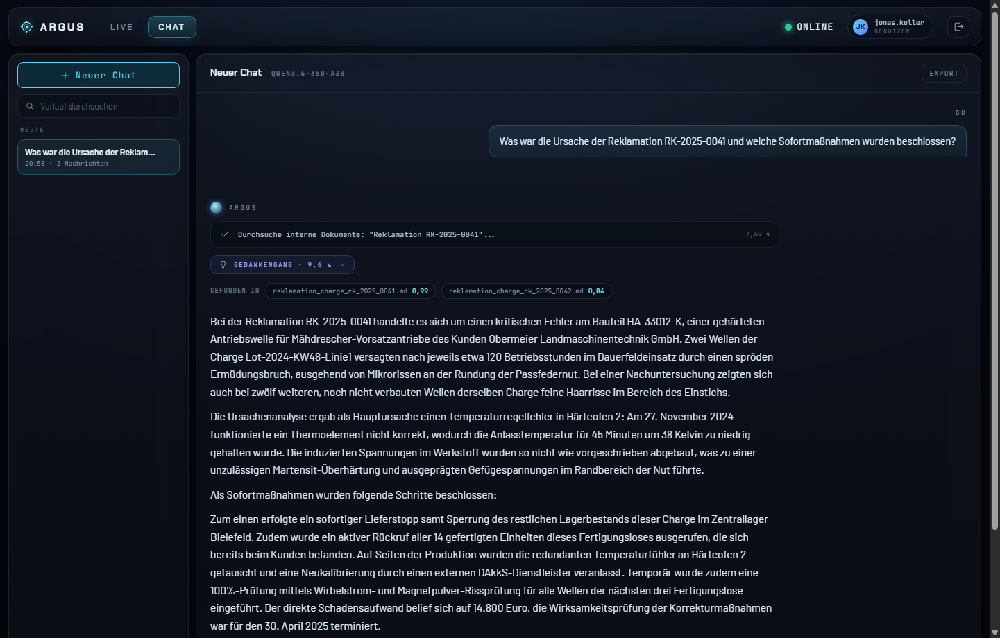
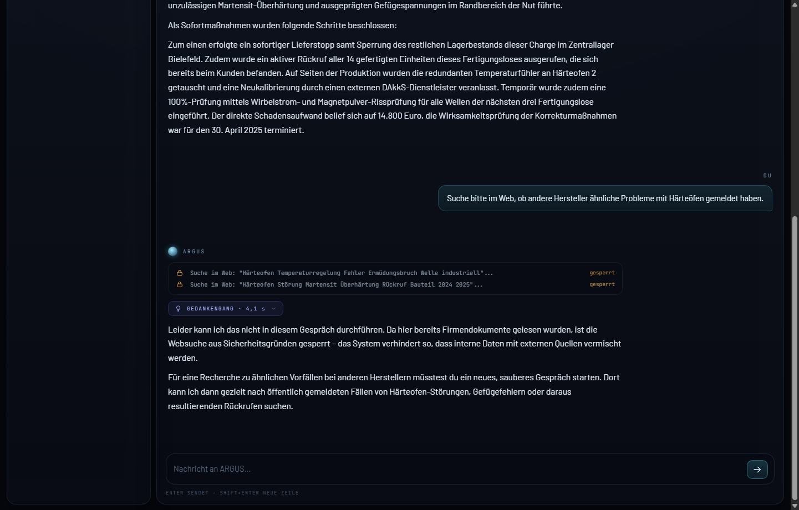
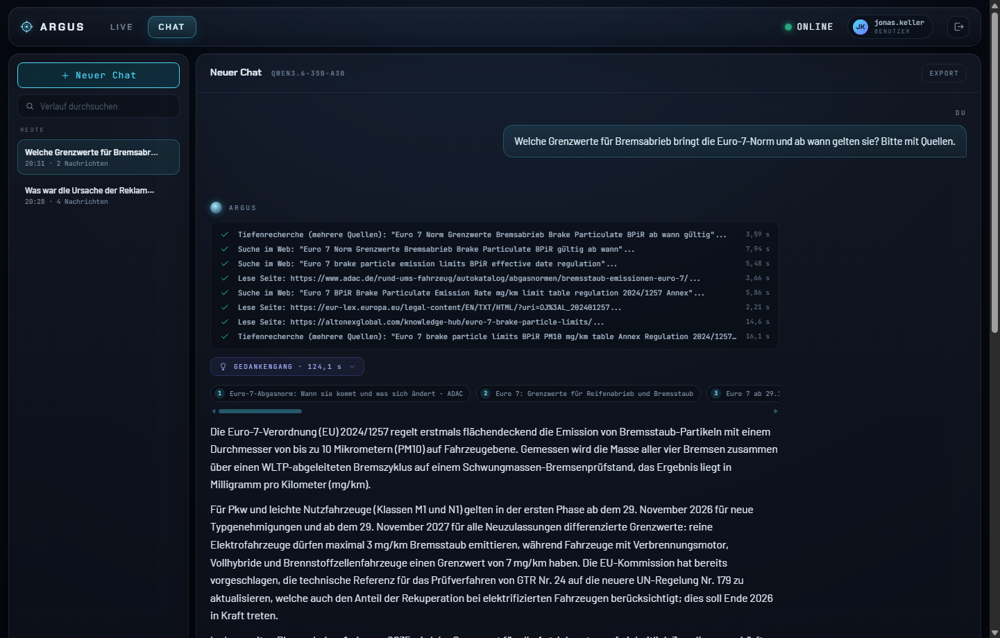
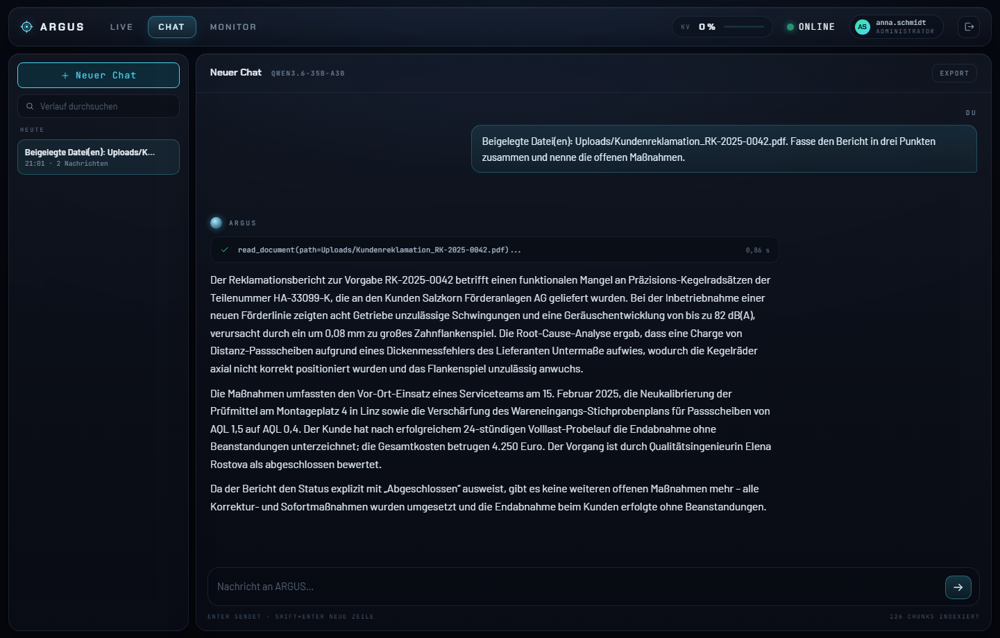
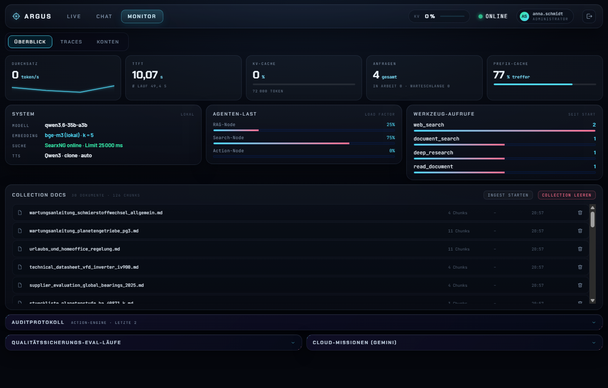
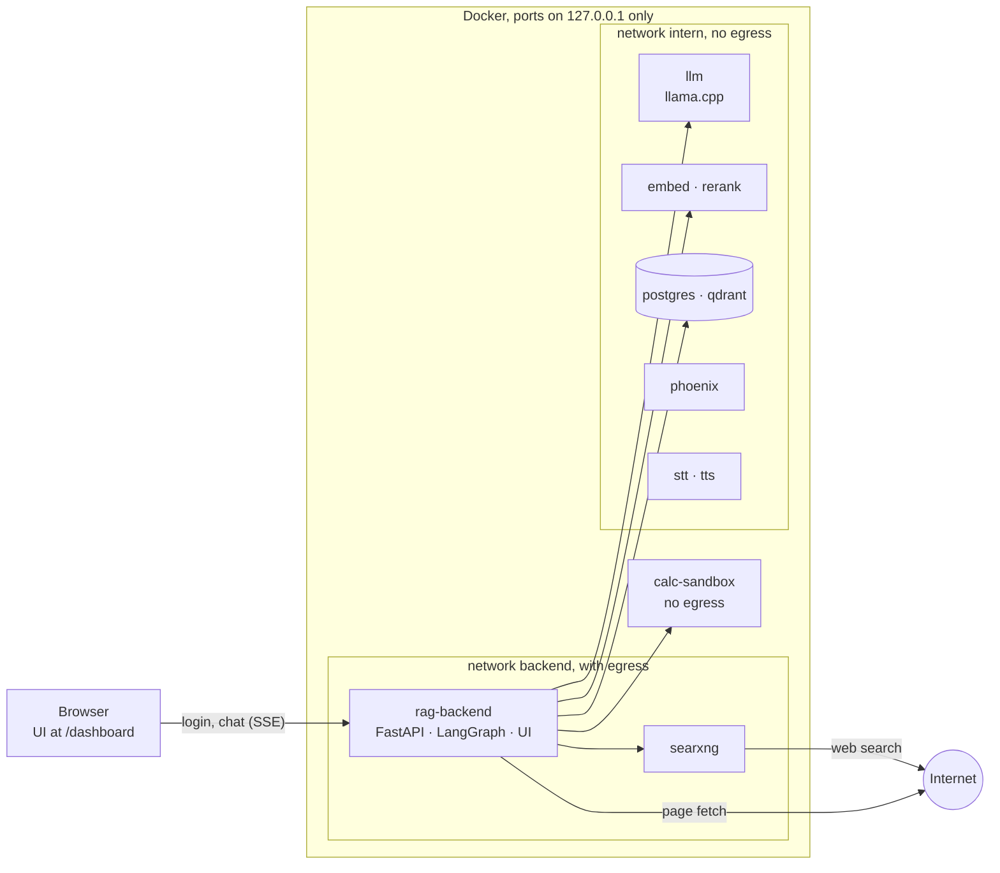

# Argus

*English · [Deutsch](README.de.md)*

**An AI assistant for documents that must not leave the building.** Argus runs entirely on
your own hardware and is used from a browser. The language model has no internet access. Once
a conversation has read company documents, every outbound path in that conversation is
blocked.



The German README is the full reference: [README.de.md](README.de.md). The interface, code
comments and most documentation are in German.

## What it is for

Many companies use a cloud assistant such as Microsoft 365 Copilot for general internal
knowledge. Material with a high protection need stays out of it because it should not or must
not go to a cloud service. For a service provider in the automotive industry that is a large
part of daily work: customer documents under NDA, specifications, prototype and pre-series
data, complaints and 8D reports, test and work instructions, contracts and prices.

For that material there is usually no AI support at all. Argus closes the gap: the same kind
of assistant, but on a machine in your own network, with a model that technically cannot send
anything out.

**An example.** A quality engineer asks for the root cause and the immediate actions of a
complaint. Argus searches the indexed reports, answers after about 20 seconds and lists the
documents the passages were found in (screenshot above). If she asks for a web search in the
same conversation, Argus refuses: this conversation has read company data, so nothing leaves
it. For research she starts a new conversation that holds no company data.



### Argus next to a cloud assistant

Argus does not replace a cloud assistant; it adds the part that does not belong there.

| | Cloud assistant (e.g. Microsoft 365 Copilot) | Argus |
|---|---|---|
| Runs | at the provider | on your own hardware in your own network |
| Meant for | general internal knowledge, office work | material that should not go to a cloud |
| Protection against data leaving | contractual and by the provider | technical: model without internet, lock after company data, checked automatically on every change |
| Model | chosen by the provider | your choice, exchangeable |
| Traceability | depends on the product | every step shown in the chat, audit log and tracing in-house |
| Cost | licence per user | hardware and operation, no licence per user |
| Office integration | yes | no |
| Maturity | product with support | in-house development with [known gaps](#known-gaps-for-multi-user-use) |

Argus is not a TISAX certificate. It provides the technical properties that matter for
material with a high protection need and makes them verifiable: the source is open, network
isolation is checked on every change, and every lock is recorded in the audit log.

## What works today

- **Questions about your own documents:** PDF, Word, Excel, PowerPoint, EPUB, HTML, text. The
  model answers from retrieved passages, not from memory (often called "RAG"). Search combines
  meaning (bge-m3) and keywords (BM25) and ranks hits with a reranker; identifiers such as
  part numbers match literally. Above the answer the chat lists the documents the passages
  were found in. That list comes from the search, not from the model's text.
- **Web research** with sources through its own SearXNG instance, separate from conversations
  with company data.
- **Dropping a file into the chat:** a PDF or other document is stored in the workspace, Argus
  reads it and works with it. A conversation with an attached file counts as a conversation
  with company data from the start. Administrators only for now.
- **Calculation and analysis** in a sandbox without network access, administrators only for
  now.
- **Speech:** recognition (Whisper) and synthesis, both local.
- **Accounts and roles:** administrators manage documents and accounts and see the monitor;
  users ask, search the documents and research. Argus addresses each person by name.
- **Traceability:** every tool step is shown in the chat, every request as a trace in Phoenix
  (in-house, content redacted), security events in the audit log.







*Screenshots show this repository's state with the model Qwen3.6-35B-A3B. Documents, companies
and names in them are invented (`eval/retrieval/corpus`).*

## Measured

All values come from one machine: a PC with one graphics card (RTX 5070 Ti, 16 GB), model
Qwen3.6-35B-A3B. The measurements are in the repository and can be repeated.

| What | Value | How |
|---|---|---|
| Document search: correct document ranked first | 96 % (67 % before the rebuild) | 60 questions on 30 documents, `eval/retrieval` |
| Time per document search | 3.5 s (19.9 s before) | same, search and reranking on the CPU |
| Tasks the whole agent solves correctly | 88 of 96 | 32 tasks, 3 runs each, against the real agent, `eval/agent` |
| Time per task | 23 s median | same |
| Output speed of the model | 79 tokens per second, 47 each with two requests at once | `bench.sh` in the container |
| Text one request can hold | 72,000 tokens, roughly 100 pages | setting `LLM_CTX_PER_SLOT` |
| Automated tests | 267 for the backend, 25 for the expression evaluator | on every change in CI, together with the network isolation check |

## Why web search, and how it is secured

A language model's knowledge ends with its training. Standards, regulations, manufacturer
information and anything current it does not know or knows outdated. With web search Argus
backs such answers with sources. The safeguards:

- **The model itself has no internet.** It runs in a network without egress. Only the backend
  can search and fetch pages.
- **Own search instance.** SearXNG in the stack, no account and no profile at a search engine.
  A research sends out the search terms and the addresses of the pages fetched.
- **Conversations with company data cannot search.** After a conversation has read a document
  or file, or a file was attached to it, web search, page fetch and every other outbound path
  are blocked in it. A rejected attempt is shown with a lock in the chat.
- **Internal questions are not searched on the web.** A fixed rule sends questions about
  policies, contracts, prices and data sheets to the documents first.
- **Foreign content is checked** for injected instructions; page fetches cannot reach internal
  addresses, including after redirects.
- **Canary tokens:** if one appears in a search query or address, the request is blocked and
  recorded.

What remains: what a person types into a research conversation can go out as a search term,
as with a manual search. There is no switch yet that turns web search off entirely.

## The model is exchangeable

Argus does not depend on a particular model. The model service loads a model file (GGUF), the
backend talks to it through a standard interface. Changing it means another file in the model
folder and two lines in `.env` (`LLM_MODEL_FILE`, `OAI_MODEL`).

| Model | Licence | Image input | Note |
|---|---|---|---|
| Qwen3.6-35B-A3B (Alibaba) | Apache 2.0 | yes | All values above were measured with it. |
| Gemma 4, 26B or 31B (Google) | Apache 2.0 | yes | |
| Mistral Small 3.2, 24B (Mistral AI, France) | Apache 2.0 | yes | European vendor |
| Llama 4 (Meta) | Llama 4 Community License | yes | The acceptable use policy excludes companies with their principal place of business in the EU from the rights to the multimodal models. Have it checked before use. |

Licences as stated on the vendors' model cards, November 2026; check before use. Only
Qwen3.6-35B-A3B has been measured so far. How good another model is can be measured instead
of claimed: the agent evaluation (`eval/agent`) runs against any model in about an hour and
produces the same table as above. A model of this size is weaker than the large cloud models,
especially on long multi-step tasks; for questions about documents, summaries and research
with sources it is sufficient, as the values above show.

Image input: interface and backend can pass images to the model (`LLM_ENABLE_MULTIMODAL`).
The model service does not load the required projector file (mmproj) yet, so image input is
off and untested.

## Architecture



## Security model

The model is treated as an untrusted component. Prompt injection cannot be reliably prevented
inside a model, so security rests on permissions, gates and isolation rather than on the
model behaving well.

- **Networks:** only `rag-backend` and SearXNG can reach the internet. Model, embedding,
  reranker, databases, speech and tracing sit in a network without egress.
  `setup/check_networks.py` verifies this in CI.
- **Lock after company data:** once a conversation has read documents, files or sandbox
  output, or had a file attached, every outbound path in that conversation is blocked (`EGRESS_AFTER_SENSITIVE=block`),
  so a prepared web page cannot make the agent leak data through a search query.
- **Foreign content** from web search and page fetches passes an injection check; page fetches
  refuse internal addresses, including after redirects.
- **No way onto a machine:** Argus cannot execute anything on a computer. There is no admin
  account, no host credential in any container and no switch that changes this.
- **Roles** are enforced at every backend route. Users get no cloud, sub-agent, file or
  sandbox tools and cannot change the knowledge base.
- **Login:** HttpOnly session cookie, Argon2, no self-registration, lockout after five failed
  attempts. The first administrator account requires the installation's setup token.
- **UI:** loads nothing from other hosts, Content-Security-Policy, host and origin checks
  against DNS rebinding and CSRF.
- **Containers:** ports on `127.0.0.1` only, `cap_drop: ALL`, `no-new-privileges`, memory and
  process limits, base images pinned by digest.
- **Cloud module, off by default:** cloud models receive redacted text only.

### Known gaps for multi-user use

These are known and not solved yet:

- **Users have no workspace of their own yet.** The workspace is one shared folder that also
  holds uploads and every account's long-term memory. Users therefore get no file tools and
  no code sandbox and cannot upload files; that is reserved for administrators.
- No source-level permissions in document search, no SSO (OIDC).
- With the cloud module enabled, the router starts an administrator's background mission
  without a confirmation card.
- Page fetches have no size limit.
- Long-term memory is currently not updated during normal chat.
- Tone and examples of the default prompts come from a personal assistant and have not been
  rewritten for company use yet.
- An administrator can clear the audit log in the database; logins are not audited; no SIEM
  export.
- No TLS proxy in the stack; behind a proxy all users share one rate limit.
- Web search (SearXNG, AGPL) and tracing (Phoenix, Elastic License) are fixed parts of the
  stack; for an offer to third parties both should be optional or replaceable.
- No lock file for Python packages; models are downloaded without checksums.

Details: [README.de.md](README.de.md#offen-für-einen-einsatz-im-unternehmen).

## Setup

Tested on Windows 11 with Docker Desktop (WSL2). Linux with Docker Engine and the NVIDIA
Container Toolkit is intended but not fully tested yet.

1. Requirements: Docker with NVIDIA support, an NVIDIA GPU (measured with 16 GB), Python 3.10+.
2. Create secrets and `.env`:

   ```powershell
   python -m pip install cryptography
   python setup/init_stack.py
   ```

   This creates `API_Tokens/` and `.env` from `.env.example`. Existing files are never
   overwritten; only file names are printed, never values. Use `--workspace` and `--models`
   for folders other than `C:\Argus_Workspace` and `C:\Argus_Models`.
3. Check `.env`: the model and `LLM_N_CPU_MOE` for your GPU.
4. Put the models into `ARGUS_MODELS_DIR`: the GGUF file named in `LLM_MODEL_FILE`,
   `bge-m3-Q8_0.gguf`, `bge-reranker-v2-m3-Q8_0.gguf`, and Whisper as a folder
   (see README.de.md). The services have no egress and download nothing themselves.
5. `docker compose up -d --build`
6. Open `http://127.0.0.1:7860`. The page asks for a user name, a password and the setup
   token from `.env` (`DASHBOARD_SETUP_TOKEN`). This account becomes the administrator; it
   creates further accounts under *Monitor › Konten*, as user or administrator.
7. Documents: as administrator, drag files into the chat, then start the ingest under
   *Monitor › Überblick*. The 30 fictional documents in `eval/retrieval/corpus` are good for
   trying it out.

For a server with several users, put a TLS reverse proxy in front of port 7860 and set
`DASHBOARD_ORIGINS`, `TRUSTED_HOSTS` and `DASHBOARD_TRACES_URL` (see README.de.md).

## Measurements

- Document search (`eval/retrieval`, 60 questions over 30 fictional documents): correct
  document in first place 67 % → 96 %, 3.5 s per search on CPU.
- Agent (`eval/agent`, real model, three rounds): 73 of 78 main tasks.
- Model throughput on an RTX 5070 Ti 16 GB with Qwen3.6-35B-A3B: 79 tokens/s.

## Tests

```powershell
uv pip install -r rag_backend/pyproject.toml
python -m pytest rag_backend/tests -q
```

Run them in a folder without a `.env` (it would override the test values). CI runs the tests,
validates the compose files and checks the network isolation on every push to `main`.

## License

Argus is licensed under the [Apache License 2.0](LICENSE); the copyright notice is in
[NOTICE](NOTICE).

Argus builds on software, fonts and models from others.
[THIRD_PARTY_NOTICES.md](THIRD_PARTY_NOTICES.md) lists them with their licenses. The points
that matter most for company use:

- No Python package in the backend is under GPL or AGPL.
- **SearXNG** (web search) is under AGPL-3.0 and runs unmodified in its own container.
- **Arize Phoenix** (tracing) is under the Elastic License 2.0: fine inside your own
  organisation, but it may not be offered to third parties as a hosted service.
- **FFmpeg** in the speech images is a GPL build from Debian.
- The language model has its own license; check its model card.

This is the maintainer's understanding, not legal advice.

See [SECURITY.md](SECURITY.md) for reporting vulnerabilities and [CHANGELOG.md](CHANGELOG.md)
for what changed.
