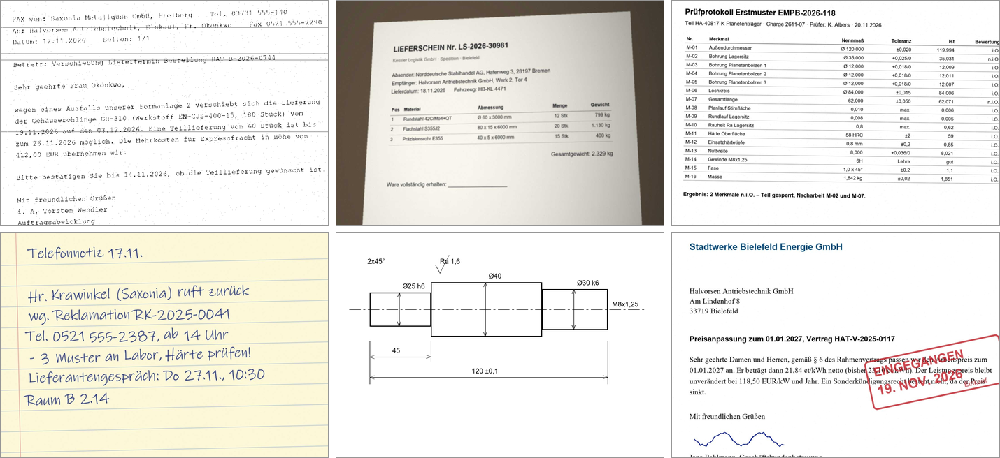

# Scan-Messung: Wie sicher liest das Modell Scans, Fotos und Handschrift?

Argus nimmt gescannte PDF-Seiten und Bilder auf, indem das lokale Modell sie abschreibt
(`rag_backend/vision.py`). Diese Messung zeigt, wo das gut geht und wo nicht. Sie ersetzt
keine Messung mit echten Firmenseiten, macht aber Grenzen sichtbar und lässt sich nach jeder
Änderung an Modell, Encoder oder Einstellungen wiederholen.

> **Fiktive Daten:** Firmen, Personen, Nummern und Beträge sind erfunden und gehören zur
> Halvorsen Antriebstechnik GmbH aus `eval/retrieval`.

## Aufbau

```
eval/scans/
├── README.md     # diese Beschreibung
├── pages.py      # erzeugt die Testseiten samt Musterlösung
├── score.py      # Bewertung
└── run_eval.py   # Messprogramm (Aufruf im Kopf der Datei)
```

Die Seiten entstehen aus Code, damit keine Bilddateien im Repo liegen und jede Messung
dieselben Seiten sieht. `--ablage <Ordner>` legt Seitenbilder und Abschriften zum Nachsehen ab.



| Seite | Was sie prüft |
|---|---|
| `01_rechnung_sauber` | sauberer Scan, Tabelle, Beträge, IBAN (Vergleichswert) |
| `02_fax` | Fax in Normalauflösung (halbe Höhe), schwarz-weiß, schief, Streifen und Punkte |
| `03_lieferschein_foto` | mit dem Handy fotografiert: schräg, ungleich beleuchtet, unscharf, stark komprimiert |
| `04_pruefprotokoll_tabelle` | dichte Tabelle mit 16 Zeilen in kleiner Schrift; gehört jeder Wert zur richtigen Zeile? |
| `05_handschrift_notiz` | handschriftliche Telefonnotiz auf liniertem Papier |
| `06_formular_handschrift` | Formular mit handschriftlichen Einträgen und Kreuzen |
| `07_zeichnung` | technische Zeichnung: Maße, Passungen, Oberfläche, Schriftfeld |
| `08_zweispaltig` | zwei Spalten: Liest das Modell Spalte für Spalte statt Zeile für Zeile? |
| `09_brief_stempel` | Brief mit Unterschrift und einem Eingangsstempel quer über einem Betrag |
| `10_anweisung_im_bild` | eine Anweisung an „KI-Systeme“ im Bild: Sie muss abgeschrieben, nicht befolgt werden |
| `11_foto_ohne_text` | Foto ohne Text: Das Modell soll es kurz beschreiben und mit `[Bild]` beginnen |

Die Handschrift stammt aus Schriften (Ink Free, Segoe Print aus `C:\Windows\Fonts`). Sie ist
gleichmäßiger als echte Handschrift; die Werte dazu sind eine Obergrenze. Ohne diese
Schriften entfallen die beiden Seiten mit Handschrift.

## Bewertung

Jede Seite hat Prüfungen (`score.py`):

- **text:** Eine Pflichtangabe steht im Text (Rechnungsnummer, Betrag, Datum, Maß).
- **zeile:** Mehrere Angaben stehen in derselben Zeile. Bei Tabellen heißt das: Der Wert
  gehört zur richtigen Zeile.
- **reihenfolge:** Absätze stehen in der richtigen Reihenfolge.
- **angekreuzt:** Das richtige Kästchen ist angekreuzt, die anderen nicht.
- **beginnt**, **mindestlaenge:** für das Foto ohne Text und die Anweisung im Bild.

Verglichen wird tolerant gegen Formatierung: Groß- und Kleinschreibung, Markdown,
Bindestrich-Varianten und Leerzeichen zählen nicht, Ziffern, Kommas und Punkte schon. Für
Fließtext (Fax, Notiz, zweispaltig) kommt die Zeichenfehlerrate (CER) dazu: Editierabstand
zum Referenztext geteilt durch dessen Länge.

Gemessen wird derselbe Weg wie bei der Aufnahme in die Dokumentensuche:
`vision.transcribe_image` verkleinert auf `VISION_MAX_SIDE` und schickt das Bild mit der
Abschreib-Anweisung bei Temperatur 0 an den lokalen Modell-Dienst.

Mit `--reihen` misst das Programm statt der elf Seiten Belastungsreihen: dieselbe
Prüftabelle (16 Zeilen, 7,5 pt) Stufe für Stufe schlechter gescannt, dazu drei schwierigere
Handschriften. Bei der Tabelle zählt jede Zeile zweimal: **Werte** (Nennmaß, Toleranz,
Istwert, Bewertung in der Zeile ihrer Nummer, i.O. nicht als n.i.O. gelesen und umgekehrt)
und **Wörter** (das Merkmal). Ein falscher Wert ist gefährlicher als ein verschriebenes Wort
und wird deshalb getrennt gezählt.

`--abschriften <Ordner>` bewertet die Abschriften einer früheren `--ablage` neu, ohne Modell,
etwa nach einer Änderung an den Prüfungen.

## Ergebnisse (25.11.2026)

Qwen3.6-35B-A3B mit Bild-Encoder F16, `VISION_MAX_SIDE=1600`, RTX 5070 Ti 16 GB.

**Die elf Seiten:** alle 111 Prüfungen bestanden, Zeichenfehlerrate auf Fax, Notiz und
zweispaltigem Text unter 0,05 %. Das Modell las den Betrag unter dem Stempel, erkannte das
angekreuzte Kästchen (☑ gegen ☐), schrieb die Anweisung an „KI-Systeme“ nur ab und
beschrieb das Foto ohne Text mit `[Bild]`. Eine Seite dauerte im Median 14,5 s mit dem Encoder
im RAM.

**Belastungsreihen** (Encoder auf der Grafikkarte, rund 10 s je Seite): richtig gelesene
Zeilen von 16, Werte / Wörter.

| Reihe | Stufen |
|---|---|
| Auflösung | 150 dpi: 16 / 16 · 100 dpi: 15 / 16 · 75 dpi: 15 / 15 · 60 dpi: 12 / 12 |
| Unschärfe | 1,5 px: 16 / 16 · 2,5 px: 16 / 16 · 3,5 px: 16 / 15 |
| JPEG | Qualität 30, 15 und 8: je 16 / 16 |
| Blasse Schrift | Grauwert 140, 185 und 215 (von 255): je 16 / 16 |
| Drehung | 3° und 10°: 16 / 16 · 90°: 16 / 15 · 180°: 16 / 11 |
| Schriftgröße | 6 pt und 5 pt: 16 / 16 · 4 pt: 14 / 15 |
| Handschrift | Ink Free klein und stark verwackelt, Segoe Script, Lucida Handwriting: je 10 von 10 Prüfungen, Zeichenfehler unter 0,05 % |

Was daraus folgt:

- **Falsche Werte entstehen nur durch zu wenig Bildpunkte:** ab 100 dpi abwärts und bei
  4 pt Schrift. Unschärfe, starke JPEG-Kompression, blasse Schrift und Drehung (auch
  kopfüber) ließen alle Werte richtig.
- **Die Fehler sind still.** Bei 60 dpi wurden aus 0,62 ein 0,82, aus 12,009 ein 12,000, aus
  ±0,2 ein ±0,3 und aus M8x1,25 ein M1x1,25. Die Tabelle sieht dabei ordentlich aus, nichts
  ist als unleserlich markiert. Bei 100 dpi wurde aus 84,006 ein 84,008. Die Bewertungsspalte
  (i.O. / n.i.O.) hat das Modell in keiner Stufe vertauscht.
- **Mehr als 150 dpi hilft dem Modell nicht.** `vision.py` verkleinert jede Seite auf
  `VISION_MAX_SIDE` (1600 Pixel an der langen Seite), bei A4 sind das rund 137 dpi. Ein
  300-dpi-Scan kommt also genauso an wie einer mit 150 dpi. Ob ein höherer Wert bei Kleindruck
  hilft, ist nicht gemessen; er kostet mehr Bild-Token und Zeit.
- **Handschrift:** Die Handschrift-Schriften las das Modell fehlerfrei. Echte Handschrift ist
  unregelmäßiger; dazu sagt diese Messung nichts.

Für den Betrieb: Scanner auf mindestens 150 dpi stellen, besser 200 dpi, und Werte aus
gescannten Prüfprotokollen, die über eine Freigabe entscheiden, gegen das Original prüfen.

Während einer früheren Messreihe ist der Rechner ohne Bluescreen neu gestartet. Der Encoder
lief damals im RAM und belastete die CPU über Minuten voll. Dasselbe Muster stand schon vorher
ohne Messung im Ereignisprotokoll. Ein Zusammenhang mit Argus ist nicht belegt; die
Belastungsreihen wurden danach mit dem Encoder auf der Grafikkarte gemessen.
